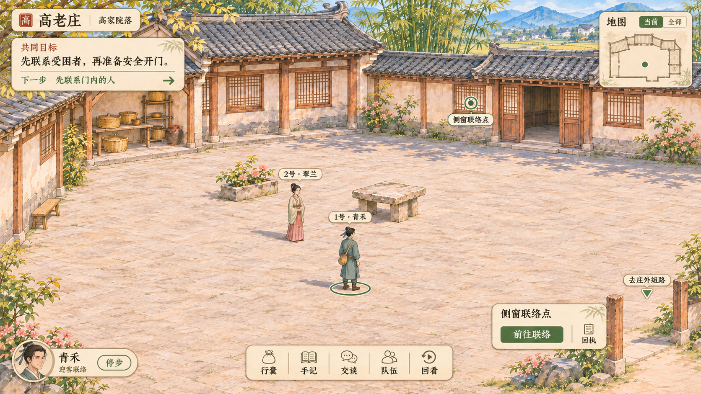
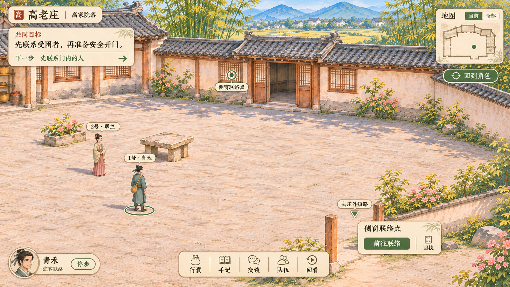

# 高老庄全屏场景与悬浮界面

状态：2026-11-21 用户已采纳四角悬浮方案及以下两种镜头状态，并要求实现后提交 PR。功能、输入与验收以 [GZ-UX-01 v0.8 / FS-01](../../specs/gaolao-client-experience.md)为准，唯一任务入口为 [#66](https://github.com/gbcdby/xiyou/issues/66)。

## 已采纳的设计原图

以下原图由本轮图像生成得到，保留生成文件内容，属于**设计基准**，不作为实际页面或运行验证截图。

### 默认跟随

### 拖动画面后

## 采用范围

采用全屏院落、左上地点与简明目标、右上小地图、左下本人/停步、底部五个随身入口及按需对象面板。浮层以暖纸色、墨线、松绿操作色组成，保持轻边框、少量阴影和中文清晰层级。先前探索中的“西侧／院中／东侧”镜头按钮已被用户取消。

跟随时不显示额外镜头状态条。鼠标或单指拖动后只改变场景取景，HUD 留在屏幕原位；镜头偏离本人时显示唯一“回到角色”，本人仍在可见区域内也适用。按钮回中后隐藏。窄屏可收起地图和详细任务描述，所有正式操作仍可打开。

生成图中的人物、装饰图标和示例文字不作为新运行资源。实现沿用仓库正式 Canvas 场景、授权对象、角色注册和图标；保留当前/全部地图、动作回执、控制恢复及真实交互入口。长篇内容放在可关闭浮层内，不增加整页滚动。

## 验证边界

本目录的两张原图仅证明设计采用。实际截图、连续动作证据、源码身份和运行环境应单独归档并链接，不能用生成图或静态拼图替代浏览器验收；PR 中分别报告实现、作者自查与独立审查结果。

本轮代码、作者检查、独立审查与实际运行结果见[检查记录](verification.md)。通过正式 GitHub Actions 手动入口，真实 Chromium 已完成四视口 40 项全屏交互检查；[运行证据](runtime/README.md)保存真实截图、连续录像与对应提交身份。原章节/空间回归和既有角色素材缺口的结果分别记录，专项通过不代表整个 #66 或全部素材验收完成。
