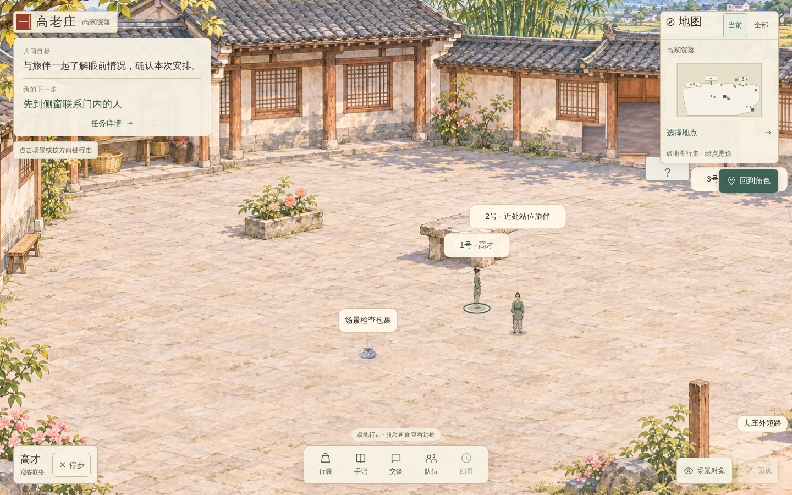
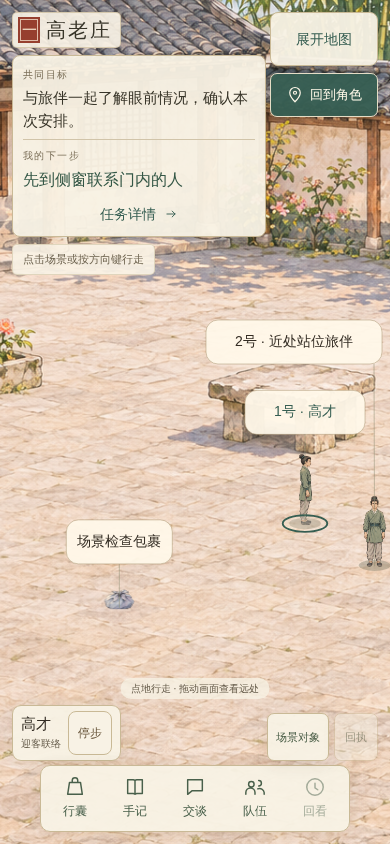

# 高老庄全屏镜头：真实浏览器证据

2026-11-21，通过仓库已有的 GitHub Actions 手动入口，对 PR #88 的确定候选运行四视口专项。这里的 PNG 与 WebM 均为真实 Chromium 原始输出，没有使用生成图、静态替身或后期合成。

- 运行：[44894436437](https://github.com/gbcdby/xiyou/actions/runs/44894436437)，专项 job：[136817042809](https://github.com/gbcdby/xiyou/actions/runs/44894436437/job/136817042809)。
- 候选：`0c18631a94ee288ca13247bec6ec1588f7bc6dab`；Git tree：`5eed97d4c74c99f1dc55ba983aadb272ed692f6e`。执行前后提交、tree、干净工作树和源码摘要一致。
- 环境：Ubuntu 24.04、Node.js 24.22.3、锁定 Playwright 1.57.0 / Chromium 143.0.7499.4、DPR 1。
- 结果：四视口各 10 项，共 **40 项 PASS**，页面错误为 0，全部服务正常清理。
- 范围：生产 Vue 路由、Canvas、Socket 客户端与原场景/高才资源；使用受控公开 DTO。画面中的检查用人物、物件与文字不是正式章节状态；未知门牌按原规则中性回退。手机尺寸及触摸为 Chromium 模拟，不代表手机真机、Safari 或真实多人后端整章验收。

## 四种视口

| 视口 | 原始截图 | 原始连续录像 |
| --- | --- | --- |
| 桌面 1440×900 | [跟随](desktop-1440-follow.png) · [拖动后](desktop-1440-free.png) | [桌面录像](desktop-1440-camera.webm) |
| 桌面 1366×768 | [跟随](desktop-1366-follow.png) | [紧凑桌面录像](desktop-1366-camera.webm) |
| 手机竖屏 390×844 | [跟随](phone-follow.png) · [拖动后](phone-free.png) · [长手记面板](phone-notebook.png) | [竖屏触摸录像](phone-camera.webm) |
| 手机横屏 844×390 | [跟随](landscape-follow.png) | [横屏触摸录像](landscape-camera.webm) |

录像保持各用例的初始录制画幅。末段 resize 检查把实际页面宽、高各缩小 20px，因此录制画幅外侧可能留下灰边；实际页面的覆盖断言和截图按缩小后的视口核对。原始录像未裁切或重编码。[录像检查记录](video-inspection.json)保留格式、全片解码退出码和抽样查看范围。

### 桌面拖动后的实际界面

### 手机拖动后的实际界面

## 报告与来源

[可读检查摘要](../verification/ci-44894436437-summary.json)保留 40 项断言、四视口尺寸、源码首尾身份、环境和清理记录；[完整原始报告](../verification/ci-44894436437-result.json.gz)无损压缩归档全部实际 paint 与受控请求记录。四视口共保存 908 次实际 paint，每个视口都完成未知回执的原请求查询。

[文件清单](evidence-manifest.json)列出本目录七张代表截图、全部四份录像的字节数与 SHA-256。完整 CI artifact 包含 24 张截图和四份录像，可从上述运行页下载；Actions 按当前 workflow 保留 7 天，本目录已归档的文件不依赖其临时有效期。

首次运行 [44894055878](https://github.com/gbcdby/xiyou/actions/runs/44894055878)确实失败：桌面前 7 项通过后，脚本将带未决计数的“回执 1”误按精确“回执”定位。保留[首轮原始报告](../verification/ci-44894055878-result.json.gz)与[失败输出](../verification/ci-44894055878-stdout.txt)；修正只适配真实按钮名称并新增计数断言，没有删除查询、请求身份或字节一致性检查。

专项成功与整个仓库 CI 结果分别判断；最新整体结果和独立审查见[检查记录](../verification.md)。
