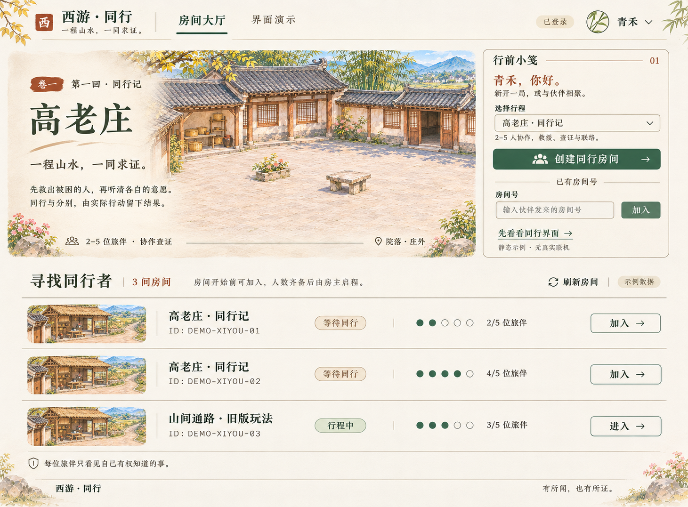

# 大厅重设计：高老庄 · 同行画卷

日期：2026-11-21（北京时间）。任务入口：[总票 #66](https://github.com/gbcdby/xiyou/issues/66#issuecomment-7056789538)。

状态：用户于 2026-11-21 明确要求「按照 auto skill，进行修改调整，完成后合并到 main」，本轮沿用下述「高老庄 · 同行画卷」方向完成调整与验收，授权及结果记于[总票续接记录](https://github.com/gbcdby/xiyou/issues/66#issuecomment-7056996394)。这项指令不把生成稿的每个细节升级为功能要求；本页合同和明确列出的近似差异继续有效。生成的视觉稿是方案示意，不是实现截图，不替代运行证据。

后续决定（2026-11-21）：用户明确要求「界面演示功能去掉，不要入口也不用页面了」，据此移除页头和大厅中的演示入口、`/demo` 页面及其专用内容；旧地址沿用未知路由返回大厅。当前合同以下述修订为准，范围见[删除决定记录](https://github.com/gbcdby/xiyou/issues/66#issuecomment-7058750667)。本页生成稿和 PR #84 截图保留原始字节与当时来源，其中旧入口不代表当前功能要求。

最新组织决定（2026-11-21）：用户要求大厅「一屏显示完整，不要出现滚动」，并在桌面双列、房间分页及手机任务页签方案说明后确认「那就按照这个来调整吧」。本轮依据[采纳与执行记录](https://github.com/gbcdby/xiyou/issues/66#issuecomment-7060531371)修订以下页面合同；原图继续作为画风及历史布局来源，不再要求沿用全宽房间列表与手机上下堆叠。

原图：[visual-proposal.png](lobby-v2/visual-proposal.png)，使用内置图像生成工具，类别 `ui-mockup`。输入为下文两张现有场景原图；它们在生成稿中承担画风与场景参考，产品代码只引用登记过的项目资产。生成简报要求：明亮水墨淡彩、暖纸阅读区域、院落章节画卷与入局小笺并列、下方三条示例房间横列；所有示例房号以 `DEMO-` 开头并标注「示例数据」。这是方案原图，不以实现截图替换它，也不把它的细节自动升级为全项目规则。

设计图来源登记：`asset_source: original_team`（本轮 AI 辅助生成），1461×1077px，2,442,584 字节，SHA-256 `621de0ab1e9407e3c6abdc1df13a4289d4de4471b23a229400f256133fc31991`。

**生成稿近似差异：**图中的头像与下拉箭头不代表已实现或已采纳账号菜单；旧版房间误沿用了高老庄缩略图，实际实现使用中性指南针。图中的圆形席位、状态胶囊、部分间距与实现的席位标记、文字状态存在差异，只表达层次与氛围，不自动新增能力或构成逐像素还原义务。正式功能仍以本页合同及真实实现为准。

## 依据与范围

继承 [整体美术方向](art-direction.md) 的「清逸仙境 · 工写相生」、[UI/UX 共性](guidelines/ui-and-ux.md) 的阅读空域与局部材质承托，以及既有字体、AppIcon、主色和按钮语义。页面基线为 `9978fa0347893a24ec44e357ce594ec95eade995`。

本次只重设计房间大厅及其页头、页脚局部变体。正式会话的 Canvas、HUD、运动、角色动画和后端权威协议继续沿用各自当前合同，本提案不改变它们的验收状态。

现状问题来自源码核对：章节美术由三个几何色块构成；进入房间操作置于长宣传区之后；窄屏隐藏完整章节简介；大厅用房间 Socket 连接状态提示 HTTP 大厅状态；未登录与满员条件主要依赖按钮变淡表达。没有把这些源码判断写成已经复现的运行观察。

## 页面组织

| 区域 | 设计决定 | 保留的真实能力 |
| --- | --- | --- |
| 页头 | 复用品牌与导航，朱砂小印作为局部强调。大厅显示「尚未登录／已登录」，其他页面沿用原连接提示。 | 返回大厅、身份姓名、跳到主要内容。 |
| 章节画卷 | 左列上方约 216–260px 的院落画卷；大宋体「高老庄」、章节目标及 2–5 人信息形成主次。手机收为 112px 章节条，完整介绍通过明确的「章节介绍」按钮阅读。 | 图旁明示「章节场景预览」，不把插画当实时地图，不展示玩家位置或未授权剧情。 |
| 行前小笺 | 桌面右列宽 320–340px，跨主体全高；未登录呈现昵称，登录后呈现章节选择、创建及房间号加入。姓名作为正常字号身份信息，完整值可点击查看。 | 原 24 字符昵称、128 字符房号、三种模式、busy 与失败反馈。 |
| 同行房间 | 左列下方使用紧凑行与显式分页，按实际可用区域和行高计算容量。完整房名、房号、行程及状态由房间「详情」阅读，加入始终使用原始房号。 | 完整服务端数组保留，所有阶段逐页可达；等待房间满员禁入；其他阶段保留原「进入」路径。刷新或容量变化后校正页码。 |
| 手机任务 | 900px 及以下切为「开始同行／寻找房间」页签；当前任务占剩余高度。页签支持左右键及 Home/End，保留称呼、房号、模式和提示。 | 已有登录、创建与加入默认入口仍在「开始同行」；未登录时，房间区提供返回填写称呼的操作。 |
| 列表反馈 | 分开呈现加载、离线重连、在线空列表及真实列表；未登录和满员原因就近提示。 | 不注入假房间，不以本地动画宣称连接或加入成功。 |

桌面最大宽 1440px，主内容水平边距 40px、垂直边距 16px，列间距 24px，页头约 64px、页脚约 24px。主体使用 `100dvh` 的剩余高度；房间行桌面 5rem、手机 5.5rem，测量尺和实际行共用变量。字体与可用区域变化触发容量重算；一屏目标不依赖屏蔽滚动条或截去末行。正文通常 14px，辅助状态 12px，主要输入及操作按钮至少 44px 高。

「一屏完整」指主要操作、当前任务及当前页房间完整可见，全部返回房间通过分页取得。目标视口为 1440×900、1366×768、1280×720、390×844，常规字号下页面及任务区均不滚动。极短视口、文字放大或键盘压缩时允许必要纵向滚动以保留可达性；不能以裁切代替此回退。长姓名、房名、房号及错误的摘要有明确详情入口，原生模态对话框支持关闭、Esc、焦点恢复及完整文本选择。请求、身份和存储提示分别保留，手机房间任务也呈现相关反馈。

## 视觉与组件

沿用 `--ink: #293c34`、`--green: #3f6551`、`--serif` 和 `AppIcon`；新增大厅局部暖纸 `#f7f5ee`、朱砂 `#a85a48` 与细分隔线。场景承担色彩和细节，文字区保持稳定阅读底面。主按钮使用深松绿，朱砂仅用于非交互印章；不增加循环装饰动画。

实现入口：[LobbyPage.vue](../../frontend/src/features/lobby/LobbyPage.vue)、[lobby.css](../../frontend/src/features/lobby/lobby.css)。页头、页脚变体由 [App.vue](../../frontend/src/App.vue) 的当前路由显式决定。新样式限定在 `.lobby-redesign`、`.lobby-header`、`.lobby-footer`；不扩展为其他页面默认样式。

复用既有素材，未重绘、改字节或新增外部图片请求：

| 资源 | 使用位置 | SHA-256 |
| --- | --- | --- |
| [courtyard.png](../../frontend/public/assets/gaolaozhuang/scenes/courtyard.png) | 大厅章节场景与已知高老庄房间缩略图，共用同一 URL | `f5df307eaea03188e823a279cb3df3a65b1b6a7931c329294cd6b79e4c0d510a` |
| [village-road.png](../../frontend/public/assets/gaolaozhuang/scenes/village-road.png) | 生成视觉提案时的画风参考；大厅产品不单独请求此图 | `51c77eddb5f29727ab6a324398b71d48bcee1f3a828ae3e470f1e6ae190b5115` |

章节与缩略图共用院落资源，避免为小缩略图额外加载一张完整场景 PNG；原图字节未改变，不将此决定冒称完整性能验收。这些是现有场景资产，不据此扩大到全部角色或场景艺术验收。生成视觉稿中的房间明确为示例数据；产品源码只使用原 `api.rooms()` 返回值。

## 行为不变与验证边界

本轮在 `LobbyPage.vue` 增加视口、分页、任务页签和详情状态；原登录、刷新、创建、加入函数保持。昵称登录、创建/加入 nonce、失败后的重试标识、三种 contentVersion 配置、region/spatial 兼容路由、房号 trim、busy 防重复仍沿用原行为。分页只派生展示数组，不替换供协议判断使用的完整 `rooms`；authNotice、storageNotice、notice 仍分别呈现，详情保留原文。演示入口按上述用户决定保持移除。

| 验收 | 判定依据 |
| --- | --- |
| LB-01 视觉层次与原图质量 | 实际浏览器整页/局部阅图；生成稿或静态源码不能替代。 |
| LB-02 响应式与长内容 | 在 1440、768、390、320px 实际查看并检查无横溢；确认长姓名、长房号、图片缺失和字号放大。 |
| LB-03 状态与交互 | 覆盖未登录、登录失效恢复、加载、离线重连、空列表、满房、三种创建模式及加入/进入。 |
| LB-04 工程检查 | 当前候选的 typecheck、构建、适用既有测试；不借用旧结果。 |
| LB-05 独立审查 | 非作者核对需求与标准；静态审查与浏览器验收分别记录。 |
| LB-06 一屏与分页 | 四档目标检查文档和面板实际 scroll/client 尺寸、末行、分页和控件边界；遍历所有房间阶段、末页、刷新缩页及视口变化。 |
| LB-07 任务与完整内容 | 手机页签切换保留输入、模式与错误；长字段详情、关闭回焦、键盘操作、200% 文字及短屏可达性分别取证。 |

真实界面验收使用当前 Vue 页面、可复现的受控 HTTP 数据及原始浏览器截图；示例身份和房间不计作在线多人联机证据。项目锁定浏览器的 CI 证据与本地兼容浏览器检查分开记录，不能互相冒用。实际检查结果、候选、截图来源、剩余差异与 PR 状态继续记入 #66；本页不维护第二份任务进度表。

## 历史实现截图归档（PR #84）

以下为 2026-11-21 实际 Vue 页面截图，使用 Playwright 1.57 与 Chromium 143.0.7499.0。本轮本地渲染环境不是项目锁定的 rev1200，不能替代 main 上的 CI 运行结论。桌面视口为 1440×1050，手机视口为 390×844，像素倍率均为 1；文件是浏览器直接输出的完整页面 JPEG（质量 88），未裁切或重绘。

截图内姓名「青禾」和三个 `DEMO-XIYOU-*` 房间来自受控 HTTP 示例，房间名已标「示例」；它们用来复现布局，不是线上房间或真实联机结果。截图与上方生成提案分别保留，实际验收及独立审查结论见 [PR #84](https://github.com/gbcdby/xiyou/pull/84)。

| 文件 | 实际图片尺寸／字节 | SHA-256 |
| --- | --- | --- |
| [implementation-desktop.jpg](lobby-v2/implementation-desktop.jpg) | 1440×1299，225,484 字节 | `d3dcd960e1b2d0e4eafcd0c0b67388e8f96ad648ac8e7439fc41d4c7fb0bd108` |
| [implementation-mobile.jpg](lobby-v2/implementation-mobile.jpg) | 390×1761，100,228 字节 | `6772bd446214ac1f9fe8aaeccdbd5b7f12b423cc0508ddfdb1605e73df0bb8c0` |

截图时的产品文件 SHA-256：

| 产品文件 | SHA-256 |
| --- | --- |
| `App.vue` | `0fd6b6a6d729e97d2a4eecbec3a11655dd67288ca510c63b5b6b6a2f35e992eb` |
| `LobbyPage.vue` | `139dbf65c0e46b9d8a360f451c259adf8e3fb8f246c8cd22b74cc4e4974e6ecf` |
| `lobby.css` | `89d4d7d04fc70fb57ce255f6a81c7cdbc1f39cd06799fece7406b6969e17a9cc` |
