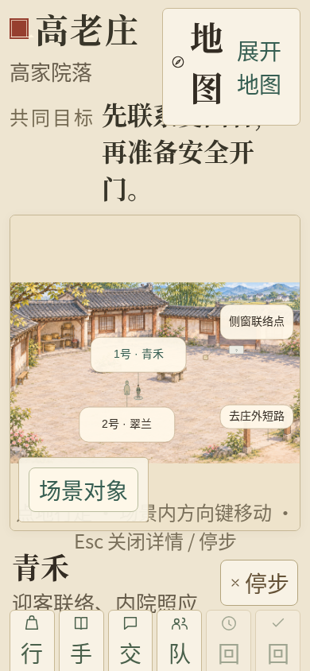
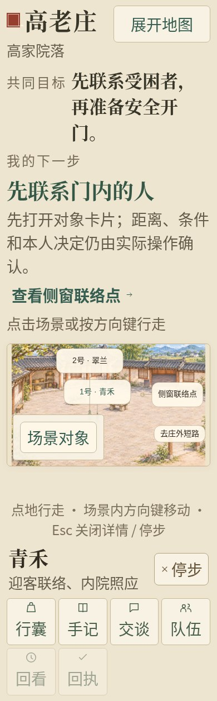

# 会话界面运行截图

日期：2026-11-21（北京时间）。范围见 [#66](https://github.com/gbcdby/xiyou/issues/66#issuecomment-7057677878)，实际检查、独立审查与合并状态见 [PR #85](https://github.com/gbcdby/xiyou/pull/85)。本目录保存本轮选取的真实界面原图和来源，不维护另一份任务进度。

页面依据为当前 [GZ-UX-01](../../specs/gaolao-client-experience.md) 的固定场景区与工具入口合同，以及 [UI/UX 共性](../guidelines/ui-and-ux.md)。这些是运行截图，不是设计生成稿；前后图用于检查布局回归，不构成逐像素还原声明。

## 图像来源

使用 Playwright 1.57、Chromium 143.0.7499.0，DPR 1。桌面视口 1440×1050，手机视口 390×844。三张修正后图片是浏览器直接输出的完整页面 JPEG，质量 88；修正前保留浏览器原 PNG。均未裁切、缩放、重绘或合成。完整尺寸、文件摘要、采集时间与源码摘要见 [capture-manifest.json](capture-manifest.json)。

文字 200% 指在真实页面将计算字号与数值行高放大到两倍，新挂载内容使用同一方法。它不是浏览器原生缩放或手机系统字号设置。修正后大字号页面允许纵向滚动，因此全页图片高于 844px；前后图片保持原尺寸，不拉伸到相同高度。

| 文件 | 样本 | 实际图片尺寸 / 大小 | SHA-256 |
| --- | --- | --- | --- |
| [gaolao-desktop.jpg](gaolao-desktop.jpg) | 桌面 | 1440×1050 / 322,208 字节 | `06ec73c1777de9dc62af1d58960db7ee72649222c65728890955de6caa0b3433` |
| [gaolao-mobile.jpg](gaolao-mobile.jpg) | 手机 | 390×844 / 62,724 字节 | `3c5eb8ffd1632c6d900803ab2719d94294018d7e6d3c65dde13d9c3692d9eb02` |
| [gaolao-mobile-text.jpg](gaolao-mobile-text.jpg) | 手机文字 200% | 390×1255 / 96,381 字节 | `9c3d8a8f85d6b9fd1fe03ade3b905b5a803e4fb1422045722770cfe145123611` |
| [gaolao-mobile-text-before.png](gaolao-mobile-text-before.png) | 修正前：手机文字 200% | 390×844 / 211,950 字节 | `e1053c8028866f215c76df86561f9126ef12b5f264d15b2f2b2674798aea324a` |

采集时产品为本地提交 `30098788ec8bf77280bab27dbbab44007f24e6df`，完整树 `25f4851d67a7ab12c9cc0eaf8d476f498c114e70`；已通过 GitHub API 核对，与公开产品候选 [`69ed096`](https://github.com/gbcdby/xiyou/commit/69ed096ea895a477d34e6976c9ecc654a37eb63a) 完整树相同。后续截图归档只增加文档，不改变图中产品源码。修正前来自主线 `5c7eb4e1a0e2853a8aed145c2e7b711c73208ca1`。

## 直接对照

桌面与手机主图：

- [桌面原图](gaolao-desktop.jpg)
- [手机原图](gaolao-mobile.jpg)

手机文字 200% 的前后对照分别保留，点击可查看原尺寸：

| 修正前 | 修正后 |
| --- | --- |
|  |  |

## 受控样本与边界

截图使用当前 Vue 页面和通过严格校验的 SnapshotV2 样本，断开 transport 后提供页面状态；姓名「青禾」「翠兰」、对象与动作状态仅用于复现布局，不是在线房间或真实玩家操作。图中「翠兰」使用样本提供的未登记 `appearanceId`，因此显示中性回退；这验证回退展示，不代表正式翠兰资产缺失或完整人物素材验收。生产素材字节没有修改。

修正前图片和源码摘要已保留，但该轮没有保存采集脚本副本；因此只称同一可见场景样本的布局回归对照，不声称前后完整 DTO 逐字段字节一致。最终采集的脚本与样本摘要已记录。

额外的终局大字号关闭探针保留一个非阻断细节：按钮框顶部 1.875 CSS px 位于视口之外，严格整框可见指标未通过；居中的关闭符号仍可见，按钮中心可命中，实际关闭并归还「回看」焦点通过。该结果没有被改写成全项通过。

本地浏览器并非项目锁定 rev1200 环境；静态截图、界面交互和 CI 分别记录。真实多人、连续运动、真实供应商、手机真机及全部角色帧资源不在本目录的验收声明内。
