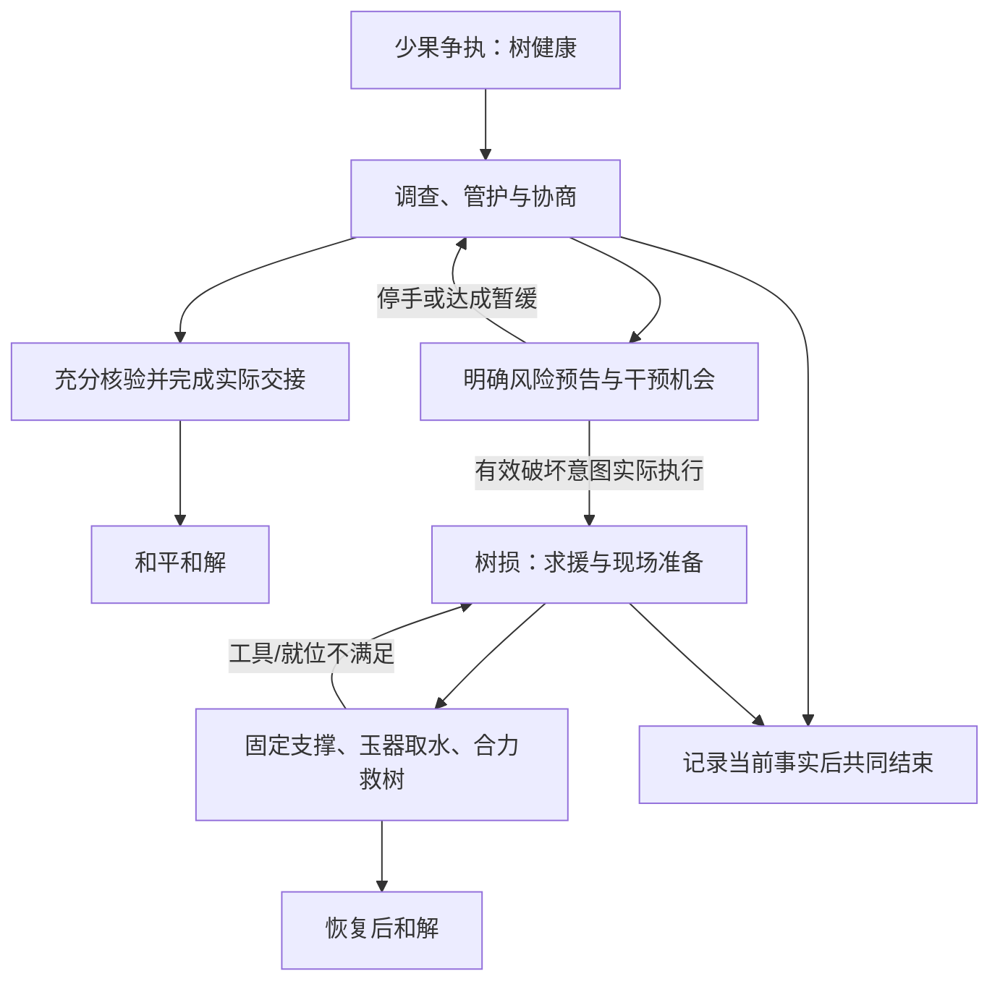

# ADV-001 CH02：五庄观·人参果风波（保留设计）

## 0. 状态、适用前史与主文档关系

- 归属：[ADV-001 主文档](narrative-adventure.md) v0.2；本章编号为 CH02。
- 设计来源：原 ADV-001 v0.1 第6节的完整五庄观设计。本轮将其迁入附属文件，保留已有行为与验收语义；高老庄作为当前 CH01，五庄观作为 [A4 后续章节候选](narrative-adventure.md#12-推进阶段与释放条件)。
- 状态：保留的候选设计，运行、AI、真人与视觉验收均为 **NOT_RUN**。文档迁移不表示新增实现、已验证章节或 A4 已开始。
- 工作记录复用 [Issue #23](https://github.com/gbcdby/xiyou/issues/23) 与 [PR #24](https://github.com/gbcdby/xiyou/pull/24)；本文件不另建任务目录或活动状态。
- 本章完整定义原 ADV-AC-07、ADV-AC-08、ADV-AC-09；主文档仅引用这些定义，不将旧编号复用于高老庄或重复维护一份判据。

### 0.1 独立选章与连续游历

本章可用于独立选章，但开局必须明确展示并固定所用的正典前史：师徒已行至五庄观，八戒与沙僧均在取经队伍中，并实际参与了本章开局前的分食。下文果数账和证言依据此已声明快照成立。独立选章不继承另一局高老庄的邀请或入队结果，也不能把选章默认前史写回那一局的历史。

连续游历需要继承实际已发生的前史。若高老庄中八戒没有加入，不能在五庄观静默补入八戒，不能声称他已经吃果、作证或参与救树；必须先设计可观察的加入事件，或提供不依赖其在队的内容变体，并重新核对人数、果实守恒、证据链和结局。其他队伍成员也遵守同一原则。**连续游历本期不实现**；本保留设计不声明相应变体已完成。跨章语义见[主文档第11节](narrative-adventure.md#11-章节配置与跨章状态)。

### 0.2 共同约束的唯一来源

本章继承主文档的[空间与交互](narrative-adventure.md#4-空间与交互)、[AI 自主性](narrative-adventure.md#7-ai-npc-的自主性与随机性)、[状态归属与接口](narrative-adventure.md#9-状态归属与系统接口)、[并发与恢复](narrative-adventure.md#10-并发掉线与可恢复性)及[整体验收](narrative-adventure.md#13-整体验收)。事实、信念与陈述继续隔离；移动、授权观察、合作提交、物品交接和终局均由权威规则决定。

本章沿用原保留设计的角色配置：唐僧、悟空为两名完整自主 AI；镇元子、土地、八戒、沙僧、观音为有状态场景角色，可使用受约束的轻量对白。主文档“八戒为第三名章内自主 AI”适用于高老庄，不自动扩成所有章节的常驻 Agent。角色执行策略按章配置，不据此改写是否入队等历史事实；本章已声明的基础亲历证言与正式核验不能被随机对白永久移除。

果实、金击子、玉器、支架及已取水份保持唯一身份/归属，公共位置也是明确的保管位置；对同一物件重复取用、交接或重试不能复制资源。掉线、工具错放和施治取消按共同恢复规则处理。下文保留的有限求援、人物到场、有效预警与离观降级只保证合法流程可继续，不代替玩家调查、合作或赔偿。

## 1. 故事钩子与改编立场

**一行客人将要离开五庄观，果树却少了四枚果子。悟空不愿担下“私藏果子”的指责；清风明月担心师父回来后无法交代，唐僧也还没有弄清所谓人参果究竟是什么。玩家需要在争执升级前把账和现场接起来，决定如何收场。**

开局选择“盗果已发生、树尚未损坏”。玩家可以阻止后续冲突，不能改写开局前发生的事。偷取和推树的责任分别记录；找到入土的一枚不能把擅自取果改写为无事发生。

原著提供人参果的材料规则、果数争议、悟空毁树求方以及玉器取水救树。[S1–S3] 本游戏增加当地帮工、可走地图、证据操作、锁定支架、和平和解和部分救援步骤；这些属于协作改编。章节不复刻惩罚性捆绑、鞭打或油锅过程。

## 2. 开局事实：所有种子共用

| 事实 ID | 权威事实 | 起初谁知道 |
| --- | --- | --- |
| F01 | 本熟共有30枚；先前开园众人吃2枚，镇元子离观时树上28枚 | 清风持开园记录；明月知道离观时数量 |
| F02 | 招待唐僧的2枚被拒收，随后清风明月各吃1枚；树上剩26枚 | 清风明月知道这2枚的去向；唐僧只知道自己拒收 |
| F03 | 悟空随后敲落4枚，其中1枚入土，另3枚被悟空、八戒、沙僧吃掉；开局枝上22枚 | 悟空见过入土现象并听过土地说明；八戒沙僧见过三人各分一枚，但没有目击入土过程 |
| F04 | 开局树仍健康；入土的1枚没有被任何角色持有 | 树可现场观察；入土事实需调查或合法传达 |
| F05 | 镇元子暂离；金击子已被使用，器具尚需正式归还/清点 | 依器具保管、实际位置和角色观察确定 |
| F06 | 本局固定的人参果性质、玉器取水条件、树恢复规则不受对白改变 | 规则是真相；角色是否知道另行记录 |

账目恒等式：**30 = 22（枝上）+ 7（已食用）+ 1（入土）**。已食用7枚包括开园2、待客2、师兄弟3。救树成功、尚未重新采果时，入土1枚归树，成为23枚；之后采摘、分食继续按实际事件更新，不能把“23”写成所有终局的固定数字。[S1–S3]

配置必须固定每枚关键果的身份/状态，或提供等价的守恒账目。不能同时计入枝上、持物、入土和已食用。客户端只得到有资格知道的部分，不直接获得这张真相表。

## 3. 本章地图与空间作用

| 地点 | 可操作内容 | 为什么值得走过去 |
| --- | --- | --- |
| 山门与前庭 | 师徒行李、离观准备、到访/归来人物、共享会面点 | 接应、转交、安排谁在何处见面；观察 NPC 是否实际执行计划 |
| 正殿与客堂 | 待客经过、唐僧、账目比对和最终交接处 | 将不同地点的物证与证言带到同一见证场合 |
| 道房与器具间 | 果数记录、金击子、衬帕丹盘、玉杯、绳索与支架 | 选择合适器具、授权取用和实际搬运；不能隔墙直接拿取 |
| 人参果园 | 树、果数观察点、落果地块、树根和支撑锚点 | 从不同观察点核对枝上果数；检查土迹、确认损伤、共同操作 |
| 后园小径与土地龛 | 地块规则线索、土地见证、救树联络点 | 对照现象、请求证人、把远处分散的信息带回现场 |

地图保留一条主要环路和明确近路，减少重复穿越。房门、墙和树冠影响可达与感知；同处“五庄观”不等于能从任何位置听见所有对话。本章不制作三岛和南海大地图，求援采用有来源、可追踪的联络事件，玩家仍需完成园内工作。

## 4. 玩家角色与人数适配

清风、明月来自原著；C/D/E 是本游戏新增的当地帮工职责，不冒称原著额外留守弟子。

| 职责 | 起始信息/资源 | 独立贡献 |
| --- | --- | --- |
| A 清风：账目与待客 | 开园记录、师父的待客交代 | 解释账目、核对食用记录、协调赔偿与见证 |
| B 明月：果园与器具 | 取果流程、部分器具取用权 | 现场数果、辨认操作痕迹、授权和交接工具 |
| C 园圃帮工（原创） | 园路、土质常识、支架存放处 | 对照入土地块、布置护栏/支架、跟进树况 |
| D 茶房帮工（原创） | 待客动线、玉器存放及使用记录 | 找到合适容器、准备材料、运送并核验水源 |
| E 山门帮工（原创） | 进出路径、联络地点、人物当前行踪 | 安排证人到场、接引求援者、分发工具并记录实际交接 |

| 真人数 | 职责组合 |
| --- | --- |
| 2 | 玩家1：A+D；玩家2：B+C+E |
| 3 | 玩家1：A+D；玩家2：B；玩家3：C+E |
| 4 | 玩家1：A；玩家2：B；玩家3：C+E；玩家4：D |
| 5 | A、B、C、D、E 各一人 |

组合只决定开局信息、权限和资源，不让一个人操控多个地图角色。大家都能行走、观察、搬运、交谈和执行已获授权的工作；工具和可委托任务允许交接。角色离线不产生不可替代的永久钥匙位，按[主文档第10节](narrative-adventure.md#10-并发掉线与可恢复性)的受控交还与恢复处理。

本章至少保留三组可并行工作：账目/证人、土迹/果数、器具/现场准备。场景辅助角色不代替真人完成核心调查和合作谜题。

五人和平路线的一次有效分工可以是：A核对开园账，B从两个观察点盘点，C检查并标示入土地块，D带来待客记录并实际归整丹盘/衬帕，E请土地到场并接应镇元子的现场交接。这些是可交换的工作机会；不强制逐人打卡，也不要求队伍为了让D/E有事做而触发树损。

## 5. 证据与解谜

| 问题 | 可操作的调查链 | 必须保留的区别 |
| --- | --- | --- |
| 为什么树上只有22枚 | 到两个观察点数果，带回开园/待客记录；询问实际食用者，形成带来源的时间线 | 玩家口述数字、人物证言和现场观察不是同一种证据 |
| 第四枚去了哪里 | 找落果点，对照周边土质与五行说明；请土地到场或取得可转达见证；让悟空说明其所见 | 没有挖出果子也可建立充分解释；证人说法不直接变成历史事实 |
| 怎样安全承接果子 | 检查金击子、丹盘、衬帕与材料说明，布置接果位置 | 知道原著答案仍须找到真实器具、取得权限并操作 |
| 怎样救树 | 看损伤、取得救治指示、选可用玉器、搭好支架、取正确的水并完成浇灌 | 普通井水不等于甘露；说“扶住了”不等于支架/角色状态已成立 |

人参果沿用金、木、水、火、土的不同反应：遇金而落、遇木而枯、遇水而化、遇火而焦、遇土而入。[S1] 这些效果只用于内容定义的直接接触操作，按对象材料、当前状态和动作计算；人物经过木门、下雨、身上携带金属不自动损坏果实，普通工具碰到树干也不生成整树毁坏。本章不提供玩家攻击、任意毁树或无许可批量采果动作。关键线索至少有两种可发现入口，例如现场检查与保管记录、合法见证与可检验痕迹；不要求抽中某一句随机对白。

不可用珍贵的唯一关键果做穷举试错。材料检查、器具说明和可重复的非消耗预演先提供足够推理依据；**正确采果可作为和解后的合作庆祝，但额外采果不是两条主路线的硬门槛**。误放新采果仍按规则处理，不能因损失庆祝果把已完成和解作废。

## 6. 情节推进与分支

这是 `ADV-001 v0.2 / CH02` 保留的拟议行为图，内容承接 v0.1，仅表示章节进度；物品所有权、角色控制和连接状态不在此图中。由人工依据本稿生成，未运行模型检查。

**调查阶段。** 玩家可以自由交错查账、问人、看土迹和收妥器具。关键事实先后发现不锁定唯一流程；不同信息顺序影响 NPC 计划。

**冲突预告。** 悟空可提出掀开树根找果等冲动方案，但树损必须来自获准执行的具体世界意图。只有争议仍在、角色到达相关位置、公开风险预告已经发出、有效干预机会已经给出且没有已生效的停手约定时，才允许进入破坏动作。风险窗口采用场景有效时间，不短于30秒（首轮可调参数）；普通聊天辱骂、沉默、LLM 超时或单纯经过时长不直接生成树损。

“有效干预机会”必须具有记录：至少一名在线真人通过现场听闻、合法转述或可见的准备动作获得风险提示，并有可达的干预位置和可用操作。只有这一条件成立且至少2名真人在线时，窗口才开始计算；预告对空房间发出不计。地图路径若使玩家来不及到达，延长窗口或暂停相关升级。风险阶段不封死干预通路，也不要求收到提示的人必须知道完整谜底；“请求共同查验/暂缓”应是可直接尝试的行动。

玩家可以让悟空离开树边、提供新证据、安排共同查验或达成可执行的暂缓。系统必须尊重已接受的暂缓，不允许旧 AI 回调继续推树。进入和平终局后不得补演原著毁树情节。窗口数值只为提供干预机会，不把关卡改为反应速度测试。

**路线A：果树无恙。** 团队完成现场盘点与去向解释，归还实际借/取用的金击子等器具，标示并封存入土地块，完成果园管护交接；镇元子返观后按明确的章规则接受处理。悟空对擅取的责任与“没有私藏第四枚”分别说明。本局和解可以接受有条件的后续补偿，但未履行承诺在复盘中仍记为未履行。追加的安全采果与分享作为庆祝，不强迫玩家制造树损以体验完整结局。

正式核验采用以下可检查组合，不要求输入某句道歉或让 LLM 给出主观通关分：

| 核验项 | 充分条件 | 人物态度与事实的边界 |
| --- | --- | --- |
| 数量 | 现场计数证据，加开园与待客记录，能够说明从28到26再到22的差额 | 证据未分享前，未到场者不能自动知道数字 |
| 三枚食用 | 悟空关于三枚分食的陈述及八戒/沙僧至少一人的独立佐证；或八戒和沙僧各自对三人分食的亲历证言 | 证言保存说话人、亲历范围、接收者和来源；不能把转述伪装为多份独立目击 |
| 一枚入土 | 落果地块的检查、已发现的五行规则，加悟空的经过或土地的合法见证 | 足以作为调停解释，不把“证人说过”直接写成新的入土历史事件 |
| 实际善后 | 指定器具已归公共位置、地块已标示、园门管护交接已提交 | 承诺未来完成不能替代这些本局动作 |

八戒、沙僧与土地的基础亲历证言是可通过正式询问获得的场景内容；AI 可改变交流过程，不能永久移除两条替代证据链。玩家在前庭联络点请求正式核验后，镇元子进入可追踪的返观流程（首轮60秒有效场景时间）；重复请求复用同一到场进度，暂停/重连不重复生成角色。充分条件满足且核验材料已合法提交给镇元子，即允许提交本局和解。人物可以仍有不满，系统不增加不可见的“好感度必须达标”条件。若证据互相矛盾，标出具体缺项并允许回查。

**路线B：失而复生。** 树损后停止争吵任务升级，转为求援、备器与现场支撑。镇元子/唐僧可以组织联络，悟空可以自愿担责求援；玩家也能在已发现的联络点提交求援，不要求悟空先说出指定台词。求援 accepted 后进入有限的到场流程（首轮配置为60秒有效场景时间，期间可备器），不再次依赖随机模型审批；少于2人在线时暂停。观音到场并按规则提供救治指示与根下水源，玩家负责达成实际施治条件。树恢复和多出一枚果的现场变化形成故事揭示，随后完成器具归还、责任处理与离观安排。[S3]

两条路线都能完整结算，有各自场景变化与结语；和平路线的价值不低于补救路线。

树损与恢复会改变现场，因此路线B允许用“恢复后的23枚现场计数＋原有开园/待客记录＋分食证言＋入土果归树的合法观察”完成核验，不再要求取得已经消失的旧土迹或损伤前现场照片。原来取得的证据保留其时间和对象版本；不能用失效的观察声称当前树仍倒着。

## 7. 合作救树：两个人也能完成

救树不要求一直有三位真人扶树。新增的**可锁定支架**是本游戏的改编机制：

1. 从器具间运来两组支撑，在树旁锚点分别安装；支持逐步准备，安装失败不消耗唯一器具。
2. 两位角色在不同操作点进行一次“就位—确认—扶正并锁定”。允许宽松的准备窗口；一人取消/掉线则不提交成功，也不扣除关键物品。
3. 锁定成功成为世界事实，双方都可离开。支架锁定后，不因某人停止按键或短暂断线自动倒树。
4. 根据救治指示使用可取水的玉杯/玉盏等合格玉器，从已启用的救治水源取水。普通水与正确水在物品状态中分开。
5. 玩家把水送到施治点；观音完成其限定施治动作。规则检查支撑、水源、容器、施治就位等实际条件后提交树恢复。

首轮施治定义两个场景护理点：树根与树冠下的导流点。每点各需一份来自已启用救治水源、由合格玉器送达的水；每次实际交付产生已完成记录。两点均完成、支架锁定且观音在施治点时，提交一次恢复事件；无需额外随机成功率。两名玩家可并行，也可先后完成，途中取消不抹掉已提交护理。份数和护理点是游戏改编参数，不是原著精确操作描述；杯具容量不形成隐藏换算题。

五人局把信息核验、支架两端、器具/水源和联络分开，形成并行工作；核心需要同时就位的真人席位最多为2，不随人数增加无意义按钮。水源可重新取用，玉器有替代品，错误容器得到清楚反馈；未提交恢复前可重做准备，已经提交的恢复不能被重试重复执行。

## 8. 终局条件

| 终局 | 必须成立的事实 | 不得误报 |
| --- | --- | --- |
| E01 果树无恙、各解心结 | 树健康；关键账目与入土解释已有有效证据链；器具归位和现场交接完成；本局处理方案获接受；离观条件成立 | 口头承诺当赔偿完成；少果全归责道童；未损树被强制改为已损 |
| E02 宝树复生、相释前嫌 | 树损事件确实发生；求援与合作施治完成；树恢复；器具与责任处理完成；离观条件成立 | 只谈好救树就判恢复；把私藏误解澄清写成没有盗果；未实际发生的归还 |
| E03 暂未和解、留下后续 | 团队主动结束或恢复条件无法维持时，记录真实进展、未尽责任与剩余物件 | 用通用失败动画覆盖已解决的事实；未完成内容写成圆满 |

“离观条件”明确为：相应路线的核验完成、指定公共器具已归还、镇元子已提交本局和解、出口可达；不存在独立隐藏好感门槛。正式核验、接受的记录由当面或可追溯通知合法送达唐僧与悟空后，恢复其稳定的继续取经目标。两位AI仍可选择交代、道别和行动次序；若模型故障，或连续两次决策没有产生有效离观准备/移动，受控策略在条件满足且已合法获知后执行前往出口的普通动作，不代做调查/赔偿，也不强迫说出道歉。降级原因和产生的动作保留记录。

成功后师徒须有实际收拾/走向离观地点的可见行动，再提交终局；技术故障中的退出不包装成剧情胜利。结算之后不再接受改变结果的旧动作，允许只读回顾。

## 9. 五庄观专属验收：保留原编号

以下为原 ADV-001 v0.1 的三个稳定验收编号及原判据，本轮仅迁移到 CH02 附属文件。全部是后续待执行义务（**NOT_RUN**），不得引用旧 VS-001 模拟切片结果或本次文档静态核对将其标为通过。主文档的共同行走、合作、感知、恢复、AI 与玩法体验义务仍同时适用。

| 验收 ID | 检查对象与输入 | 可观察结果与失败判据 |
| --- | --- | --- |
| ADV-AC-07 五庄观事实 | 初始数果、证言分歧、不同调查顺序、恢复后再采果 | 初始30=22+7+1、恢复后按实际事件计数；证言不改事实，确认入土不抹除盗果责任 |
| ADV-AC-08 和平完整路线 | 玩家及时补证、制止/暂缓冲突、完成实物交接 | 树保持健康且可完整结算、师徒可见离观；强制毁树/缺少正式结局均失败 |
| ADV-AC-09 救树完整路线 | 有效风险预告后树损，2人与5人分别准备、取水、施治 | 两人无需额外真人可完成；器具替代/失误可补救；仅对白施治或永久扶树死锁均失败 |

## 10. 原著依据与改编标识

- **S1**：[《西游记》第24回：万寿山大仙留故友，五庄观行者窃人参](https://zh.wikisource.org/zh-hans/西遊記/第024回)。果数账、唐僧拒果、道童食果、三人分食、入土果、五行性质及悟空毁树的原著依据。
- **S2**：[《西游记》第25回：镇元仙赶捉取经僧，孙行者大闹五庄观](https://zh.wikisource.org/zh-hans/西遊記/第025回)。毁树后的纠纷、追赶与拘束的原著依据；原著的追赶、拘束和惩罚不构成本章操作内容。
- **S3**：[《西游记》第26回：孙悟空三岛求方，观世音甘泉活树](https://zh.wikisource.org/zh-hans/西遊記/第026回)。求方、甘露、玉器替代、共同扶树、恢复后23枚及和解的原著依据。

原著依据不表示任何游戏逻辑已运行。当地帮工、和平完整结局、锁定支架、有限到场时长、两处护理点和可追踪交接均为本游戏的协作改编；对应数值与验收状态按本文件及主文档保留。
