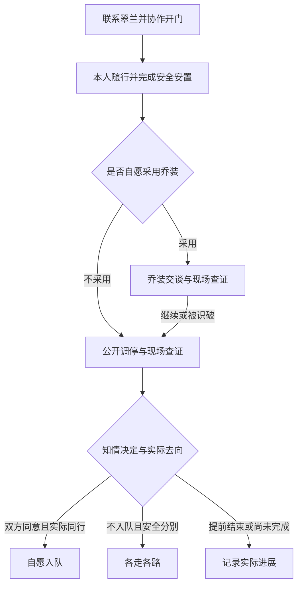

# ADV-001：无战斗多人叙事冒险与首章高老庄

## 0. 状态与阅读入口

| 项目 | 内容 |
| --- | --- |
| `spec_ref` | `docs/specs/narrative-adventure.md`；稳定标识 `ADV-001` |
| 修订 | `v0.2`；唯一内容身份取保存本文的 Git 提交，后续任务须绑定提交 |
| 日期 | 2026-11-12（北京时间） |
| 状态 | 设计候选；用户已明确选定高老庄为首章并要求修改原 Spec。章节选择已确认，本文具体机制、参数与阶段仍是待实现、待试玩的设计 |
| 本次交付终点 | 修订共同玩法、经典章节顺序、首章完整行为、系统边界和整体验收；保留五庄观为第二章详案，不开始业务实现或实施拆票 |
| 代码观察基线 | [`main@5d0befff3673c840756d64a982878ac76dfd0273`](https://github.com/gbcdby/xiyou/tree/5d0befff3673c840756d64a982878ac76dfd0273) |
| 任务入口 | [Spec 汇总 #23](https://github.com/gbcdby/xiyou/issues/23)；[同一设计 PR #24](https://github.com/gbcdby/xiyou/pull/24)；实施 Tickets 尚未建立 |
| 配套详案 | [CH02 五庄观·人参果风波](narrative-adventure-wuzhuang.md)，属于同一 ADV-001 修订与后续 A4 范围 |
| 既有约束 | [总设计](../../初步设计文档.md)、[工程约定](../engineering.md)、[M0 协议](m0-protocol.md)、[美术方向](../design-direction/art-direction.md) |

**产品目标：2–5 位玩家进入一幅可行走的水墨淡彩西游场景，各自扮演当地人物，通过探索、实物操作、信息交换和协作解谜，影响唐僧、孙悟空与章内人物的判断，共同完成一个有起伏、可补救、有不同结果的故事。**

本稿完整展开共用能力与 CH01 高老庄，保留 CH02 五庄观详案；CH03–CH06 只规定选题、体验和改编边界，进入制作前补齐章内规则。真假美猴王仍是需验证的候选，六章不同时进入生产。

### 0.1 v0.2 修订范围

- 依据用户最新决定，以《高老庄收八戒》替换首章五庄观；旧五庄观的果数、和平路线与救树路线移到 CH02 详案，未丢弃设计。
- 内容路线改为更广为人知的经典篇章；保留原著顺序，真假美猴王设明确选题门槛与红孩儿替补规则。
- 首章加入八戒这一章内自主 AI，以及乔装身份、按观察者投影、翠兰自愿随行、真实到达和自愿入队/分别的契约。
- 原 `ADV-AC-07/08/09` 保留五庄观原义并迁至 CH02；新增 `GZ-AC-*`，不把旧编号改成另一种验收。
- 此修订改变设计候选，不改变既有代码基线。v0.1 的静态审查不等于 v0.2 已通过，更不代表高老庄已可玩。

## 1. 用户决定与本稿取舍

### 1.1 已明确的方向

| 编号 | 决定 | 对实现的约束 |
| --- | --- | --- |
| DIR-01 | 玩家能在游戏中行走、交互 | 必须有可操控角色、连续可见的走动、障碍与距离；区域按钮不能代替场景行走 |
| DIR-02 | 故事、解谜、协作完成任务为主，不加战斗 | 不设攻击循环、伤害数值、杀敌胜负和战斗成长；也不靠自动战斗或过场打斗解决关键冲突 |
| DIR-03 | 冒险体验参考多人版轩辕剑、仙剑奇侠传 | 借鉴探索、人物关系和故事推进；不照搬其战斗和资产 |
| DIR-04 | 水墨淡彩，接近江南百景图的画风感受 | 沿用本项目明亮、有色彩的国风水墨方向；人物、场景和界面使用原创表达 |
| DIR-05 | 故事本身有趣，再加入 AI NPC 随机性 | 先有完整情境、谜题和人物诉求，再允许临场判断；随机对白不能代替完整玩法 |
| DIR-06 | 选更经典的故事，按故事顺序逐章改编 | 采用原著相对顺序；完整候选及替补规则见第5节，不将“经典”解释成必须复现战斗或悲剧 |
| DIR-07 | 首章确定为高老庄，并修改原 Spec | A1–A3、首章内容、美术资产与新增验收均改为高老庄；五庄观保留为 CH02 |

2–5 人、玩家逐章轮换当地身份、唐僧与孙悟空为两位跨章核心 AI，承接已有总设计。高老庄再启用八戒这一章内自主 AI，不占真人席位。制作顺序不等于强制解锁顺序；首期仍保留选择已制作章节的方向。

### 1.2 本稿采用的设计默认值

- 首先制作 **CH01《高老庄·收八戒》**，建立可走场景、救援协作、乔装与信息权限；CH02《五庄观·人参果风波》检验底座复用。
- 固定斜俯视二维场景；点地行走，点对象后走近交互，支持停止与换目的地。键盘方向移动在底座阶段评估。
- 首章在桌面浏览器以鼠标操作完成验收，预留触控；手机真实设备验收另列。
- 一局目标 **20–30 分钟**，用于试玩调节；没有到点强制失败的全局倒计时。
- 唐僧、悟空、八戒具备自主意图闭环。翠兰、高太公和普通见证人使用有状态角色逻辑，可有受约束对白；不要求每个路人都接完整 LLM。
- 先用灰盒验证玩法。正式 UI/美术实现前须有已采用的场景与界面视觉基准，灰盒可玩不等于视觉交付。

### 1.3 本阶段边界

本阶段覆盖行走、距离交互、局部感知、物品交接、合作操作、伪装与识破、经本人同意的带路同行、三名自主 NPC、首章不同可完成结果、重连与授权复盘。通用战斗、技能树、装备数值、开放世界、玩家对抗、完整经济、通用物理模拟、语音通话、运行时自由生成地图及谜底不进入本阶段。

本次只修订设计与可审阅记录；不开始业务实现、正式视觉出图、实施拆票、合并或发布。

## 2. 从现有底座到可行走游戏

现有代码具有 Session、角色绑定、权威规则、唯一所有权、幂等动作、事件回放、授权投影、断线交还、Model Gateway 与受控双 NPC，可复用背包、证据、对话和复盘。[I1–I4]

当前 `move` 仅指定 `regionId`，`nearby` 主要判断同一区域；前端仍为区域按钮与物件卡片，内容操作/结局围绕修路 fixture。[I1–I3] 内容 schema 对 NPC 数与终局所需 NPC 数仍固定为2，世界实例把内容 NPC 一律设为 `core_npc`；当前投影仍公开角色真实标识、姓名与角色信息，不能直接支持悟空乔装。[I3、I5]

| 继续使用 | 必须新增或调整 |
| --- | --- |
| 身份、控制权、唯一所有权、事务和授权事件流 | 场景坐标、障碍、入口、交互锚点、持续移动与真实到达 |
| 观察、信念、目标、意图、Validator | 按事件发生位置及观察者身份知识过滤；动作按真实依赖重验 |
| 背包、证据、对话和授权复盘 | 地图行走、近距反馈、合作状态、乔装的外观视角与随行状态 |
| NPC 编排和 Gateway | 两位持续核心、章内自主角色、场景角色三种职责；首章覆盖3名自主 NPC 的公平调度 |
| 配置装载与版本 | 章内事实、证据、合作、身份/同意关系、分支和按结局声明的参与角色 |

历史 VS-001 模拟验证保留原候选和 profile，不证明本 Spec 的空间、乔装、高老庄剧情、真实 AI 或美术已通过。旧 fixture 保留为独立回归内容。

## 3. 一局游戏的体验合同

### 3.1 从进入到结束

1. **进入章节。** 玩家选择当地身份，看到自己的职责、已经知道的事情和共同目标；角色出现在可行走的场景中。
2. **在现场发现问题。** 首个可操作目标在出生点附近；玩家通过看、走、问、拿取或核对得到第一条线索。
3. **分头推进。** 同时存在两条以上有用工作，例如联系后宅与准备开门、查访旧事与布置会面。共享任务板说明已证实事实和待办，不自动公布其他角色的秘密。
4. **把信息变成行动。** 玩家向具体 NPC 展示证物、传达证言、交付道具或请求协助。NPC 可以同意、质疑、拒绝、自己去核对或提出替代方案。
5. **共同执行方案。** 方案必须落到合法的地图行动；口头说“给你了”“修好了”不能完成道具转交或场景修复。
6. **处理偏差与补救。** 被拒绝、拿错器具、NPC 改变计划或同伴暂离会改变行动安排；系统给出可理解的反馈和下一步机会。
7. **结束与复盘。** 结局由已提交的事实判断；复盘显示本队实际做了什么、哪些信息改变了 NPC 行动、哪些承诺尚未兑现。

### 3.2 趣味来源

| 趣味 | 玩家能够感受到的结果 | 设计失败信号 |
| --- | --- | --- |
| 探索发现 | 走到另一侧才看清物件、痕迹或一段关系 | 从出生点打开所有卡片即可通关 |
| 规则推理 | 对材料、道具、身份或仪式规则的理解能指导操作 | 只剩猜对白关键词或背原著答案 |
| 多人合作 | 同伴的发现或动作能改变自己的可行方案 | 一人谈话，其他人长时间等候 |
| 人物即兴 | 同一证据下 NPC 提出不同但说得通的行动 | 任意反复拒绝，玩家无法判断原因 |
| 世界反馈 | 门、物品、树、天气或人群发生实际变化 | 只有聊天框宣布成功，场景不变 |
| 后果与补救 | 好决定避免事故，失误带来可继续玩的分支 | 成功干预被剧情覆盖；一次试错永久卡死 |

协作不依靠强制逐人按同一按钮。允许熟练玩家更主动，但每个角色必须有可持续的贡献机会。局部信息差应服务沟通，不能依赖外部语音软件才可解。

## 4. 空间与交互

### 4.1 行走与视图

- 一章由少量连通场景组成，场景内连续行走；首章采用高家院落、庄口与一小段连通山路，不做大世界赶路。
- 摄像机跟随本地角色，提供回到角色的操作。建筑和树冠遮住角色或关键交互时使用淡化/轮廓等方式维持可读性。
- 人物与固定障碍碰撞；玩家之间默认不形成可恶意堵门的硬碰撞。地图出口只有在靠近且条件满足时才能切换。
- 点目标可先导航至交互点；到达后重新检查目标状态并执行。等待导航的动作可取消；目标移动或失效时停止自动执行并说明原因。
- 点击错误不消耗关键资源。材料效果导致消耗或物件状态改变时，界面应先提供已知风险；未知结果允许保留探索性，但必须符合固定规则。

### 4.2 首章使用的有限动作

| 动作 | 前提与实际效果 |
| --- | --- |
| 行走、停止、通过入口 | 服务端确认路线/位置及出口条件；接受路线不代表已经到达 |
| 观察、检查、比较 | 靠近合法对象，形成带来源的观察或证据；隐藏内容按身份与发现条件投影 |
| 拿取、放置、转交 | 空间条件、权限和唯一所有权同时满足才提交；地面物件有位置 |
| 展示证物、转述证言 | 接收者确实在范围内或通过已定义渠道收到；分别记录看到物证与听到陈述 |
| 使用工具、固定门撑、开启/释放通路 | 依据对象和材料规则产生状态变化；支撑锁定后无需一人永远扶着 |
| 提议随行、同意/撤回、带路、确认安置 | 绑定真实本人、目的地与计划版本；走到并确认后才算安置 |
| 准备乔装、变换外观、观察异常、揭示身份 | 改变外观及合法获知范围，不改变真实实体、物权或他人同意 |
| 提议合作、就位、执行、取消 | 明确参与者、目标与可中断状态；不靠高精度同时按键 |
| 交谈、请求协助、提出条件 | AI 形成意图，经同一规则入口执行；承诺单独记录 |

### 4.3 感知与沟通

“同场景”“看得见”“听得见”“能操作”是不同条件。首版可使用距离、墙/门标记、听闻分区，不要求真实光学和声学模拟；这些配置都应可视化调试，但不把隐藏层暴露给普通玩家。

现场公开对话的受众按**发言发生时**的权威位置确定。后来走近不会补听过去内容。队伍频道服务真人沟通，不自动进入 NPC 感知；要让 NPC 知道，需当面转述或展示。发现过的证据可以留在角色笔记，队伍共享必须通过合法分享；地图标记可共享位置，不自动赋予证据内容。

## 5. 六章内容路线

以下是六个计划位置的制作与推荐游玩顺序；CH01 已由用户选定，其余为本稿路线，CH05 带选题门槛。经典场面提供辨识度，实际完成方式服从无战斗与玩家能改变结果的要求。

| 顺序与章节 | 主要趣味与玩家行动 | AI 变化空间 | 完成目标与改编边界 |
| --- | --- | --- | --- |
| **CH01 高老庄·收八戒**（18–19） | 被封住的后宅、悟空变翠兰、意外遇到等候取经人的八戒；开门护送、乔装配合、访查旧事、安排会面和实际离庄 | 悟空是否愿意乔装，八戒如何解释和核验来客，唐僧提出什么可执行条件 | 翠兰先获得自由与安全，再处理入队和离庄；保留不入队的真实结果；原著追打、绑缚、烧洞不转成自动战斗 |
| **CH02 五庄观·人参果风波**（24–26） | 少果之争、五行规则与人情；查账、核验果园、归还器具、提前和解或协作救树 | 悟空解释/补救次序，唐僧查证方式，是否愿意等待 | 保留树未毁的完整结果；推树仅可在已声明、可干预条件下发生；详细事实与双路线见配套详案 |
| **CH03 白虎岭·三打白骨精**（27） | 三次化身逐步制造认知分歧；辨别来历、追踪现场、保护取经队伍、让师徒交换真正获知的证据 | 悟空的警觉与解释方式，唐僧是否请求现场核验，白骨精如何继续掩饰 | 保留三次变相与信任危机，将“三打”的动作重写为三次识破/脱困；不要求杀人，也不强制赶走已被玩家成功取信的悟空 |
| **CH04 女儿国·去留之间**（53–54） | 子母河、迎亲与取经使命；协作取得解困条件，理解真心，安排公开会面和诚实的离境约定 | 唐僧怎样表达心意与使命，女王如何回应，悟空如何协助履约 | 玩家帮助各方作选择，不代替女王或唐僧决定感情；不把假意成亲设为唯一解，不延伸到第55回蝎子精战斗 |
| **CH05 灵山路·真假美猴王**（57–58，条件候选） | 两个悟空与互相冲突的说法；保存来源、保护现场、比较行动和关系事实、组织有效查验 | 真悟空的反应、假悟空的掩饰、唐僧在不确定下的行动 | 原著并非一道暗号能解；须先证明玩家的调查能实质改变路径与可查验结果。若最后只剩等权威宣布答案，本章不进入制作 |
| **CH06 火焰山·三借芭蕉扇**（59–61） | 旧怨、真假扇与反骗；访查关系、商定借用条件、验证扇子、分区开路并履约 | 悟空采用何种计策，铁扇公主怎样判断实际履约，唐僧如何协调承诺 | 灭火通行、归还/合法续借形成实际闭环；原著战斗收尾改为协商与操作，不靠连续点扇凑进度 |

### 5.1 选题门槛与替补

CH05 在详细设计前做玩法论证：至少两项不可被一段终局对白替代的调查/协作行动，至少两种信息到达顺序改变合法后续行动，且玩家不能靠背原著直接锁定答案。世界真相固定，查验权限与证据来源可追溯；模型不临时抽签决定真假。

若上述门槛不成立，**红孩儿（40–42回）为第一替补**，以火云洞的识破、协作救援与脱困作无战斗改编。替补后重新按原著排序为：高老庄→五庄观→白骨精→红孩儿→女儿国→火焰山，并同步章号、角色与验收映射；仍是六章，不能把红孩儿额外塞成第七章。红孩儿自身也需完成无战斗闭环设计，不因是替补而自动通过。

旧稿中的平顶山、乌鸡国、车迟国、金平府退出本轮六章路线，保留题材参考，不保留隐含实施承诺。

### 5.2 能力复用

CH01 建立行走、物件协作、真实身份与感知、随行和不同人物选择；CH02 复用调查与行动底座，增加材料规律、状态修复和善后；CH03 加强连续骗局与信任；CH04 深化相互尊重的承诺和去留；CH05 通过门槛后再扩展复杂身份查验；CH06 组合借用、真假判断、环境操作和履约。伪装能力从高老庄就开始，不再推迟到旧稿的平顶山。

## 6. CH01：高老庄·收八戒

### 6.1 故事钩子与改编立场

**高家曾经招来一个能干的女婿，如今后宅却被封住，翠兰已经很久不能自由出来。唐僧师徒刚到庄上，玩家要先把人接出，再陪悟空应对那个夜里回来的“猪女婿”。对方说自己早已受观音劝诫，正在等一位东土来的取经人——这番话能怎样核实，又该怎样收场？**

原著第18回先救出翠兰，再由悟空变化成她与猪刚鬣交谈；第19回在冲突后才说明取经身份，并出现受观音指点、等候取经人的自述。[S1] 本章保留救人、乔装套话、认出取经机缘的顺序与趣味，把追逐打斗改成会面、查证和自主选择。

可走地图、玩家帮工、固定门撑、旧饭账与见证人、公开调停和不入队结局属于原创协作改编。没有“观音认证令牌”或唯一暗号；支持某人的说法不等于证明所有超自然经历。章名使用大众熟悉的“收八戒”；情节内在唐僧取名之前，按实际获知使用猪刚鬣/猪悟能，不能把未来事件提前写入人物知识。

### 6.2 固定事实、目标与起始局面

| 对象 | 所有变体共用的事实/稳定目标 | 不可随机化的边界 |
| --- | --- | --- |
| 翠兰 | 被困后宅，明确希望离开；可以选择本局可达的安置点、是否见面、是否允许悟空借用自己的外貌 | 自由与安全不以父亲/八戒同意、婚姻承诺或招徒成功为条件；不能再次被剧情强制关回去 |
| 高太公 | 知道八戒曾出力，也为女儿受困忧虑；希望女儿安全、后宅恢复正常出入 | 可关心名声与财物，不能代表翠兰同意婚事、随行或乔装 |
| 猪刚鬣/猪悟能 | 确曾受观音劝诫并等候取经人；开局在庄外，回来时尚未知道来客身份 | 事实固定但人物可能误信、隐瞒；不得因种子变化临时改成另一个妖怪或取消原有经历 |
| 唐僧 | 希望保护人、辨明来历、继续取经；是否收徒需其真实选择 | 不以先招徒换取救人，也不因玩家口头宣布就视为已收徒 |
| 悟空 | 保护师父、帮助受困者、辨别对方意图 | 可选择乔装或直说；不能独自自动完成全部调查，也不能随机攻击/摧毁房屋推进剧情 |
| 门与物件 | 后宅门锁被灌铜封住；普通钥匙不能开。门撑材料、公用工具、合法联络位置和出口可达 | 物件位置只能从已检查的有限布局选；必需工具不在八戒不可访问的私物中 |

开局是白日来客刚到，八戒在庄外。本章以**翠兰安全安置**作为开放“八戒归来”日程的前提，再给出暮色/庄口动静等可见变化；不是玩家看不见的倒计时。此节奏是入门章改编，避免初学行走时已错失救援。翠兰安全前，外访、准备和交谈仍可并行，不能提前触发把她作为人质的场面。

### 6.3 地图与可操作对象

| 空间 | 主要对象与操作 | 带来的信息/变化 |
| --- | --- | --- |
| 庄口与前厅 | 迎接师徒、询问高太公、借用工具、规划公开会面 | 了解共同目标、人物分歧和不完整说法；师徒实际进入场景 |
| 灶房与杂物棚 | 检查旧饭账、找门撑/绳索、归还公用物、准备座席 | 账本显示来客到达前已有候客记录；物件真实搬运、装配和回收 |
| 后宅门与侧窗联络点 | 联系翠兰、检查铜封/门扇、确认她退到安全位置、固定门撑后请悟空破锁 | 不是找钥匙开普通门；安全准备与开锁是可见的世界操作 |
| 内室与侧廊 | 翠兰随行、整理她同意取回的包裹、检查开放通路、隔开乔装现场与安置区 | 翠兰本人移动和安置，外貌相同的人不会替她完成任务 |
| 安置点 | 翠兰可选高家前院客房或庄口相熟人家的茶棚后间；两处均有可达通路 | 本人决定目的地与是否继续会面；不因八戒的态度失去安全结果 |
| 庄外短路与云栈洞外 | 找到旧日见证人、核对候客往事、通知/引导八戒、安排离开 | 小范围探访，不进入迷宫或副本；洞口可作八戒暂回地点，不要求烧洞 |

地图首轮只做上述紧凑连通空间，导航、可见/听闻分区和退出条件须可视化审阅。美术可以有庭院层次与曲折道路，不以大段无事赶路增加时长。

### 6.4 真人身份与人数配置

| 职责 | 身份及起始便利 | 救人之后的持续工作 |
| --- | --- | --- |
| A 迎客联络 | 高才；知道求助缘由，熟悉庄口与高家 | 合法传话、接待师徒、组织会面与道别 |
| B 内院照应 | 原创内院帮工；熟悉联络点和翠兰物件 | 核对本人意愿、带路安置、整理获准取回的物件、反馈现场变化 |
| C 木作帮手 | 原创木匠学徒；懂门扇受力，知道公用工具位置 | 准备/锁定门撑、安排安全通路、撤收工具、布置会面空间 |
| D 灶房帮手 | 原创灶房帮工；熟悉饭账、待客物与日程 | 查旧账、比较时间、送交证据、准备或调整会面用品 |
| E 庄外引路 | 原创樵客；知道短路与洞外往来 | 寻访独立见证人、引导会面、核对返回/离庄路线 |

| 真人数 | 职责组合 | 合作约束 |
| --- | --- | --- |
| 2 | 角色1承担 A+B+D；角色2承担 C+E | 门撑安装最多需两人；装好可锁定，两人都能离开再做护送/访查，不需要第三真人扶门 |
| 3 | A+B、C、D+E | 救援与外访可以分组，人员在关键合作时重聚 |
| 4 | A、B、C、D+E | 内院、工具、证据和外访各有工作，任务可交接 |
| 5 | A、B、C、D、E | 同时开放现场照应、准备、取证与联络；后半段继续有物件/带路/布置任务 |

职责提供知识和效率，不是永久不可替代的专属钥匙。公共知识可在现场重新学习，旧事可由常驻茶棚见证人合法提供；私密内容仍需本人授权。具体身份、初始知识和权能按人数组合声明，不把缺席角色的信息无条件广播给所有人。

### 6.5 开门、接人和安置

1. **建立联系。** 在侧窗联络点听到翠兰本人说明被困与希望离开，玩家把目标和已准备的方案当面传给悟空。高太公的介绍只是陈述，不代替与翠兰的接触。
2. **识别门的实际问题。** 检查铜封与门扇。钥匙试用会得到“不适用”的反馈且不消耗资源；两人把门撑移到标记出的承力点，调整后锁定。这个小谜题要求比较门扇状态与工具用途，不背原著口令。
3. **安全开门。** 翠兰确认退到门内安全位置；悟空基于合法观察与稳定救援目标执行破开铜封的工具动作。此举只改变锁/门，不是对角色的攻击系统。若他尚不知现场情况，先需要转述/核验；模型故障或两次无有效救援动作后，受控策略可在全部前提成立时执行同一已授权救援动作，不替玩家准备门撑。
4. **提议随行。** 与真实翠兰确认安置点、带路者和路线；她可暂停、改选地点、撤回当前安排。其固定离开意愿不等于同意每一条路线。
5. **实际到达并确认。** 玩家在地图上带路，翠兰走出后宅，到指定地点后确认安置。只说“出来了”、让乔装悟空站到安置点、或者只发出移动请求，都不能满足安全条件。

`CuilanSafe` 只引用真实翠兰的实体、有效同意、真实到达、可自由离开的安置点和安置确认事件。已完成救援不因招徒失败、乔装暴露、她拒绝会面或模型故障被回滚。请求取回包裹与信件另记同意，可稍后处理；这些私物不作为获得自由的交换品。

### 6.6 乔装套话与公开调停

翠兰安全后，可提出借用其外貌；须得到她对**这次用途与范围**的同意，且悟空愿意执行。真实翠兰留在自己的安置点，玩家无须让她充当诱饵。不同意或临时撤回时，直接进入公开调停；撤回使继续冒用的授权失效，悟空解除外观，不删除别人已合法观察到的事件。

玩家在已腾出的外间准备会面点、理清可见通路，给悟空传达已合法获得的家中信息。八戒返回后，玩家可分工观察异常、调查旧事、把证物带到场。悟空可以套问洞府、来历与所等之人；八戒可以疑惑、反问、查验现场、退到庄口或改变会面地点。这些变化由感知和人物目标驱动，不靠纯随机概率强制识破。

| 局面 | 合法后续 | 玩家可做的事 |
| --- | --- | --- |
| 乔装仍被相信 | 保持当前外观开展有限交谈，收集带来源的说法 | 传递已知细节、核对前后叙述、安排让对方见到取经人的机会 |
| 八戒合法发现矛盾/真实身份 | 记录其新知识，转为公开会面；过去听闻保留当时视角 | 解释救人已完成，展示可核实材料，换地点继续，不重开剧情 |
| 悟空不愿乔装或翠兰不同意 | 从庄口/前厅公开来意 | 通过同样的旧事证据与旅人身份交换建立会面，不损失完整结局 |
| 八戒拒绝当前地点/暂不想谈 | 可提议另一公开地点、先送证据或让其暂回洞外 | 用实际准备和信息改变计划；也可以结束招徒尝试并安全分别 |

乔装不赋予悟空翠兰的物品所有权、随行同意或婚姻承诺权限。玩家认出了悟空，不代表八戒也知道；知道者可当面揭穿，系统据实际受众传播，不能假装无人听见以强推名场面。揭穿没有“选错对白立即失败”。

### 6.7 候客旧事、取经身份与可执行选择

本段有两条互相补充的信息链，均须落到观察/证言与送达动作：

| 信息链 | 固定材料及来源 | 规则上能得出的结论 |
| --- | --- | --- |
| 八戒确曾提前等候来客 | 灶房旧饭账记录多日前为“东土来、往西去的僧人”留饭；庄外茶棚见证人讲述其来客到达前的询问，来源与日期可比较 | 两个独立来源支持“等候并非临时编出”；仍不等于玩家证明观音所有言行 |
| 眼前师徒的来意 | 唐僧自主允许展示通关文牒中的相关信息，说明自身使命；悟空可当面介绍，接收者须真的在场听到/看到 | 对方收到有来源的东土取经人身份材料；不是只听到一个名字便自动归队 |

上述材料为游戏原创查证环节；文字内容、可核验关系与事件来源由章节配置固定，AI 只能改变解释和回应。发现、分享与当面送达分别记录。任务板最多说“已有材料支持该说法”，不把人物自述标签改成全知认证。

`AccountsCompared` 要求旧饭账与独立证言均取得、来源/先后时间已在现场比较，且与唐僧获准展示的身份材料一起，合法送达唐僧与八戒；两者在同一约定地点真实会面并听到对方说明。可以先公开说明、后补材料，也可先乔装得线索再查证；已知原著的玩家仍要完成世界里的查验。翠兰不需要到场作证。

达到这些条件只开放知情决定，不自动产生认同。唐僧可以接受或暂不收徒，八戒可以愿意同行、提出可执行条件或留下；口头意向记录为承诺，真实选择通过各自授权的决定动作提交。玩家不能替两人签字，单一信物/名字/玩家命令不能跳过条件。

会面后的工作包括按本人许可收拾包裹、归还玩家借用的公用工具、将后宅恢复可自由出入、安排不同人物的实际去向。八戒的钉耙是其个人物品，只能按许可搬运/放置，不作为战斗装备或战利品；高家与其劳动报酬、赔偿的分歧可以记录待议，不以全员原谅或强制认错卡住救援与分别。

### 6.8 资源、拒绝与补救

- 必需的门撑、公用工具与证据入口都在玩家可达处；每种合法变体都保留两人解法。锁定支撑是持久准备状态，安装者离开或断线不会自动解除。
- 翠兰的私人包裹/信件和八戒的钉耙/行李不属于离线公共物领回范围；未经本人同意不得转交。请求未完成时如实列为剩余事项，不虚构归还。
- 公用物领回按第10节。关键调查有常驻证人/公开档案等合法替代入口，不需读取离线者的私密笔记。
- 乔装暴露、放弃乔装、证物尚未送达或一次邀请被拒，都有继续查证、换公开地点、暂缓或安全分别的下一步；不恢复封门、不临时抽新身份、不让 NPC 把证据带到永久不可达处。
- 一次会面邀请允许明确接受、提出另一可达地点、暂缓或拒绝。连续两次无有效回应或模型超时，进入可见“暂缓”状态，保留邀请；不把沉默当作同意或拒绝。玩家可补充新材料后再邀请，或由在线团队明确选择结束招徒尝试。结束招徒属于章节收束选择，按第10节要求全部当前在线真人明确确认；单人点击或他人沉默不能提交。这只结束本局招徒尝试，不关闭仍待完成归还/分别/离庄的会话，也不提前提交GZ-E02。少于2人时不借此推进剧情，仍按等待/未完成结束规则处理。
- 故障降级只执行有合法知识与稳定目标支持的安全行动，例如悟空已获准的破锁、八戒走到公开等待点、师徒在条件满足后的离庄。收徒、加入、同意借貌、原谅与赔偿承诺不能由超时策略替人物作出。

### 6.9 分支与终局

“后宅开放”指铜封已解除、通路可达且不再限制翠兰出入；“公共物收尾”只检查本队实际借出的有限清单，争议赔偿与私人遗留事项另列。结局由规则检查以下事实，不由一句总结或隐藏好感值决定：

| 结局 | 必须同时成立的事实 | 不得伪造的完成项 |
| --- | --- | --- |
| **GZ-E01 自愿同行** | `CuilanSafe`；后宅开放；本队公共物已实际归还；`AccountsCompared`；唐僧真实接受、八戒真实自愿加入；相关决定合法送达悟空；唐僧、悟空与八戒完成到庄外出发点的移动，实际提交入队与同行结果 | 口头答应即算入队；翠兰未安置就庆祝招徒；强迫其原谅；仅播放离庄字幕 |
| **GZ-E02 各走各路** | `CuilanSafe`；后宅开放；本队公共物已实际归还；明确记录“不加入”或团队选择结束未决招徒；八戒实际在庄外可达的等待/归处，师徒合法获知安全结果并实际离庄 | 未响应写成八戒拒绝；无人加入却记入队；分别写成所有纠纷已经和解；删掉未解决财物/承诺 |
| **GZ-E03 暂告一段** | 团队按第10节主动结束，或会话恢复条件不能维持；逐项记录已救出/尚未安置/已查明/未完成等真实状态 | 统一失败动画抹消已救出的事实；未核实、未归还或未离庄写成圆满 |

GZ-E02 是完整的安全分别结果，可在当事人不愿收徒/加入时完成；不要求先做完所有招徒证据。对未决邀请须写“未达成同行”，不能写“对方已拒绝”。若八戒仍在院内，须先安排其到公开等待/归处；受控降级可执行其稳定的避开纠缠、回到可达住处的普通行动，但不能伪造离场或收徒决定。

除尚待完成的角色移动与最终入队提交之外，其余相应结局前置已经成立，且相关角色通过现场通知合法获知当前安排后，即可启动离庄/分别的普通移动。唐僧/悟空恢复继续取经目标；连续两次决策没有有效准备/移动或模型故障时，可降级为普通导航，仍受距离、路径和权限校验。八戒已提交仍有效的自愿加入决定与同行安排时，也可按该安排导航；实际到达后再校验双方决定并提交最终入队。GZ-E02则分别导航到师徒出发点与八戒的公开等待/归处，再检查终局。降级不能新生成加入决定，故障原因及动作保留记录。

安置与入队是不同事件：前者先独立落地；后者的提交同时校验两人仍有效的决定、真实同行位置与本局未终结。决定在最终提交前撤回须使待完成计划失效；结算后旧回调不能改写结果。复盘呈现救人、乔装是否采用/何时暴露、证据来源、各人的真实选择与实际去向。

## 7. AI NPC 的自主性与随机性

### 7.1 人格与可执行目标

下表描述 CH01 高老庄的自主角色。后续章节按自己的角色配置复用原则，不自动继承八戒的完整 Agent；CH02 的两名自主 AI 与场景角色边界见保留详案。

| 角色 | 稳定目标 | 可以出现的不同做法 | 不能成为的捷径 |
| --- | --- | --- | --- |
| 唐僧（持续核心） | 保护人、辨清是非、尊重承诺、继续取经 | 先听证人、亲自查看、要求补证、提出明确条件、接受或暂不收徒 | 永远误判的阻碍；无依据信任；以翠兰安危交换收徒 |
| 悟空（持续核心） | 保护师父、解救受困者、弄清阻碍 | 乔装或直说，查证或请人传话，改变会面安排，执行已授权救援 | 自动独自解完全部任务；随机打斗；用外貌替翠兰同意或偷看所有秘密 |
| 八戒（章内自主） | 维护自己的生活与名誉，核实所等之人，作出自己的去留选择 | 解释、隐瞒、反问、去看证据、换地点、暂回洞外、同意或不加入 | 只充当预设答案按钮；识破毫无来源；拒绝救出翠兰；随意带走唯一证据形成永久软锁 |

翠兰、高太公、见证人亦有明确目标和权限，但不必用同等复杂的推理循环。翠兰已有的离开意愿不是供模型随机重写的悬念。客观任务不会因人物态度变化倒退；接受收徒、原谅等主观选择也不会因客观证据齐全而自动生成。拒绝的后果由替代路径和不同结果承接。

### 7.2 三层变化

| 层 | 首章范围 | 约束 |
| --- | --- | --- |
| 开局变体 | 公共工具的合法位置、可达会面点、辅助人物日程、等价线索入口，从经检查的有限组合选择 | 固定 `chapterVersion + variantId + seed`；所有角色数配置都可解；关键真相和物品规则不变 |
| 行为变化 | NPC 请求核验、暂缓、移动、寻找证人、保管物品、提条件及执行计划 | 仅使用可见信息和已开放工具；一项行动合法不等于已成功执行 |
| 表达变化 | 语气、用词、合理的玩笑和对同一经历的看法 | 台词不能新增物件、改谜底、抹消事件或泄露未感知内容 |

种子固定布局和变体，不承诺真实模型逐字复现。复盘重放以记录的合法意图与权威事件为准，不重新询问模型来重写过去。

### 7.3 随机性质量要求

- 改变的是“接下来怎么做”，不只是每局换一句台词。至少准备不同的信息到达顺序、一个合理拒绝后的替代路径、一次玩家行动改变 NPC 计划的场景。
- 关键物件转移必须留下可发现的去向；NPC 不得把唯一关键物件带到永不可达之处。
- NPC 拒绝需给出其可公开的理由或待满足条件；允许玩家补证、换方案、请另一位角色协调。提示不能偷用尚未发现的真相。
- 模型超时、非法工具输出和服务暂不可用时，采用只基于合法观察的保守行为；不冻结房间，也不自动完成调查或代作重大选择。
- AI 的提示、人格与随机参数不构成安全边界。事实、知识来源、工具权限、一次效果和不可逆动作由服务端校验。

## 8. UI 与美术交付边界

游戏主视图以场景为主，常驻信息只保留角色/队友位置、当前可操作提示与轻量任务提示。背包、证据笔记、对话记录和复盘按需展开；对话中仍能看见地图反馈，并允许其他玩家继续活动。

任务提示描述当前问题与已知下一步，不提前给出全部真相。未知、待核验、已确认、已完成、承诺未执行须有清楚区别。不能只靠红绿颜色传达可操作性和结果。

视觉沿用“清逸仙境·工写相生”：纸感、墨线骨架、通透淡彩、丰富但克制的冷暖，重要人物和材质有明确细节，远景保留留白。高老庄用白墙灰瓦、木门、竹篱、灶房烟气和薄暮田路建立空间层次；剧情变化通过人物动作、灯火和局部环境表达，保持关键物件、行走边界和交互提示清晰。[A1]

首章正式视觉交付至少包括可走的高家院落与短路、玩家角色的待机/行走/交互反馈、唐僧/悟空/八戒、真实翠兰与悟空借用外貌的表现、门的封闭/支撑/开启状态、关键道具，以及对话/背包/证据/任务/随行的实际界面。先完成场景与主要界面设计，记录采用的视觉基准与交互状态，再据此实施正式 UI，最后用真实浏览器截图对照。可以先做灰盒，但不得把灰盒称为最终美术，或先任意拼出正式界面再补设计。不同观察者看到不同身份时，图形与姓名提示都遵守同一授权视角。

当前没有已接受的完整场景设计图；旧资料中缺失的72张参考不能作为“本轮已核对素材”。渲染工具和动画资产方式由视觉/技术原型选择，沿用 Vue 外壳，不在本稿预定新游戏引擎。[A1]

## 9. 状态归属与系统接口

### 9.1 共同原则

继续遵守：**LLM 提出意图，规则决定世界事实，事件记录过去。** 世界事实、NPC 信念、人物陈述和承诺分别表达。所有角色、场景机关和定时任务通过同一 Session 权威提交边界产生效果。

| 模块 | 责任与对外合同 |
| --- | --- |
| 场景客户端 | 渲染授权场景、预测/插值表现、提交意图、显示待确认与拒绝；没有位置/物品写权限 |
| 权威空间逻辑 | 可走区域、路径/步进、位置、移动计划、出口、距离、遮挡与交互锚点 |
| Rules / 事务提交 | 角色控制、权限、对象版本、距离、消耗、合作完成和终局的原子判定 |
| 事件与快照 | 持久化有效世界变化、收据与同步游标；足以重放交互发生时使用的空间依据 |
| 感知与记忆 | 按发生时位置和身份知识生成观察；合法转述带来源；隐藏真实标识及身份关联；保护跨角色、跨场景、跨章秘密 |
| NPC 编排 | 按持续核心/章内自主/场景角色注册；非阻塞、公平调度、计划生命周期、真实依赖与超时降级；模型不计算逐帧路径 |
| 内容解释器 | 装载有版本的地图、事实、角色、有限操作、分支条件与终局；拒绝不完整/不可达配置 |

### 9.2 最小新增状态

以下为语义合同，具体 schema 与兼容编号在协议任务中固定，不冒充已有字段：

| 状态 | 必需语义 |
| --- | --- |
| 场景实例 | `chapterVersion`、`mapVersion`、`variantId`、`seed`、场景及可达连接 |
| 空间实体 | `sceneId`、权威位置、朝向/表现状态；落地物品有唯一位置，持有物品只有一个 owner |
| 移动计划 | `movementId`、控制 epoch、目标、当前状态、终止原因；状态至少含 accepted / moving / arrived / blocked / cancelled |
| 合作操作 | `operationId`、参与角色与就位、目标、前提版本、准备/提交/取消状态；完成效果只提交一次 |
| 章节进度 | 事实/观察/陈述分开；救出与安置、乔装与合法识破、会面、证据、收徒意向、实际入队、分别和终局 |
| 身份外观 | 稳定真实实体、当前外观及 `appearanceVersion`、授权使用范围、每个观察者已获知的身份关系与感知引用 |
| 随行安排 | 真实本人、本人同意及版本、目的地、带路者、计划版本、跟随/暂停/撤回/到达/安置状态 |
| 角色职责 | 持续核心、章内自主、场景角色分别声明；自主角色数量和各结局所需角色不固定为2 |
| NPC 行动计划 | 来源观察、当前目标、真实依赖、进行中移动/操作、需重规划的原因 |

不能让客户端的显示坐标、模型的描述或队伍笔记成为隐藏的第二套权威状态。

### 9.3 请求、持续动作与未知结果

- 复用可信主体、`clientActionId`、控制 epoch、资源前置条件和 Receipt。移动/停止/替换请求也必须能去重与识别迟到请求。
- 移动请求表达场景和目的地，或已知目标的交互锚点；服务端判定可达。Receipt 的 accepted 只表示接纳计划；到达需要独立的权威结果。
- NPC 的“去拿杯子”必须拆成导航、到达、重查、拿取。现有同事务“移动区域后立即取物”的假设不能直接沿用。
- 转交、拿取、消耗和合作提交时，重新检查双方/目标当前位置、距离、遮挡、所有权、控制权和目标状态。用户在等待中可以取消，取消结果与原动作提交由同一顺序决定。
- 收据丢失时按原 `clientActionId` 查结果或重发；不要新建动作 ID 再执行。若首次动作已提交，取消不倒转已生效事件，界面应显示真实状态和下一步补救。
- 新路线、明确停止、控制权交还或终局使旧移动/到达回调失效。门关闭或目标移动会重新判定路线，不允许穿墙完成旧计划。

寻路算法、插值方式、空间步进与存储频率属于实现自由度。可以保存权威路径与必要检查点，避免把每个动画帧写成数据库事务；但必须保证交互采用的权威位置、感知时刻和重放依据一致。不能仅保留客户端坐标或绕过现有提交顺序。

### 9.4 避免持续运动饿死 AI

现有决策上下文会把可见人物版本纳入读依赖。[I4] 连续走动后应按操作的**实际依赖**判断是否过期：

- 无关旁观者换位置，不应使 NPC 一切计划不断重试。
- 目标物件被移走、控制权变化、门被关闭、关键证据失效或 Session 终结，必须使相关意图重新校验/重规划。
- 可使用语义版本与空间版本分离、分步骤再校验等机制；不能为减少拒绝而跳过控制权、权限或物品版本检查。
- 每帧移动不触发模型调用；到达、接收到新证据、任务条件变化等语义事件才驱动重新判断。

### 9.5 版本与时钟迁移

新章节使用独立的内容/规则版本和声明的空间协议能力。已有region版会话、事件和回放保留旧解释器；不把运行中的旧角色自动放进猜测坐标，也不把旧 `move(regionId)` 当作新持续移动请求。旧客户端进入需要空间协议的新章节时，应获得明确的升级提示并停止发起不兼容动作，不能静默接收缺字段的状态。新旧会话可以并存；移除旧路径需要单独确认历史回放与使用范围。

新章区分两种时间：连接宽限、请求超时等使用服务端时间；剧情日程、风险窗口和章内求援使用持久的有效场景时间，仅在至少2名真人在线、会话处于可推进状态时累计。重启不追赶无人在线期间的剧情时间。旧 fixture 的强制到期终局不直接继承到新章节；如需技术资源回收，作为明确的会话暂停/结束原因记录，不伪造剧情失败。

### 9.6 乔装的身份与信息权限

- **真实实体不变。** 真实悟空、真实翠兰始终是两个实体。变换外观只更新悟空的外观与版本，不改物品 owner、控制权、历史和别人的同意。
- **按观察者投影。** 未识破者只收到其有权看到的外观、称呼与不暴露关联的感知引用。真实 `characterId`、姓名、`roles`、控制模式、事件 actor/owner 引用、工具目标、AI context、快照、重连和复盘都不能旁路泄露悟空身份。[I5]
- **可操作而不泄密。** 客户端/AI 向“眼前这个人”的授权引用提交动作，服务端解析到真实实体并检查感知权限。物件交给乔装悟空后，实际 owner 是悟空；不会转给别处的真实翠兰。未识破者的收据仍使用其合法视角。
- **身份知识有来源。** 亲眼见变身、听到现场揭穿、获准收到证据等可以改变知识；玩家队聊不自动改变八戒知识。两人同外貌、当事人的异常行动可触发合法核验；系统不能屏蔽真实线索强行维持骗局。
- **历史保持当时视角。** 当时听到的是谁的外貌/称呼、之后何时知道真身分别记录；重连不补发无权知道的秘密，结局复盘也不默认全知解密。
- **依赖正确过期。** 对目标外貌/身份判断有依赖的待执行意图绑定其版本；变身、揭示、授权撤回使相关旧计划重验。不能把本意给眼前人的操作悄悄重定向到另一个同名实体，也不能把无关走动当作全部决策失效。

### 9.7 随行、本人同意与安全事实

随行状态顺序为提议→本人接受→跟随→实际到达→本人确认安置；途中可暂停、撤回、改约。接受不是到达，到达也不替代安置确认。提议绑定真实翠兰、目的地、带路安排与计划版本；父亲、玩家或乔装悟空均不能代替她接受。

同一人物同时只有一个有效随行安排。更换带路者/目的地需本人重新确认，旧到达回调不得完成新安排；重试、并发邀请、控制 epoch 变化、撤回与确认按同一权威顺序处理。领路者掉线、人数不足、路线失效或本人撤回时，在已声明安全位置暂停，显示可恢复步骤；受限托管不擅自替别人作出新同意。重新安排由在线角色提出，原人物按已有愿望与实际条件回应。

翠兰的场景策略可在其明确接受的安排成功到达后提交确认，不需等待 LLM 文案。安置点必须有自由可达出口，并且实际已到达；只更新旗标或把悟空的同外貌实体算入均非法。确认后的安全事实独立于招徒；后续撤回会面/借貌同意不倒转已经发生的获救。

### 9.8 三名自主 NPC 与终局参与者

内容声明 Tang/Wukong 为两位持续核心，Bajie 为高老庄章内自主角色，Cuilan/Gao/见证人为场景角色。不得把“持续核心有两名”写成“所有自主 NPC 只能有两名”，也不能让八戒占用玩家席位。schema、世界实例、投影、编排注册与终局策略必须同步支持此区别。[I3、I5]

推理并发上限可根据预算保留2或另行配置，注册3名自主 NPC 不等于必须同时发3个模型请求；必须有公平队列、防饥饿与普通动作不停顿的证据。按章节/结局声明所需决定与离场角色，GZ-E01检查三人同行，GZ-E02只检查师徒离庄及八戒另处安置，不沿用固定长度2的终局数组。

## 10. 并发、掉线与可恢复性

| 场景 | 规定行为 |
| --- | --- |
| 两人同时拿同一器具 | 同一权威顺序只允许一人获得；另一人得到当前合法状态，不能复制 |
| 移动时转交/目标离开 | 提交时检查有效距离与目标感知引用；失败不丢物，必要时重新约定交接点 |
| 合作就位期间掉线 | 未提交操作取消或保留安全准备；不假定掉线者仍同意，可由其他在线角色重新就位 |
| 门撑/CH02支架已经锁定后掉线 | 锁定是已提交事实，保持有效；不倒退为必须永远扶着 |
| 真人断线 | 停止其当前输入和未提交合作，按宽限/受限托管保留位置、物品、知识；托管不擅自消耗关键道具或作不可逆选择 |
| 道具/权限被离线角色占用 | 只对预先声明的公共借用物开放领回；专属调查有替代入口，公共操作有受限重新授权 |
| 翠兰随行中带路者掉线/本人撤回 | 暂停旧安排，不自动换领路人；重新确认后继续，旧回调不触发安置 |
| 乔装改变/被识破/授权撤回 | 相关外观版本和合法知识更新，失效意图重验；不泄露给未获知者，不把物件交给另一真实实体 |
| 真人重连 | 回到同一角色的授权位置、物品、有效计划和身份视角；新 epoch 排除旧连接与旧 AI 回调 |
| 少于2名真人在线 | 已提交事实保留，需真人协作的剧情与日程暂停；显示等待/结束选择，不把缺席计为失信 |
| 全员离线/服务重启 | 不在离线期间推进或破坏剧情；恢复持久事实，停止失效移动，按会话生命周期恢复/明确结束 |
| 模型故障 | 普通交互继续，NPC 状态可理解；按合法知识保守降级，不自动收徒、同意、原谅或泄密 |
| 工具/证据使用错误 | 按固定规则反馈，可换工具、重新收集或再送达；不永久消耗唯一通关条件 |
| 玩家主动结束 | 任一在线玩家可发起；所有当前在线真人明确确认后按本章未完成结局结算。沉默不算同意；少于2人且宽限结束后剩余玩家可结束；单人离开不关闭仍有队友的一局 |

**离线公共物领回合同：** 高老庄公用工具、门撑零件，以及 CH02 的金击子/公共玉器等，在借出前明确标记公共借用性质并说明领回方式。宽限期内不领回；进入受限托管后，在线同队角色可走到离线持有人旁请求。服务端同时检查原持有人仍离线及控制版本匹配、物品在公共集合中、距离与物品版本正确、无已提交操作占用，再原子转移。重连先提交则拒绝领回；领回先提交则重连看到实际交接。不得复制或跨地图瞬移，也不包括翠兰信件/包裹、八戒私物和私人笔记。

职责不形成缺席后的永久锁。公共工作台重新授权需要同队身份、章节阶段和原职责离线条件，只开放本局必要操作，不移交私密记忆。领回由规则执行，不扩大托管 AI 权限。实施前补协议、有限模型及恢复验收，不推广为任意物品或重大剧情选择的代决权。

## 11. 章节配置与跨章状态

章节包描述原著来源/原创改编、固定事实、有限变体、地图/导航/锚点、2/3/4/5人职责组合、持续核心/章内自主/场景角色、可知信息、目标与动作、物品、身份外观与同意、谜题前提/效果、分支、按结局声明的参与者、复盘视角和验证样例。现有 schema 必须升级，不能只替换修路物品名称。[I3]

内容使用有限动作与条件，不提供任意脚本写库，不让 LLM 临时生成判胜条件。每个已发布变体须声明完整可达路径与合法拒绝后的替代结果，按人数组合检查。

首章先完成本局可追溯事实与授权章末摘要。跨章长期记忆、连续游历在 A5 再实现：唐僧/悟空只携带亲历或合法获知的重要经历，账号进入新当地角色不会自动继承前一角色秘密。

**独立选章与连续游历必须分开：** 独立选择五庄观时，可以明示采用“八戒、沙僧已同行且盗果已发生”的预设前情；这是另一个章节会话，不是把上一局高老庄的不入队结果偷偷改写。真正的连续游历必须读取高老庄实际入队事件；八戒没加入时，后续需已设计的内容变体或后来真实发生的加入事件，否则不能进入默认依赖他参与偷果的前情。界面说明这是独立章节预设，不能声称承接了玩家上一局的全部选择。

## 12. 推进阶段与释放条件

本表是设计路线，不是 Ticket 或日历承诺。本次停在 A0；后续若推进，首先按本修订拆出真实实施任务。

| 阶段 | 交付边界 | 进入下一阶段的条件 |
| --- | --- | --- |
| **A0 设计修订** | ADV-001 v0.2、首章高老庄完整流程、CH02保留详案、六章候选路线、系统与验收调整 | 文档自洽、独立设计审查和版本记录明确；本次工作终点 |
| **A1 高老庄行走灰盒** | 院落/短路最小场景，2–5人移动、障碍、距离、物品交接、停走/重连；空间协议与相关模型 | 真正可控行走；权威距离与感知正确；不用场所按钮冒充地图；协议风险有本候选证据 |
| **A2 高老庄完整规则** | 全章灰盒，开门/安置、乔装/识破/直接会面、证据、不同去留与结算；受控NPC；三类角色模型 | 2/3/4/5人可走通，乔装和直接路线均成立，入队/分别/未完成结果真实，无隐私泄漏与资源软锁 |
| **A3 高老庄体验候选** | 唐僧/悟空/八戒真实AI，正式视觉基准及据此实施的必要资产/UI，任务反馈与复盘，真人观察 | 技术、真实模型、真人趣味与运行视觉分别验收；能观察玩家贡献、因果变化与三NPC公平调度 |
| **A4 五庄观验证复用** | 使用保留详案制作CH02；五行材料、果数、树未毁/协作救树与善后 | 旧 `ADV-AC-07/08/09` 实际执行；底座复用且高老庄不回归；前情模式明确 |
| **A5 逐章扩展与跨章** | CH03→CH04→条件CH05→CH06，或按替补重排；章选择、角色轮换和合法连续前情 | 每章先补详细设计与验收；真假美猴王先过选题门槛；无战斗与真实选择持续成立 |

A1空间原型可与视觉设计并行，共用尺度、视角和锚点；正式UI开发依赖已采用的视觉/交互基准。A2依赖相应协议/内容规则，A3真实AI与真人观察依赖可玩的A2。完整最终美术不是开始灰盒的前提，灰盒也不能跳过正式设计和运行对照。

## 13. 整体验收

### 13.1 共用与保留编号

以下是实现/体验的**待执行义务（NOT_RUN）**，不是本次文档静态审查结果。`ADV-AC-07/08/09` 原义不变，其唯一条目定义和详情移至 [CH02 保留验收](narrative-adventure-wuzhuang.md#9-五庄观专属验收保留原编号)，在 A4 执行；不能把它们重新编号成高老庄已通过。

| 验收 ID | 检查对象与输入 | 可观察结果与失败判据 |
| --- | --- | --- |
| ADV-AC-01 范围 | 候选六章、CH05门槛与替补、全部首章动作/结局 | 首章高老庄，原著相对顺序正确；无攻击/伤害循环或自动战斗代解；未将条件候选写为已确定内容 |
| ADV-AC-02 实际行走 | 独立客户端点地、换路、停走、穿门、撞障碍 | 角色按权威可达路径连续走动；区域瞬移、穿墙、动画和交互位置不一致均失败 |
| ADV-AC-03 空间交互 | 远距、跨墙、行走中、目标移动、收件者离开 | 提交时重验；失败无物品副作用且有反馈；伪造客户端坐标不能成功 |
| ADV-AC-04 物品与合作 | 抢物、重复转交、合作就位/取消/断线/重试 | 唯一归属、一次效果，合法就位后才提交；已锁定准备不因安装者离线失效；具体门撑/果水用例由各章覆盖 |
| ADV-AC-05 移动与恢复 | 乱序、替换、旧到达、旧epoch、重连/重启 | 旧路线/旧AI不复活，位置/物品一致，少于2人的暂停与恢复正确 |
| ADV-AC-06 感知权限 | 距离/墙、移动途中说话、晚到、队聊 | 只有合法受众形成观察；跨墙偷听、晚到补知、队聊自动泄露或跨局串入均失败 |
| ADV-AC-10 人数与贡献 | 2/3/4/5人完成首章，重点观察2人与5人 | 每个职责有可交接工作；五人都有实际因果贡献；空角色权限卡死和轮流按钮凑贡献均失败 |
| ADV-AC-11 AI因果 | 相同真相，不同证据顺序、合理拒绝后补证、NPC间交流 | 两位持续核心及首章章内自主八戒有可解释计划，玩家行动能改变计划；只有换台词或随机改谜底不成立 |
| ADV-AC-12 非阻塞 | 全部章内自主NPC排队/推理时持续走动，注入超时/非法输出 | 普通操作继续，无关走动不使计划无限过期；高老庄的3名自主NPC均能获调度，其他章按声明的自主角色集合检查；降级不替人物作重大选择 |
| ADV-AC-13 终局与复盘 | 章内全部结果、主动结束、迟到动作 | 按该章规定检查事实/角色/真实离场；授权复盘不泄密，不受旧回调改写；GZ结果见下表，CH02沿保留条目 |
| ADV-AC-14 视觉可读 | 已采用设计与真实浏览器地图/UI/遮挡/状态截图 | 看清路径/角色/操作；水墨淡彩符合基准；灰盒或设计图不能冒充正式运行视觉通过 |
| ADV-AC-15 可解与补救 | 声明变体×人数组合、关键物/证人/模型故障 | 固定真相且有可达的合法结果；拒绝后有替代，资源有合法补救；任何随机软锁需修正或下架 |
| ADV-AC-16 玩法体验 | 首章真实AI下2人/5人完整局及同组复玩 | 玩家能说明发现、贡献与NPC因何改计划；复玩出现处理路径差异；技术完成不能单独宣称好玩 |

### 13.2 高老庄新增验收

| 验收 ID | 输入/场景 | 可观察结果与失败判据 |
| --- | --- | --- |
| GZ-AC-01 固定事实与改编 | 不同种子、知原著/不知原著玩家，拒绝招徒情境 | 后宅受困、提前候客事实不被模型重写；救援不以招徒/婚事为条件；无打斗/烧洞代解 |
| GZ-AC-02 开门与安全 | 试错工具、合作安装、锁定后离开/掉线、申请随行 | 铜封/支撑规则有效；两人可完成；确认真实翠兰意愿后实际开门与离开，不靠对白旗标 |
| GZ-AC-03 同意与随行 | 并发提议、本人撤回、父亲代答、换目的地/带路者、掉线/重连、旧到达 | 一个有效计划；只本人同意；需重新确认的安排不复用旧许可；暂停可恢复；旧回调不能安置/入队 |
| GZ-AC-04 真假实体 | 真实翠兰与乔装悟空同时存在，展示/交物/护送 | 各自唯一身份/物权；交给眼前悟空不转给翠兰；悟空到安置点不能满足 `CuilanSafe` |
| GZ-AC-05 全链路身份权限 | 未识破八戒/已知玩家/其他观察者的快照、事件、收据、owner、工具、AI context、重连及复盘 | 仅收到各自合法身份信息；真实ID/姓名/角色标签不得旁漏；历史保留发生时视角 |
| GZ-AC-06 乔装分支 | 同意乔装、拒绝乔装、撤回借貌、当面揭穿、八戒合法识破 | 均可转入查证/公开会面并达成完整结果；不重关翠兰、不强制NPC失明、不因暴露重开 |
| GZ-AC-07 查证与主观决定 | 单独背名字、伪造令牌、旧账/证人顺序改变、材料未送达、双方自主接受/拒绝 | 无单口令认证；`AccountsCompared`检查来源/送达/会面；证据支持不自动等于同意加入 |
| GZ-AC-08 三名自主角色 | 内容加载、实例化、调度、不同并发预算、三人分别作出行动 | 两位持续核心+八戒章内自主均有完整闭环，不占真人位；无固定2人schema拦截或第3人饥饿 |
| GZ-AC-09 三类结局 | 入队、拒绝/未决招徒后的安全分别、主动结束；取名/收徒意向在提交前撤回 | 逐项满足GZ-E01/02/03；承诺/决定/实际同行分开；未决不写拒绝，未完成不写圆满，安全结果不回滚 |
| GZ-AC-10 前情一致 | 高老庄不入队后独立选五庄观；后续连续游历读取同一结果 | 独立预设前情明确标注；连续模式无真实加入事件/内容变体时不能静默补八戒；本期未实现跨章不得称已承接 |
| GZ-AC-11 降级与出口 | 救援/会面/离庄连续无效决策、超时；八戒已同意但尚未到出发点时模型故障；一人请求结束招徒；公用物由掉线者持有 | 不等待实际离庄才启动导航；先到达再最终入队，撤回使旧计划失效；结束招徒需在线真人明确确认；可恢复或安全分别/结束；私人财物不可强领 |

### 13.3 检查分层与样本

| 层 | 首轮范围 | 能说明什么 |
| --- | --- | --- |
| 文档静态核对 | 用户决定、原著/改编、不同结果闭环、角色组合、前情、相对链接与编号 | 设计是否自洽可交接；不说明玩法已运行 |
| 有限模型与契约 | 持续移动、控制交还、合作提交、公共物领回、外观/知识版本、本人同意与旧回调、事件时刻权限 | 按工程要求给出负对照、状态规模、实现映射和未覆盖范围；不验证自然语言质量 |
| 受控技术检查 | 实际服务端/数据库/网络/浏览器，2/3/4/5人；2人与5人分别覆盖乔装/直接路径及入队/分别；五客户端至少15分钟连续操作 | 验证权威、空间、权限、恢复与同步；受控NPC不代表真实AI效果 |
| 真实AI评价 | 首章记录三个自主角色的模型/配置、来源观察、意图、等待、拒绝/重规划；覆盖分支、两种信息顺序及故障；后续章按各自自主角色集合评价 | 验证指定配置样本的因果与表达，不推断所有模型普遍成立 |
| 真人玩法观察 | 至少2人组、5人组各一组，各复玩一次，覆盖不同路线/去留与调查方式 | 发现理解、协作与复玩问题；小样本不代表留存 |

首轮每人至少2次有效贡献，其中至少1次是非聊天的世界操作；不应连续超过120秒因设计/界面阻塞而无事可做。贡献要能追到有后续作用的证据、物品、合作结果或计划改变；无目的走动、复读、重复点按不计。自愿旁观与系统不给机会分开记录，不增加重复劳动凑指标。

记录完成时长、求提示点、拒绝后的恢复、复玩差异、模型调用/延迟；这些是调节依据，不是“好玩”的自动评分。测试绑定候选、内容版本、变体、人数、模型、设备及网络；改动后只重查受影响风险。旧 `mock-20261111` 与 v0.1 静态审查只对各自历史候选有效，不能改名为高老庄运行证据。A4再执行CH02专用用例。

## 14. 取舍、待验证事项与返回设计条件

| 取舍 | 原因与代价 | 后续验证 |
| --- | --- | --- |
| 高老庄首发 | 用户明确选择；人物鲜明，救人—乔装—认出机缘适合紧凑入门章 | 破锁准备是否自然、公开路线是否同样有趣、两人/五人工作量是否合适 |
| 先救人再招徒 | 翠兰自由有独立结果，避免一切围绕强行复现入队 | 现实操作与人物意愿是否清楚；拒绝后能继续玩而非陷入长对白 |
| 三名自主NPC | 八戒是本章故事与临场反应的中心，不能只是结局按钮 | 调用成本、公平调度与人物区分；不要求固定并发3 |
| 固定真相、变化应对 | 推理可核验，变化来自信息和选择 | 若仅换台词，增加行为/地点/条件分支，不随机改身份 |
| 乔装带真实信息权限 | 名场面成立要靠观察者不知道，而非prompt假装不知道 | 全链路泄漏、同外貌对象误操作、变身/揭示后的过期动作 |
| 保留不入队结果 | 尊重人物与玩家选择；增加后续内容的前情责任 | 当前独立选章标清预设，连续游历留到有真实变体时实现 |
| 先定视觉再实现正式UI | 让最终表现遵守水墨淡彩与场景交互设计 | 用采用的基准和真实截图核对，不把灰盒过渡状态当交付 |
| 真假美猴王有条件入选 | 经典但原著查验高度依赖更高权威，玩家能动性尚未证明 | 第5.1节门槛不成立则启用红孩儿并重排，不硬凑六章 |

加入战斗、改变玩家/核心角色身份、降低本人同意、让AI改写真相、取消公开路线/不入队结果、强制回到原著失败、增加不可补救随机锁、放宽物权/控制/身份权限、提前强接跨章记忆，均须返回设计评估。

尺寸、速度、距离、调度预算与呈现细节由后续原型固定版本；影响可达/感知/时序的值进入配置和样本。本稿无需再等用户给出这些技术参数才能交接。真实AI、真人体验、正式视觉与CH05可玩性尚未验证。

## 15. 任务交接与完成状态

- **产物**：ADV-001 v0.2 主 Spec、CH02保留详案及索引/总设计/项目现状的同步修订。绑定保存它们的Git提交。
- **唯一任务入口**：[汇总 #23](https://github.com/gbcdby/xiyou/issues/23)，同一[设计 PR #24](https://github.com/gbcdby/xiyou/pull/24)。实施Tickets尚未建立，A0–A5不是实际票号。
- **下一阶段**：若继续实施，从高老庄A1–A2拆协议、空间灰盒、章内规则/人物、身份权限/随行、场景前端与验证任务；正式UI按视觉基准衔接。每票绑定Spec提交与 `ADV-AC-*`/`GZ-AC-*`。
- **保留约束**：M0事务/物权/控制/秘密边界、原AC编号含义、所有人数组合、双核心与章内自主的区别、同意/行动/结果分开、连续前情一致，以及静态/运行/体验证据区别。
- **本次未执行**：业务实现、TLC、多人运行、真实模型、真人试玩、正式视觉出图、合并和部署。设计文档更新不关闭后续功能交付。

## 16. 依据与来源

### 项目依据

- **[I1]** 当前基线的[领域类型](https://github.com/gbcdby/xiyou/blob/5d0befff3673c840756d64a982878ac76dfd0273/game/types.ts)与[规则](https://github.com/gbcdby/xiyou/blob/5d0befff3673c840756d64a982878ac76dfd0273/game/rules.mjs)：区域移动、接近判断与动作边界。
- **[I2]** 当前基线的[世界界面](https://github.com/gbcdby/xiyou/blob/5d0befff3673c840756d64a982878ac76dfd0273/frontend/src/features/world/WorldPanel.vue)：现有场所/物件交互呈现。
- **[I3]** 当前基线的[内容 schema](https://github.com/gbcdby/xiyou/blob/5d0befff3673c840756d64a982878ac76dfd0273/content/schema.mjs)与[试验配置](https://github.com/gbcdby/xiyou/blob/5d0befff3673c840756d64a982878ac76dfd0273/content/fixtures/trust-repair-fixture-v1.json)：修路机制及人数职责配置。
- **[I4]** 当前基线的[AI 上下文](https://github.com/gbcdby/xiyou/blob/5d0befff3673c840756d64a982878ac76dfd0273/backend/ai/context.mjs)与[意图提交](https://github.com/gbcdby/xiyou/blob/5d0befff3673c840756d64a982878ac76dfd0273/backend/decisions.mjs)：依赖版本与合法决策提交。
- **[I5]** 当前基线的[世界实例](https://github.com/gbcdby/xiyou/blob/5d0befff3673c840756d64a982878ac76dfd0273/game/world.mjs)、[投影](https://github.com/gbcdby/xiyou/blob/5d0befff3673c840756d64a982878ac76dfd0273/game/projection.mjs)与[AI编排](https://github.com/gbcdby/xiyou/blob/5d0befff3673c840756d64a982878ac76dfd0273/backend/ai/orchestrator.mjs)：角色分类、身份公开和调度的观察基线。
- **[A1]** [美术方向](../design-direction/art-direction.md)与[资料状态](../design-direction/README.md)：本项目现行风格、可复用规范及缺失参考边界。
- 历史底座的实际交付记录：[VS-001汇总 #2](https://github.com/gbcdby/xiyou/issues/2)、[PR #22](https://github.com/gbcdby/xiyou/pull/22)。历史候选身份与当前源码基线分别保留。
- 产品要求来源：本轮对话中用户明确要求行走交互、水墨淡彩、无战斗、故事/协作解谜、优先有趣故事与AI随机性，并授权先形成Spec；随后要求更经典的篇章，明确决定首章高老庄并要求修订原Spec。

### 原著依据

以下用于校对小说事实与章节次序；玩法、地图、协作证据、和平分支和验收数值是项目改编。后续章的表格是设计提案，不将影视版本的专有情节写成原著事实。

- **[S1] 高老庄**：[第18回](https://zh.wikisource.org/wiki/西遊記/第018回)，高家求助、后宅铜封、先救翠兰再乔装；[第19回](https://zh.wikisource.org/wiki/西遊記/第019回)，取经身份、受观音劝诫与招徒。追打、绑缚、烧洞等不进入本游戏闭环。
- **[S2] 五庄观**：[第24回](https://zh.wikisource.org/wiki/西遊記/第024回)、[第25回](https://zh.wikisource.org/wiki/西遊記/第025回)、[第26回](https://zh.wikisource.org/wiki/西遊記/第026回)，详见保留章内设计的逐项来源。
- **[S3] 白骨精**：[第27回](https://zh.wikisource.org/wiki/西遊記/第027回)，三次化身与师徒分歧；本项目不照搬伤害动作或固定驱逐。
- **[S4] 女儿国**：[第53回](https://zh.wikisource.org/wiki/西遊記/第053回)、[第54回](https://zh.wikisource.org/wiki/西遊記/第054回)，子母河、迎亲与离国；真诚协商的替代路线是游戏改编。
- **[S5] 真假美猴王**：[第57回](https://zh.wikisource.org/wiki/西遊記/第057回)、[第58回](https://zh.wikisource.org/wiki/西遊記/第058回)，真假难辨与多次查验，不能直接简化为暗号认证。
- **[S6] 火焰山**：[第59回](https://zh.wikisource.org/wiki/西遊記/第059回)、[第60回](https://zh.wikisource.org/wiki/西遊記/第060回)、[第61回](https://zh.wikisource.org/wiki/西遊記/第061回)，三借、真假扇与最终归还。
- **[S7] 红孩儿替补**：[第40回](https://zh.wikisource.org/wiki/西遊記/第040回)至[第42回](https://zh.wikisource.org/wiki/西遊記/第042回)；只作为候选原著范围，完整无战斗设计尚未展开。
