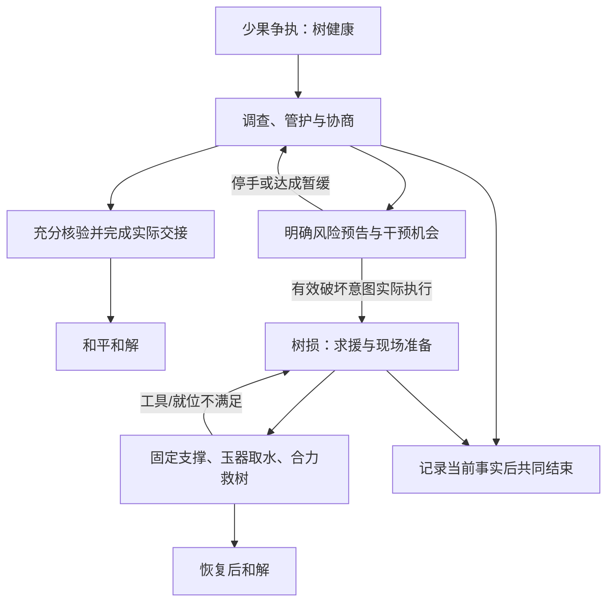

# ADV-001：无战斗多人叙事冒险与首章五庄观

## 0. 状态与阅读入口

| 项目 | 内容 |
| --- | --- |
| `spec_ref` | `docs/specs/narrative-adventure.md`；稳定标识 `ADV-001` |
| 修订 | `v0.1`；唯一内容身份取保存本文的 Git 提交，后续任务须绑定提交 |
| 日期 | 2026-11-11 UTC（北京时间 2026-11-12） |
| 状态 | 设计候选。用户已同意将前轮推荐落成 Spec；本稿具体机制、参数和排期分段是设计方案，不声称已实现、已试玩或已获逐项确认 |
| 本次交付终点 | 保存共同玩法、六章顺序、首章完整行为、系统边界和整体验收；实施 Tickets 尚未拆分 |
| 代码观察基线 | [`main@5d0befff3673c840756d64a982878ac76dfd0273`](https://github.com/gbcdby/xiyou/tree/5d0befff3673c840756d64a982878ac76dfd0273) |
| 任务入口 | [Spec 汇总 #23](https://github.com/gbcdby/xiyou/issues/23)；具体实施任务尚未建立，不沿用已关闭的 VS-001 Tickets 代表本阶段工作 |
| 既有约束 | [总设计](../../初步设计文档.md)、[工程约定](../engineering.md)、[M0 协议](m0-protocol.md)、[美术方向](../design-direction/art-direction.md) |

**产品目标：2–5 位玩家进入一幅可行走的水墨淡彩西游场景，各自扮演当地人物，通过探索、实物操作、信息交换和协作解谜，影响唐僧与孙悟空的判断，共同完成一个有起伏、可补救、有不同结果的故事。**

本文确定六章的内容路线，展开共用能力与第一章的完整设计。第二至六章在本文中具有章节目标、独特玩法和改编边界；正式制作各章前，仍需补齐该章地图、角色配置、谜题状态和验收用例。六章不同时进入生产。

## 1. 用户决定与本稿取舍

### 1.1 已明确的方向

| 编号 | 决定 | 对实现的约束 |
| --- | --- | --- |
| DIR-01 | 玩家能在游戏中行走、交互 | 必须有可操控角色、连续可见的走动、障碍与距离；区域按钮不能代替场景行走 |
| DIR-02 | 故事、解谜、协作完成任务为主，不加战斗 | 不设攻击循环、生命值消耗、杀敌胜负、战斗成长；压力来自信息、承诺、环境和任务后果 |
| DIR-03 | 冒险体验参考多人版轩辕剑、仙剑奇侠传 | 借鉴探索、人物关系和故事推进的体验目标；不照搬其战斗和资产 |
| DIR-04 | 水墨淡彩，接近江南百景图的画风感受 | 沿用本项目明亮、有色彩的国风水墨方向；具体人物、场景和界面使用原创表达 |
| DIR-05 | 故事本身要有趣，再加入 AI NPC 的随机性 | 先有完整的情境、谜题和人物诉求，再允许 NPC 临场判断；不能靠随机对白支撑整关 |
| DIR-06 | 按故事顺序逐章改编 | 本稿采用原著顺序：五庄观、平顶山、乌鸡国、车迟国、火焰山、金平府 |

2–5 人、玩家逐章轮换当地身份、唐僧与孙悟空为持续存在的两位核心 AI，承接已有总设计。章节制作顺序不等于强制解锁顺序；首期仍保留选择已制作章节的方向。

### 1.2 本稿采用的设计默认值

- 首先制作 **CH01《五庄观·人参果风波》**，同时建立可行走的共用底座；CH02 检验能力复用，再扩展余下章节。
- 采用固定斜俯视的二维场景。玩家点地行走，点对象后走近交互；支持停止与更换目的地。键盘方向移动可在底座阶段评估，不作为首章前置条件。
- 首章以桌面浏览器的鼠标操作完成整体验收，布局和交互预留触控；手机真实设备验收另列，不能用桌面模拟器替代。
- 一局目标 **20–30 分钟**，承接总设计每关 15–30 分钟的体验区间。此数字用于试玩调节；首章没有到点强制失败的全局倒计时。
- 首章只要求唐僧、悟空具有完整自主 AI 闭环；镇元子、土地、八戒、沙僧、观音使用有状态的场景角色逻辑，允许轻量对白，不新增六个同等复杂的自主 Agent。
- 玩法和美术验收分别进行。可先用灰盒地图验证行动，再形成一张正式风格场景作为首章资产基准。

### 1.3 本阶段边界

本阶段必须覆盖行走、距离交互、场景观察、物品携带与交接、合作操作、局部信息、双 AI 决策、首章两条完整解决路线、重连与复盘。通用战斗、技能树、装备数值、开放世界、玩家对抗、完整经济、通用物理模拟、语音通话、运行中自由生成地图及谜底均不进入本阶段。

本次请求只交付设计文档和可审阅记录；没有开始应用实现，也没有将六章实施任务标记完成。

## 2. 从现有底座到可行走游戏

当前代码已经具有 Session、角色绑定、权威规则、物品所有权、幂等动作、事件回放、授权投影、断线交还、Model Gateway 与受控双 NPC。现有前端的背包、证据、对话和复盘可以复用。[I1–I4]

当前 `move` 仅指定 `regionId`，`nearby` 主要检查是否同一区域；世界界面通过区域按钮和物件卡片操作。内容中的操作、结局也仍围绕修路 fixture，不是已经可装入六章的完整内容引擎。[I1–I3]

| 继续使用 | 必须新增或调整 |
| --- | --- |
| 身份、控制权、唯一所有权、事务和授权事件流 | 场景坐标、可走区域、障碍、入口、交互锚点与移动生命周期 |
| 合法观察、信念、目标、意图、Validator | 按发生位置过滤视觉与听闻；AI 走到后才能交互；避免无关人物走动不断使决策过期 |
| 背包、证据详情、对话和授权复盘 | 场景视图、角色走动、近距提示、合作状态、地图中的操作反馈 |
| 配置装载和版本机制 | 支持章节事实、谜题、有限交互原语、分支及终局的内容结构 |

历史 VS-001 的模拟验证保留原候选和 profile；不用于证明本 Spec 的行走、首章剧情、真实 AI 趣味性或美术已经通过。旧 fixture 保留为独立回归内容，不改名冒充五庄观。

## 3. 一局游戏的体验合同

### 3.1 从进入到结束

1. **进入章节。** 玩家选择当地身份，看到自己的职责、已经知道的事情和共同目标；角色出现在可行走的场景中。
2. **在现场发现问题。** 首个可操作目标在出生点附近；玩家通过看、走、问、拿取或核对得到第一条线索。
3. **分头推进。** 同时存在两条以上有用工作，例如查账与查看果园、准备器具与说服见证人。共享任务板说明已证实事实和待办，不自动公布其他角色的秘密。
4. **把信息变成行动。** 玩家向具体 NPC 展示证物、传达证言、交付道具或请求协助。NPC 可以同意、质疑、拒绝、自己去核对或提出替代方案。
5. **共同执行方案。** 方案必须落到合法的地图行动；口头说“给你了”“修好了”不能完成道具转交或场景修复。
6. **处理偏差与补救。** 被拒绝、拿错器具、NPC 改变计划或同伴暂离会改变行动安排；系统给出可理解的反馈和下一步机会。
7. **结束与复盘。** 结局由已提交的事实判断；复盘显示本队实际做了什么、哪些信息改变了 NPC 行动、哪些承诺尚未兑现。

### 3.2 趣味来源

| 趣味 | 玩家能够感受到的结果 | 设计失败信号 |
| --- | --- | --- |
| 探索发现 | 走到另一侧才看清物件、痕迹或一段关系 | 从出生点打开所有卡片即可通关 |
| 规则推理 | 对材料、道具、身份或仪式规则的理解能指导操作 | 只剩猜对白关键词或背原著答案 |
| 多人合作 | 同伴的发现或动作能改变自己的可行方案 | 一人谈话，其他人长时间等候 |
| 人物即兴 | 同一证据下 NPC 提出不同但说得通的行动 | 任意反复拒绝，玩家无法判断原因 |
| 世界反馈 | 门、物品、树、天气或人群发生实际变化 | 只有聊天框宣布成功，场景不变 |
| 后果与补救 | 好决定避免事故，失误带来可继续玩的分支 | 成功干预被剧情覆盖；一次试错永久卡死 |

协作不依靠强制逐人按同一按钮。允许熟练玩家更主动，但每个角色必须有可持续的贡献机会。局部信息差应服务沟通，不能依赖外部语音软件才可解。

## 4. 空间与交互

### 4.1 行走与视图

- 一章由少量连通场景组成，场景内连续行走；首章采用同一观院地图的连通庭院与房间，不做大世界赶路。
- 摄像机跟随本地角色，提供回到角色的操作。建筑和树冠遮住角色或关键交互时使用淡化/轮廓等方式维持可读性。
- 人物与固定障碍碰撞；玩家之间默认不形成可恶意堵门的硬碰撞。地图出口只有在靠近且条件满足时才能切换。
- 点目标可先导航至交互点；到达后重新检查目标状态并执行。等待导航的动作可取消；目标移动或失效时停止自动执行并说明原因。
- 点击错误不消耗关键资源。材料效果导致消耗或物件状态改变时，界面应先提供已知风险；未知结果允许保留探索性，但必须符合固定规则。

### 4.2 首章使用的有限动作

| 动作 | 前提与实际效果 |
| --- | --- |
| 行走、停止、通过入口 | 服务端确认路线/位置及出口条件；接受路线不代表已经到达 |
| 观察、检查、比较 | 靠近合法对象，形成带来源的观察或证据；隐藏内容按身份与发现条件投影 |
| 拿取、放置、转交 | 空间条件、权限和唯一所有权同时满足才提交；地面物件有位置 |
| 展示证物、转述证言 | 接收者确实在范围内或通过已定义渠道收到；分别记录看到物证与听到陈述 |
| 使用工具、设置支撑、取水、浇灌 | 依据对象和材料规则产生状态变化；不接受自然语言直接宣布结果 |
| 提议合作、就位、执行、取消 | 明确参与者、目标与可中断状态；不靠高精度同时按键 |
| 交谈、请求协助、提出条件 | AI 形成意图，经同一规则入口执行；承诺单独记录 |

### 4.3 感知与沟通

“同场景”“看得见”“听得见”“能操作”是不同条件。首版可使用距离、墙/门标记、听闻分区，不要求真实光学和声学模拟；这些配置都应可视化调试，但不把隐藏层暴露给普通玩家。

现场公开对话的受众按**发言发生时**的权威位置确定。后来走近不会补听过去内容。队伍频道服务真人沟通，不自动进入 NPC 感知；要让 NPC 知道，需当面转述或展示。发现过的证据可以留在角色笔记，队伍共享必须通过合法分享；地图标记可共享位置，不自动赋予证据内容。

## 5. 六章内容路线

以下顺序同时作为制作顺序和推荐游玩顺序；每章使用同一套规则底座，增加少量可复用能力。回数对应本次核对的原著编排，来源见文末。

| 顺序与章节 | 原著趣味与玩家行动 | AI 的变化空间 | 完成目标与改编边界 |
| --- | --- | --- | --- |
| **CH01 五庄观·人参果风波**（24–26） | 少果之争与五行禁忌；查账、实地核验、归还器具、保护或救活果树、共同收尾 | 悟空隐瞒/解释/认错的次序，唐僧查证与调解方式，是否愿意等待 | 查清关键去向、完成实际善后并达成本局和解；保留树未毁的完整结局；追逐鞭打与油锅冲突移出玩法 |
| **CH02 平顶山·莲花洞换宝**（32–35） | 应名法宝、假葫芦与换宝骗局；小妖/杂役分工查规则、准备可信演示、维持身份、转移宝物和同伴 | 悟空的说辞与备选计策，看守盘问和核验次序 | 人员脱困、关键物品脱离威胁且通路可用；法宝拘禁可解救，不设置化脓死亡；普通聊天提到名字不自动触发拘禁 |
| **CH03 乌鸡国·井下真相**（37–39，36可作引入） | 鬼王诉冤、玉珪与隔绝的母子；寺院/宫苑双线取证，保护证人，协作打开井边通路并安排救援 | 唐僧何时愿意介入，悟空先取证还是先求援，假王如何掩饰已发生的事 | 建立可核验的身份依据、完成救援并恢复安全秩序；真假身份开局固定；复生需要明确任务条件与世界动作 |
| **CH04 车迟国·台前台后**（44–46） | 祈雨、隔板猜物和后台干预；仪式准备、天气信号、物件查验、揭露或应对规则内的干扰 | 悟空临时改方案，唐僧对程序与证据的坚持，三仙对异常的反应 | 完成非伤害竞赛、兑现解除苦役/放行的条件；三仙保留真实法术；砍头、剖腹、油锅竞赛不进入玩法 |
| **CH05 火焰山·借扇与还愿**（59–61） | 旧怨、真假扇、冒认与反骗；访查关系、安排可执行的借用条件、测风、分区开路、归还扇子 | 悟空选择求情或变通，唐僧对承诺的要求，铁扇公主如何判断实际履约 | 验明真扇、完成安全通行和归还/合法续借；原著战斗收尾改为协商与行动；不靠连续点击扇风凑进度 |
| **CH06 金平府·灯会疑云**（91–92） | 三盏大灯、昂贵香油、假佛显圣；灯匠/油坊/巡夜等角色核对账目、追踪油路、布置可见证的揭露 | 唐僧对显圣的判断，悟空揭露时机，冒充者的转移与遮掩 | 揭明假显圣、解救受困者并恢复灯会；油路、照明与公开见证为原创协作改编；后段战斗改写 |

### 5.1 每章应带来的新增体验

- **CH01**：验证实物规则、调查、角色分歧、双分支善后；建立完整玩法标准。
- **CH02**：加入身份伪装、受约束的名字/法宝规则、可恢复拘禁；验证内容能复用，不复制一套引擎。
- **CH03**：扩大到互相隔绝的证人和区域；强调保护、路线和证据来源。
- **CH04**：加入分阶段公开事件与后台协作；任务节奏不依赖战斗。
- **CH05**：让借用条件、真假验证、世界操作和履约连续发生。
- **CH06**：综合人群环境、物资追踪、公开证据和多人布置，形成首期节庆高潮。

高老庄、白骨精、女儿国、凤仙郡、灭法国、天竺等保留为后续候选。本 Spec 不为其建立实施承诺。尤其真假美猴王暂缓，其原著辨认困难不能简化为一道暗号题。

## 6. CH01：五庄观·人参果风波

### 6.1 故事钩子与改编立场

**一行客人将要离开五庄观，果树却少了四枚果子。悟空不愿担下“私藏果子”的指责；清风明月担心师父回来后无法交代，唐僧也还没有弄清所谓人参果究竟是什么。玩家需要在争执升级前把账和现场接起来，决定如何收场。**

开局选择“盗果已发生、树尚未损坏”。玩家可以阻止后续冲突，不能改写开局前发生的事。偷取和推树的责任分别记录；找到入土的一枚不能把擅自取果改写为无事发生。

原著提供人参果的材料规则、果数争议、悟空毁树求方以及玉器取水救树。[S1–S2] 本游戏增加当地帮工、可走地图、证据操作、锁定支架、和平和解和部分救援步骤；这些属于协作改编。章节不复刻惩罚性捆绑、鞭打或油锅过程。

### 6.2 开局事实：所有种子共用

| 事实 ID | 权威事实 | 起初谁知道 |
| --- | --- | --- |
| F01 | 本熟共有30枚；先前开园众人吃2枚，镇元子离观时树上28枚 | 清风持开园记录；明月知道离观时数量 |
| F02 | 招待唐僧的2枚被拒收，随后清风明月各吃1枚；树上剩26枚 | 清风明月知道这2枚的去向；唐僧只知道自己拒收 |
| F03 | 悟空随后敲落4枚，其中1枚入土，另3枚被悟空、八戒、沙僧吃掉；开局枝上22枚 | 悟空见过入土现象并听过土地说明；八戒沙僧见过三人各分一枚，但没有目击入土过程 |
| F04 | 开局树仍健康；入土的1枚没有被任何角色持有 | 树可现场观察；入土事实需调查或合法传达 |
| F05 | 镇元子暂离；金击子已被使用，器具尚需正式归还/清点 | 依器具保管、实际位置和角色观察确定 |
| F06 | 本局固定的人参果性质、玉器取水条件、树恢复规则不受对白改变 | 规则是真相；角色是否知道另行记录 |

账目恒等式：**30 = 22（枝上）+ 7（已食用）+ 1（入土）**。已食用7枚包括开园2、待客2、师兄弟3。救树成功、尚未重新采果时，入土1枚归树，成为23枚；之后采摘、分食继续按实际事件更新，不能把“23”写成所有终局的固定数字。[S1–S2]

配置必须固定每枚关键果的身份/状态，或提供等价的守恒账目。不能同时计入枝上、持物、入土和已食用。客户端只得到有资格知道的部分，不直接获得这张真相表。

### 6.3 首章地图与空间作用

| 地点 | 可操作内容 | 为什么值得走过去 |
| --- | --- | --- |
| 山门与前庭 | 师徒行李、离观准备、到访/归来人物、共享会面点 | 接应、转交、安排谁在何处见面；观察 NPC 是否实际执行计划 |
| 正殿与客堂 | 待客经过、唐僧、账目比对和最终交接处 | 将不同地点的物证与证言带到同一见证场合 |
| 道房与器具间 | 果数记录、金击子、衬帕丹盘、玉杯、绳索与支架 | 选择合适器具、授权取用和实际搬运；不能隔墙直接拿取 |
| 人参果园 | 树、果数观察点、落果地块、树根和支撑锚点 | 从不同观察点核对枝上果数；检查土迹、确认损伤、共同操作 |
| 后园小径与土地龛 | 地块规则线索、土地见证、救树联络点 | 对照现象、请求证人、把远处分散的信息带回现场 |

地图保留一条主要环路和明确近路，减少重复穿越。房门、墙和树冠影响可达与感知；同处“五庄观”不等于能从任何位置听见所有对话。首章不制作三岛和南海大地图，求援采用有来源、可追踪的联络事件，玩家仍需完成园内工作。

### 6.4 玩家角色与人数适配

清风、明月来自原著；C/D/E 是本游戏新增的当地帮工职责，不冒称原著额外留守弟子。

| 职责 | 起始信息/资源 | 独立贡献 |
| --- | --- | --- |
| A 清风：账目与待客 | 开园记录、师父的待客交代 | 解释账目、核对食用记录、协调赔偿与见证 |
| B 明月：果园与器具 | 取果流程、部分器具取用权 | 现场数果、辨认操作痕迹、授权和交接工具 |
| C 园圃帮工（原创） | 园路、土质常识、支架存放处 | 对照入土地块、布置护栏/支架、跟进树况 |
| D 茶房帮工（原创） | 待客动线、玉器存放及使用记录 | 找到合适容器、准备材料、运送并核验水源 |
| E 山门帮工（原创） | 进出路径、联络地点、人物当前行踪 | 安排证人到场、接引求援者、分发工具并记录实际交接 |

| 真人数 | 职责组合 |
| --- | --- |
| 2 | 玩家1：A+D；玩家2：B+C+E |
| 3 | 玩家1：A+D；玩家2：B；玩家3：C+E |
| 4 | 玩家1：A；玩家2：B；玩家3：C+E；玩家4：D |
| 5 | A、B、C、D、E 各一人 |

组合只决定开局信息、权限和资源，不让一个人操控多个地图角色。大家都能行走、观察、搬运、交谈和执行已获授权的工作；工具和可委托任务允许交接。角色离线不产生不可替代的永久钥匙位，按第10节的受控交还与恢复处理。

首章至少保留三组可并行工作：账目/证人、土迹/果数、器具/现场准备。场景辅助角色不代替真人完成核心调查和合作谜题。

五人和平路线的一次有效分工可以是：A核对开园账，B从两个观察点盘点，C检查并标示入土地块，D带来待客记录并实际归整丹盘/衬帕，E请土地到场并接应镇元子的现场交接。这些是可交换的工作机会；不强制逐人打卡，也不要求队伍为了让D/E有事做而触发树损。

### 6.5 证据与解谜

| 问题 | 可操作的调查链 | 必须保留的区别 |
| --- | --- | --- |
| 为什么树上只有22枚 | 到两个观察点数果，带回开园/待客记录；询问实际食用者，形成带来源的时间线 | 玩家口述数字、人物证言和现场观察不是同一种证据 |
| 第四枚去了哪里 | 找落果点，对照周边土质与五行说明；请土地到场或取得可转达见证；让悟空说明其所见 | 没有挖出果子也可建立充分解释；证人说法不直接变成历史事实 |
| 怎样安全承接果子 | 检查金击子、丹盘、衬帕与材料说明，布置接果位置 | 知道原著答案仍须找到真实器具、取得权限并操作 |
| 怎样救树 | 看损伤、取得救治指示、选可用玉器、搭好支架、取正确的水并完成浇灌 | 普通井水不等于甘露；说“扶住了”不等于支架/角色状态已成立 |

人参果沿用金、木、水、火、土的不同反应：遇金而落、遇木而枯、遇水而化、遇火而焦、遇土而入。[S1] 这些效果只用于内容定义的直接接触操作，按对象材料、当前状态和动作计算；人物经过木门、下雨、身上携带金属不自动损坏果实，普通工具碰到树干也不生成整树毁坏。首章不提供玩家攻击、任意毁树或无许可批量采果动作。关键线索至少有两种可发现入口，例如现场检查与保管记录、合法见证与可检验痕迹；不要求抽中某一句随机对白。

不可用珍贵的唯一关键果做穷举试错。材料检查、器具说明和可重复的非消耗预演先提供足够推理依据；**正确采果可作为和解后的合作庆祝，但额外采果不是两条主路线的硬门槛**。误放新采果仍按规则处理，不能因损失庆祝果把已完成和解作废。

### 6.6 情节推进与分支

这是 `ADV-001 v0.1` 的拟议行为图，仅表示章节进度；物品所有权、角色控制和连接状态不在此图中。由人工依据本稿生成，未运行模型检查。

**调查阶段。** 玩家可以自由交错查账、问人、看土迹和收妥器具。关键事实先后发现不锁定唯一流程；不同信息顺序影响 NPC 计划。

**冲突预告。** 悟空可提出掀开树根找果等冲动方案，但树损必须来自获准执行的具体世界意图。只有争议仍在、角色到达相关位置、公开风险预告已经发出、有效干预机会已经给出且没有已生效的停手约定时，才允许进入破坏动作。风险窗口采用场景有效时间，不短于30秒（首轮可调参数）；普通聊天辱骂、沉默、LLM 超时或单纯经过时长不直接生成树损。

“有效干预机会”必须具有记录：至少一名在线真人通过现场听闻、合法转述或可见的准备动作获得风险提示，并有可达的干预位置和可用操作。只有这一条件成立且至少2名真人在线时，窗口才开始计算；预告对空房间发出不计。地图路径若使玩家来不及到达，延长窗口或暂停相关升级。风险阶段不封死干预通路，也不要求收到提示的人必须知道完整谜底；“请求共同查验/暂缓”应是可直接尝试的行动。

玩家可以让悟空离开树边、提供新证据、安排共同查验或达成可执行的暂缓。系统必须尊重已接受的暂缓，不允许旧 AI 回调继续推树。进入和平终局后不得补演原著毁树情节。窗口数值只为提供干预机会，不把关卡改为反应速度测试。

**路线A：果树无恙。** 团队完成现场盘点与去向解释，归还实际借/取用的金击子等器具，标示并封存入土地块，完成果园管护交接；镇元子返观后按明确的章规则接受处理。悟空对擅取的责任与“没有私藏第四枚”分别说明。本局和解可以接受有条件的后续补偿，但未履行承诺在复盘中仍记为未履行。追加的安全采果与分享作为庆祝，不强迫玩家制造树损以体验完整结局。

正式核验采用以下可检查组合，不要求输入某句道歉或让 LLM 给出主观通关分：

| 核验项 | 充分条件 | 人物态度与事实的边界 |
| --- | --- | --- |
| 数量 | 现场计数证据，加开园与待客记录，能够说明从28到26再到22的差额 | 证据未分享前，未到场者不能自动知道数字 |
| 三枚食用 | 悟空关于三枚分食的陈述及八戒/沙僧至少一人的独立佐证；或八戒和沙僧各自对三人分食的亲历证言 | 证言保存说话人、亲历范围、接收者和来源；不能把转述伪装为多份独立目击 |
| 一枚入土 | 落果地块的检查、已发现的五行规则，加悟空的经过或土地的合法见证 | 足以作为调停解释，不把“证人说过”直接写成新的入土历史事件 |
| 实际善后 | 指定器具已归公共位置、地块已标示、园门管护交接已提交 | 承诺未来完成不能替代这些本局动作 |

八戒、沙僧与土地的基础亲历证言是可通过正式询问获得的场景内容；AI 可改变交流过程，不能永久移除两条替代证据链。玩家在前庭联络点请求正式核验后，镇元子进入可追踪的返观流程（首轮60秒有效场景时间）；重复请求复用同一到场进度，暂停/重连不重复生成角色。充分条件满足且核验材料已合法提交给镇元子，即允许提交本局和解。人物可以仍有不满，系统不增加不可见的“好感度必须达标”条件。若证据互相矛盾，标出具体缺项并允许回查。

**路线B：失而复生。** 树损后停止争吵任务升级，转为求援、备器与现场支撑。镇元子/唐僧可以组织联络，悟空可以自愿担责求援；玩家也能在已发现的联络点提交求援，不要求悟空先说出指定台词。求援 accepted 后进入有限的到场流程（首轮配置为60秒有效场景时间，期间可备器），不再次依赖随机模型审批；少于2人在线时暂停。观音到场并按规则提供救治指示与根下水源，玩家负责达成实际施治条件。树恢复和多出一枚果的现场变化形成故事揭示，随后完成器具归还、责任处理与离观安排。[S2]

两条路线都能完整结算，有各自场景变化与结语；和平路线的价值不低于补救路线。

树损与恢复会改变现场，因此路线B允许用“恢复后的23枚现场计数＋原有开园/待客记录＋分食证言＋入土果归树的合法观察”完成核验，不再要求取得已经消失的旧土迹或损伤前现场照片。原来取得的证据保留其时间和对象版本；不能用失效的观察声称当前树仍倒着。

### 6.7 合作救树：两个人也能完成

救树不要求一直有三位真人扶树。新增的**可锁定支架**是本游戏的改编机制：

1. 从器具间运来两组支撑，在树旁锚点分别安装；支持逐步准备，安装失败不消耗唯一器具。
2. 两位角色在不同操作点进行一次“就位—确认—扶正并锁定”。允许宽松的准备窗口；一人取消/掉线则不提交成功，也不扣除关键物品。
3. 锁定成功成为世界事实，双方都可离开。支架锁定后，不因某人停止按键或短暂断线自动倒树。
4. 根据救治指示使用可取水的玉杯/玉盏等合格玉器，从已启用的救治水源取水。普通水与正确水在物品状态中分开。
5. 玩家把水送到施治点；观音完成其限定施治动作。规则检查支撑、水源、容器、施治就位等实际条件后提交树恢复。

首轮施治定义两个场景护理点：树根与树冠下的导流点。每点各需一份来自已启用救治水源、由合格玉器送达的水；每次实际交付产生已完成记录。两点均完成、支架锁定且观音在施治点时，提交一次恢复事件；无需额外随机成功率。两名玩家可并行，也可先后完成，途中取消不抹掉已提交护理。份数和护理点是游戏改编参数，不是原著精确操作描述；杯具容量不形成隐藏换算题。

五人局把信息核验、支架两端、器具/水源和联络分开，形成并行工作；核心需要同时就位的真人席位最多为2，不随人数增加无意义按钮。水源可重新取用，玉器有替代品，错误容器得到清楚反馈；未提交恢复前可重做准备，已经提交的恢复不能被重试重复执行。

### 6.8 终局条件

| 终局 | 必须成立的事实 | 不得误报 |
| --- | --- | --- |
| E01 果树无恙、各解心结 | 树健康；关键账目与入土解释已有有效证据链；器具归位和现场交接完成；本局处理方案获接受；离观条件成立 | 口头承诺当赔偿完成；少果全归责道童；未损树被强制改为已损 |
| E02 宝树复生、相释前嫌 | 树损事件确实发生；求援与合作施治完成；树恢复；器具与责任处理完成；离观条件成立 | 只谈好救树就判恢复；把私藏误解澄清写成没有盗果；未实际发生的归还 |
| E03 暂未和解、留下后续 | 团队主动结束或恢复条件无法维持时，记录真实进展、未尽责任与剩余物件 | 用通用失败动画覆盖已解决的事实；未完成内容写成圆满 |

“离观条件”明确为：相应路线的核验完成、指定公共器具已归还、镇元子已提交本局和解、出口可达；不存在独立隐藏好感门槛。正式核验、接受的记录由当面或可追溯通知合法送达唐僧与悟空后，恢复其稳定的继续取经目标。两位AI仍可选择交代、道别和行动次序；若模型故障，或连续两次决策没有产生有效离观准备/移动，受控策略在条件满足且已合法获知后执行前往出口的普通动作，不代做调查/赔偿，也不强迫说出道歉。降级原因和产生的动作保留记录。

成功后师徒须有实际收拾/走向离观地点的可见行动，再提交终局；技术故障中的退出不包装成剧情胜利。结算之后不再接受改变结果的旧动作，允许只读回顾。

## 7. AI NPC 的自主性与随机性

### 7.1 人格与可执行目标

| 角色 | 稳定目标 | 可以出现的不同做法 | 不能成为的捷径 |
| --- | --- | --- | --- |
| 唐僧 | 保护同行者，辨清是非，尊重生命与承诺，继续取经 | 先听证人、亲到果园查验、要求补证、替双方争取暂缓、组织求援与交接 | 永远误判的阻碍；自动相信玩家一句话；掌握无人告知的园内秘密 |
| 悟空 | 保护师父，维护名誉，解决阻路问题，对自己的行为作出选择 | 先辩解或先查证，承认部分事实，请玩家帮忙核验，按条件等候，主动求援 | 无条件独自搬完所有物件、瞬移解完谜题，或一被挑衅就随机毁树 |

NPC 对已完成的客观门槛可以有不同态度，但不能仅因随机措辞重置世界任务。章节权威角色的验收条件是可检查的规则；AI 表达不满不构成永久拒绝合法结果的额外锁。

### 7.2 三层变化

| 层 | 首章范围 | 约束 |
| --- | --- | --- |
| 开局变体 | 器具的合法保管者/位置、辅助人物日程、等价线索入口，从经检查的有限组合选择 | 固定 `chapterVersion + variantId + seed`；所有角色数配置都可解；关键真相和物品规则不变 |
| 行为变化 | NPC 请求核验、暂缓、移动、寻找证人、保管物品、提条件及执行计划 | 仅使用可见信息和已开放工具；一项行动合法不等于已成功执行 |
| 表达变化 | 语气、用词、合理的玩笑和对同一经历的看法 | 台词不能新增物件、改谜底、抹消事件或泄露未感知内容 |

种子固定布局和变体，不承诺真实模型逐字复现。复盘重放以记录的合法意图与权威事件为准，不重新询问模型来重写过去。

### 7.3 随机性质量要求

- 改变的是“接下来怎么做”，不只是每局换一句台词。至少准备不同的信息到达顺序、一个合理拒绝后的替代路径、一次玩家行动改变 NPC 计划的场景。
- 关键物件转移必须留下可发现的去向；NPC 不得把唯一关键物件带到永不可达之处。
- NPC 拒绝需给出其可公开的理由或待满足条件；允许玩家补证、换方案、请另一位角色协调。提示不能偷用尚未发现的真相。
- 模型超时、非法工具输出和服务暂不可用时，采用只基于合法观察的保守行为；不冻结房间，也不自动完成调查或代作重大选择。
- AI 的提示、人格与随机参数不构成安全边界。事实、知识来源、工具权限、一次效果和不可逆动作由服务端校验。

## 8. UI 与美术交付边界

游戏主视图以场景为主，常驻信息只保留角色/队友位置、当前可操作提示与轻量任务提示。背包、证据笔记、对话记录和复盘按需展开；对话中仍能看见地图反馈，并允许其他玩家继续活动。

任务提示描述当前问题与已知下一步，不提前给出全部真相。未知、待核验、已确认、已完成、承诺未执行须有清楚区别。不能只靠红绿颜色传达可操作性和结果。

视觉沿用“清逸仙境·工写相生”：纸感、墨线骨架、通透淡彩、丰富但克制的冷暖，重要人物和材质有明确细节，远景保留留白。五庄观可用松竹、山门、庭院与果树建立空间层次；危险提示通过人物动作和局部变化表达，保持关键物件、行走边界和交互提示清晰。[A1]

首章正式视觉交付至少包括一张可走地图、玩家角色的待机/行走/交互反馈、两位核心 NPC、关键器具和果树健康/受损/恢复状态，以及对话/背包/证据/任务的实际界面。先完成一处正式风格场景作为资产尺度、透视和动画基准，再扩展全章。

当前没有已接受的完整场景设计图；旧资料中缺失的72张参考不能作为“本轮已核对素材”。渲染工具和动画资产方式由视觉/技术原型选择，沿用 Vue 外壳，不在本稿预定新游戏引擎。[A1]

## 9. 状态归属与系统接口

### 9.1 共同原则

继续遵守：**LLM 提出意图，规则决定世界事实，事件记录过去。** 世界事实、NPC 信念、人物陈述和承诺分别表达。所有角色、场景机关和定时任务通过同一 Session 权威提交边界产生效果。

| 模块 | 责任与对外合同 |
| --- | --- |
| 场景客户端 | 渲染授权场景、预测/插值表现、提交意图、显示待确认与拒绝；没有位置/物品写权限 |
| 权威空间逻辑 | 可走区域、路径/步进、位置、移动计划、出口、距离、遮挡与交互锚点 |
| Rules / 事务提交 | 角色控制、权限、对象版本、距离、消耗、合作完成和终局的原子判定 |
| 事件与快照 | 持久化有效世界变化、收据与同步游标；足以重放交互发生时使用的空间依据 |
| 感知与记忆 | 按发生时权限生成观察；合法转述带来源；保护跨角色、跨房间、跨章节秘密 |
| NPC 编排 | 非阻塞推理、计划生命周期、动作依赖与超时降级；模型不计算逐帧路径 |
| 内容解释器 | 装载有版本的地图、事实、角色、有限操作、分支条件与终局；拒绝不完整/不可达配置 |

### 9.2 最小新增状态

以下为语义合同，具体 schema 与兼容编号在协议任务中固定，不冒充已有字段：

| 状态 | 必需语义 |
| --- | --- |
| 场景实例 | `chapterVersion`、`mapVersion`、`variantId`、`seed`、场景及可达连接 |
| 空间实体 | `sceneId`、权威位置、朝向/表现状态；落地物品有唯一位置，持有物品只有一个 owner |
| 移动计划 | `movementId`、控制 epoch、目标、当前状态、终止原因；状态至少含 accepted / moving / arrived / blocked / cancelled |
| 合作操作 | `operationId`、参与角色与就位、目标、前提版本、准备/提交/取消状态；完成效果只提交一次 |
| 章节进度 | 事实与观察分别存储；账目、树况、风险预告、暂停约定、求援、善后与终局条件 |
| NPC 行动计划 | 来源观察、当前目标、真实依赖、进行中移动/操作、需重规划的原因 |

不能让客户端的显示坐标、模型的描述或队伍笔记成为隐藏的第二套权威状态。

### 9.3 请求、持续动作与未知结果

- 复用可信主体、`clientActionId`、控制 epoch、资源前置条件和 Receipt。移动/停止/替换请求也必须能去重与识别迟到请求。
- 移动请求表达场景和目的地，或已知目标的交互锚点；服务端判定可达。Receipt 的 accepted 只表示接纳计划；到达需要独立的权威结果。
- NPC 的“去拿杯子”必须拆成导航、到达、重查、拿取。现有同事务“移动区域后立即取物”的假设不能直接沿用。
- 转交、拿取、消耗和合作提交时，重新检查双方/目标当前位置、距离、遮挡、所有权、控制权和目标状态。用户在等待中可以取消，取消结果与原动作提交由同一顺序决定。
- 收据丢失时按原 `clientActionId` 查结果或重发；不要新建动作 ID 再执行。若首次动作已提交，取消不倒转已生效事件，界面应显示真实状态和下一步补救。
- 新路线、明确停止、控制权交还或终局使旧移动/到达回调失效。门关闭或目标移动会重新判定路线，不允许穿墙完成旧计划。

寻路算法、插值方式、空间步进与存储频率属于实现自由度。可以保存权威路径与必要检查点，避免把每个动画帧写成数据库事务；但必须保证交互采用的权威位置、感知时刻和重放依据一致。不能仅保留客户端坐标或绕过现有提交顺序。

### 9.4 避免持续运动饿死 AI

现有决策上下文会把可见人物版本纳入读依赖。[I4] 连续走动后应按操作的**实际依赖**判断是否过期：

- 无关旁观者换位置，不应使 NPC 一切计划不断重试。
- 目标物件被移走、控制权变化、门被关闭、关键证据失效或 Session 终结，必须使相关意图重新校验/重规划。
- 可使用语义版本与空间版本分离、分步骤再校验等机制；不能为减少拒绝而跳过控制权、权限或物品版本检查。
- 每帧移动不触发模型调用；到达、接收到新证据、任务条件变化等语义事件才驱动重新判断。

### 9.5 版本与时钟迁移

新章节使用独立的内容/规则版本和声明的空间协议能力。已有region版会话、事件和回放保留旧解释器；不把运行中的旧角色自动放进猜测坐标，也不把旧 `move(regionId)` 当作新持续移动请求。旧客户端进入需要空间协议的新章节时，应获得明确的升级提示并停止发起不兼容动作，不能静默接收缺字段的状态。新旧会话可以并存；移除旧路径需要单独确认历史回放与使用范围。

新章区分两种时间：连接宽限、请求超时等使用服务端时间；风险窗口、求援/返观和剧情日程使用持久的有效场景时间，仅在至少2名真人在线、会话处于可推进状态时累计。重启不追赶无人在线期间的剧情时间。旧 fixture 的强制到期终局不直接继承到五庄观；如需技术资源回收，作为明确的会话暂停/结束原因记录，不伪造剧情失败。

## 10. 并发、掉线与可恢复性

| 场景 | 规定行为 |
| --- | --- |
| 两人同时拿同一器具 | 同一权威顺序只允许一人获得；另一人得到物品当前状态，不能复制 |
| 移动时转交/目标离开 | 在提交时检查有效距离；失败不丢物；提示靠近或重新约定交接点 |
| 合作就位期间掉线 | 未提交操作取消或保留安全准备状态；不假定掉线者仍同意；可由其他在线角色重新就位 |
| 支架已经锁定后掉线 | 锁定是已发生事实，保持有效；不倒退到必须持续扶树 |
| 人类断线 | 停止其当前人类输入和未提交合作；进入现有宽限/受限托管语义，保留位置、物品和合法知识；托管不能擅自消耗关键道具或作重大不可逆决定 |
| 道具/权限被离线角色占用 | 只对预先标记的章内公共借用物开放下述领回流程；专属调查有替代证据入口，基础操作可通过公共工作台重新授权；不能由 LLM 私自赠送 |
| 真人重连 | 返回同一角色的授权位置、物品、有效移动/操作与任务状态；新 epoch 排除旧连接和旧 AI 回调 |
| 少于2名真人在线 | 已提交事实保留；需要真人协作的剧情与风险计时暂停，显示等待/结束选择，不把缺席计为角色失信；恢复人数后继续 |
| 全员离线/服务重启 | 不在离线期间自动完成/破坏剧情；从持久记录恢复，失效移动停止，持久世界事实保留；按会话生命周期恢复或明确结束 |
| 模型故障 | 房间和普通交互继续，NPC 给出可理解的短暂状态；按合法知识降级，不偷渡谜底 |
| 关键容器拿错/材料未备齐 | 返回已知条件差异；可换器具、重新取水或改组合作，不能永久失去唯一通关条件 |
| 玩家主动结束 | 任一在线玩家可发起团队结束；所有当前在线真人明确确认后按E03结算，超时/沉默不视为同意。少于2人且宽限期结束后，剩余玩家可结束；单人离开不直接关闭仍有队友的整局 |

**离线公共物领回合同（新增规则）：** 金击子、公共玉器、支架零件等在借出时标记为章内公共借用物，并向借用者说明离线托管后的领回方式。宽限期内不领回；进入受限托管后，在线同队角色可走到离线角色旁，发起领回请求。服务端同时校验原持有人仍离线且控制版本匹配、物品属于公共借用集合、实际距离和物品版本正确、没有已经提交的操作占用，然后原子地转入领回者持物栏。原持有人重连与领回按同一权威顺序竞争：重连先提交则拒绝领回；领回先提交则重连看到实际交接记录。物品不复制、不跨地图瞬移，不涉及私有笔记、私人持物和身份秘密。

相关职责只赋予起始便利和信息，不设置缺席后永久不可转授的权限。公共工作台的替代授权须有同队身份、章节阶段和原职责离线条件；只开放本局必要操作，不移交私密记忆。领回与授权由规则执行，不是扩大托管 AI 的决策权。实施前同步补充协议、有限模型和恢复验收；不得把该特例推广至所有物品或不可逆剧情选择。

## 11. 章节配置与跨章状态

章节包至少描述：故事与原著来源、原创改编点、固定事实、变体集合、场景/导航/交互锚点、玩家职责及2/3/4/5人组合、辅助人物策略、两位核心 NPC 的可知信息与目标、道具性质、谜题前提/效果、分支、结局、复盘视图和验证样例。

内容使用有限动作与条件组合；本阶段不提供任意脚本写库、不让 LLM 临时生成判胜条件。现有内容 schema 的操作/结局结构需要扩展或升级，不能只换修路物品名称。[I3]

跨章长期记忆保留为后续阶段：记录唐僧/悟空亲历或合法获知的重要经历、承诺结果和判断倾向。第一章先把本局可追溯事件及有权限的章末摘要做好；未完成跨章时，不把重新进入一章称为带有持续记忆。

当地角色逐章变化。`UserId` 不等于新的 `CharacterId`，NPC 不能因为同一账号进入新角色就认识其隐藏身份；跨章携带的是两位核心 NPC 的经历，不能转移上一章当地角色的私密知识。独立选章采用声明的默认前情，后续连贯旅程采用合法保存的前情，不能混用。

## 12. 推进阶段与释放条件

本表是设计路线，不是已创建 Ticket，不承诺日历工期。完成条件不满足时先修正对应能力，不能用后续内容掩盖首章问题。

| 阶段 | 交付边界 | 可以进入下一阶段的条件 |
| --- | --- | --- |
| **A0 设计落稿** | 本 Spec、章节顺序、首章双路线、权威边界、验收矩阵和审阅记录 | 关键歧义已明确；后续规划绑定确切修订；本次工作停在此处 |
| **A1 行走与交互灰盒** | 一小块五庄观场景；2–5人移动、障碍、距离、道具交接、停走与重连；新协议/相关模型 | 行走与权威状态一致；远距/穿墙交互被拒绝；移动不阻塞普通操作；新协议性质有本候选证据 |
| **A2 五庄观完整规则流程** | 全章灰盒、角色人数组合、固定事实、两条解决路线、补救、结算；受控 NPC | 2/3/4/5人可完成；两条路线各有实际世界操作；无角色/资源软锁；事实账可复核 |
| **A3 五庄观体验候选** | 双真实 AI 接入、正式风格基准与必要资产、任务提示、复盘；真人观察 | 技术检查与真实模型/真人体验分别报告；能验证发现、合作和有因果的变化；首章范围内设计缺陷已处理 |
| **A4 平顶山验证复用** | CH02详细配置、伪装/法宝规则与无战斗脱困 | 共用底座可复用；新增能力通过章内及首章回归；没有为新故事复制一整套规则 |
| **A5 逐章扩展与跨章** | CH03→CH04→CH05→CH06；章选择、角色轮换、合法跨章记忆 | 每章制作前补齐详细设计与验收；章间状态和权限独立检查 |

A1 的空间技术原型和首章视觉探索可以并行，双方共用角色尺度、视角与交互锚点约束。A2依赖相应空间协议与玩法契约，A3中的正式模型和真人评价依赖可玩的A2候选。未经验证的完整美术不作为开始灰盒工作的前置条件。

## 13. 整体验收

### 13.1 稳定验收编号

下表全部是本设计的**待执行义务（NOT_RUN）**。观察基线、历史通过与本候选的实际结果必须分开记录。

| 验收 ID | 检查对象与输入 | 可观察结果与失败判据 |
| --- | --- | --- |
| ADV-AC-01 范围 | 六章路线与首章全部操作/结局 | 顺序正确、无战斗循环；章节改编点可辨；不能用攻击/伤害换名满足需求 |
| ADV-AC-02 实际行走 | 独立客户端点地、换路、停走、穿门、撞障碍 | 角色连续走动，按权威可达路径到达；瞬移区域按钮、穿墙、动画与交互位置不一致均失败 |
| ADV-AC-03 空间交互 | 远距、跨墙、行走中、目标被移走、接收者离开 | 每次在提交时检查；错误无物品副作用，有可理解反馈；客户端伪造坐标不能成功 |
| ADV-AC-04 物品与合作 | 抢同一物、重复转交、双方就位/取消/断线/重试 | 唯一归属、一次效果，合作前提明确；重复水/果、未就位即成功或已锁支架因断线失效均失败 |
| ADV-AC-05 移动与恢复 | 输入乱序、替换、旧到达、旧epoch、重连、重启 | 旧路线/旧AI不复活，恢复位置和物品一致；少于2人时规则中的暂停生效 |
| ADV-AC-06 感知权限 | 同场景不同墙/距离、移动途中发言、晚到、队伍频道 | 只有合法受众形成观察；跨墙偷听、晚到补知、队聊自动泄露或跨局信息串入均失败 |
| ADV-AC-07 五庄观事实 | 初始数果、证言分歧、不同调查顺序、恢复后再采果 | 初始30=22+7+1、恢复后按实际事件计数；证言不改事实，确认入土不抹除盗果责任 |
| ADV-AC-08 和平完整路线 | 玩家及时补证、制止/暂缓冲突、完成实物交接 | 树保持健康且可完整结算、师徒可见离观；强制毁树/缺少正式结局均失败 |
| ADV-AC-09 救树完整路线 | 有效风险预告后树损，2人与5人分别准备、取水、施治 | 两人无需额外真人可完成；器具替代/失误可补救；仅对白施治或永久扶树死锁均失败 |
| ADV-AC-10 人数与并行贡献 | 2/3/4/5人配置通关；2人与5人重点体验观察 | 各职责有可交接工作；五人局每人有实际因果贡献；只轮流按钮、权限空位卡死均失败 |
| ADV-AC-11 AI 因果变化 | 相同真相、不同证据到达顺序、合理拒绝后补证、NPC间交流 | 两位AI有不同且可解释的计划；至少可观察到玩家证据/动作改变计划；只有换台词或随意改谜底不成立 |
| ADV-AC-12 非阻塞与饥饿 | 两位AI推理时玩家持续走动，注入超时/非法输出 | 其他行动继续；无关走动不使决策无限过期；降级不替玩家解谜或泄露秘密 |
| ADV-AC-13 终局与复盘 | 两条成功路线、主动结束、终局后迟到动作 | 结局与树况、实际物品和履约吻合；只读授权复盘不泄密，终局不受旧动作改写 |
| ADV-AC-14 场景可读与风格 | 真实浏览器中的地图、遮挡、任务/背包/对话、关键变化截图 | 看清可走路径、自己的角色和操作反馈；水墨淡彩与现行基准相符；纯设计图不能代表运行界面通过 |
| ADV-AC-15 变体与可解性 | 所有已声明种子变体×人数配置，关键道具与求援故障 | 固定真相、有可达解、丢物有合法补救、无穷拒绝受控；任何随机组合软锁需修正或下架 |
| ADV-AC-16 玩法体验 | 首章真实AI下2人/5人完整局及同组复玩 | 玩家能说明自己发现/贡献了什么、为何NPC改变计划；重复游玩出现处理路径差异；仅技术完成不得宣称好玩 |

### 13.2 检查分层与样本

| 层 | 首轮范围 | 能说明什么 |
| --- | --- | --- |
| 文档静态核对 | 用户决定、原著/改编区分、两条闭环、角色组合、相对链接、验收编号 | 本 Spec 是否自洽和可交接；不说明玩法运行已通过 |
| 有限模型与契约 | 移动替换、控制交还、合作提交、归还关键物与事件时刻权限的相关有限抽象 | 按工程要求提供负对照、状态规模、实现对应与未覆盖范围；不验证视觉或自然语言质量 |
| 受控技术检查 | 实际服务端/数据库/网络/浏览器，2/3/4/5人配置；2人、5人各完成两路线；五客户端至少15分钟连续动作 | 验证权威规则、动作、恢复和同步；受控NPC不能代表真实模型效果 |
| 真实AI评价 | 记录模型/配置、来源观察、意图、延迟、拒绝/重规划；至少覆盖两路线、两种信息顺序和故障降级 | 验证在指定配置与样本内的因果和表达质量，不推断所有模型普遍成立 |
| 真人玩法观察 | 至少2人组、5人组各一组；每组完成后复玩一次，覆盖不同分支/调查方式 | 检查理解、协作与复玩差异；小样本只用于发现问题，不代表留存结论 |

真人观察的首轮指标：每位玩家至少2次有效贡献，其中至少1次为非聊天的世界操作；不应连续超过120秒因设计/界面阻塞而没有有用事情可做。贡献必须能追到后续使用的证据、物品、合作效果或NPC计划变化；无目的走动、复读和重复点按不计。玩家自愿旁观与系统不给机会分别记录，不用强制等待和重复任务凑指标。

首轮还记录完成时长、主动求提示点、拒绝后的可恢复性、同队复玩差异、模型调用与延迟。指标是调节依据，不等于“好玩”的自动判分器。测试前固定候选、内容版本、变体集合、人数、模型、设备和网络条件；改参数后重评受影响范围。

旧 `mock-20261111` 只对应上一轮 VS-001。后续若继续采用模拟输入，必须给 ADV-001 单独记录 profile 与实际覆盖；真实AI、真人和设备项继续保留真实状态，不能把历史豁免写成本 Spec 已体验通过。

## 14. 主要取舍、待验证事项与返回设计条件

| 取舍 | 原因与代价 | 验证/调整点 |
| --- | --- | --- |
| 首章选五庄观 | 原著同时提供道具规则、人情争执和协作善后；地图可收束 | 和平路线是否足够有行动感，救树是否压过前半段调查 |
| 先做点地行走 | 适合场景探索与道具操作，减少首阶段输入复杂度 | 试玩若频繁选错目标，再加快捷键/方向输入；不改变权威位置原则 |
| 两个完整自主AI | 保留项目核心，控制成本与调试范围 | 辅助角色若成为单调瓶颈，可局部增加受控表达，不改世界写权限 |
| 固定真相、变化处理方式 | 让推理可验证，复玩变化可解释 | 若变化仅剩台词，应增加行动/日程/需求分支，不随机改凶手或规则 |
| 支架与可恢复资源 | 两人也能协作完成，减轻断线/误操作软锁 | 不把支持性机制做成无后果自动救场；保留实际准备与操作 |
| 技术与体验分层验收 | 模拟可覆盖规则，趣味仍需要真实模型和玩家 | 模型/预算、参与者、真实设备在后续验证任务固定；本稿不假定已经具备结果 |

以下变化必须回到本 Spec 评估：加入战斗、改变人数/主角身份、把本地角色知识跨账号继承、让AI改写事实、取消和平分支、增加无法补救的随机失败、调整事实守恒、放宽控制/所有权、改变空间事件的权威顺序、把跨章记忆提前变为首章前置。

地图尺寸、移动速度、交互半径、风险窗口、辅助文案、模型厂商和渲染库由后续原型与任务固定版本；它们不是尚待用户补充才能继续落稿的问题。正式实施前，所有影响可达、感知和时序的数值必须进入配置与验收样本。

## 15. 任务交接与完成状态

- **本次产物**：`ADV-001 v0.1` 设计候选，以及索引/总设计/项目现状中的必要引用。设计身份以 Git 提交定位。
- **任务目录**：[汇总 #23](https://github.com/gbcdby/xiyou/issues/23)保存唯一入口；实施 Tickets 与依赖尚未建立。本稿 A0–A5 是路线标签，不是实际票号。
- **下一接收者**：按本稿确定首批 A1–A2 的协议细化、空间原型、内容规则、前端场景和相应验证任务；每票关联 `ADV-AC-*`、真实依赖和绑定的 Spec 提交。
- **拆票前需要保留**：已有 M0 事务/控制/权限边界、空间持续动作的新增风险、首章两路线、全部人数配置、素材状态以及技术/体验证据区别。
- **本次未执行**：业务实现、TLC、多人运行、真实模型、真人试玩、正式视觉出图和部署。Spec 成稿不关闭后续功能交付。

## 16. 依据与来源

### 项目依据

- **[I1]** 当前基线的[领域类型](https://github.com/gbcdby/xiyou/blob/5d0befff3673c840756d64a982878ac76dfd0273/game/types.ts)与[规则](https://github.com/gbcdby/xiyou/blob/5d0befff3673c840756d64a982878ac76dfd0273/game/rules.mjs)：区域移动、接近判断与动作边界。
- **[I2]** 当前基线的[世界界面](https://github.com/gbcdby/xiyou/blob/5d0befff3673c840756d64a982878ac76dfd0273/frontend/src/features/world/WorldPanel.vue)：现有场所/物件交互呈现。
- **[I3]** 当前基线的[内容 schema](https://github.com/gbcdby/xiyou/blob/5d0befff3673c840756d64a982878ac76dfd0273/content/schema.mjs)与[试验配置](https://github.com/gbcdby/xiyou/blob/5d0befff3673c840756d64a982878ac76dfd0273/content/fixtures/trust-repair-fixture-v1.json)：修路机制及人数职责配置。
- **[I4]** 当前基线的[AI 上下文](https://github.com/gbcdby/xiyou/blob/5d0befff3673c840756d64a982878ac76dfd0273/backend/ai/context.mjs)与[意图提交](https://github.com/gbcdby/xiyou/blob/5d0befff3673c840756d64a982878ac76dfd0273/backend/decisions.mjs)：依赖版本与合法决策提交。
- **[A1]** [美术方向](../design-direction/art-direction.md)与[资料状态](../design-direction/README.md)：本项目现行风格、可复用规范及缺失参考边界。
- 历史底座的实际交付记录：[VS-001汇总 #2](https://github.com/gbcdby/xiyou/issues/2)、[PR #22](https://github.com/gbcdby/xiyou/pull/22)。历史候选身份与当前源码基线分别保留。
- 产品要求来源：本轮对话中用户明确要求行走交互、水墨淡彩、无战斗、故事/协作解谜、优先有趣故事与AI随机性，并授权先形成Spec。

### 原著依据

以下为已核对的原著事实入口；玩法动作、地图布局、辅助角色、和平分支和验收数值均是本项目设计，不声称原著已有。

- **[S1] 五庄观**：[第24回](https://zh.wikisource.org/wiki/西遊記/第024回)，果数、待客与偷果、五行性质及推树；[第25回](https://zh.wikisource.org/wiki/西遊記/第025回)，毁树后的纠纷。
- **[S2] 五庄观救树**：[第26回](https://zh.wikisource.org/wiki/西遊記/第026回)，求方、玉器取水、合力扶树、恢复23枚与果会。
- **[S3] 平顶山**：[第33回](https://zh.wikisource.org/wiki/西遊記/第033回)、[第34回](https://zh.wikisource.org/wiki/西遊記/第034回)，法宝规则、伪装、葫芦演示与交易。
- **[S4] 乌鸡国**：[第37回](https://zh.wikisource.org/wiki/西遊記/第037回)，鬼王、玉珪、太子与取证；全篇范围37–39回。
- **[S5] 车迟国**：[第45回](https://zh.wikisource.org/wiki/西遊記/第045回)、[第46回](https://zh.wikisource.org/wiki/西遊記/第046回)，祈雨与比赛、猜物及原著伤害性项目。
- **[S6] 火焰山**：[第59回](https://zh.wikisource.org/wiki/西遊記/第059回)、[第61回](https://zh.wikisource.org/wiki/西遊記/第061回)，借扇关系、真假扇及灭火归还；全篇范围59–61回。
- **[S7] 金平府**：[第91回](https://zh.wikisource.org/wiki/西遊記/第091回)、[第92回](https://zh.wikisource.org/wiki/西遊記/第092回)，灯会、三灯香油、假佛与后续营救。
