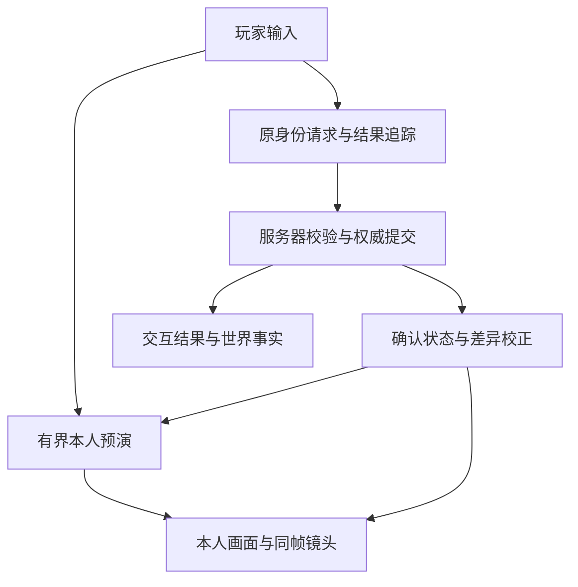

# GZ-RESP-01：角色操控与交互体验优化

> **状态：已建档的规划基线，尚未释放实现合同。** 本文为 v0.1 的 `repo-20261123-r2` 归档修订，保留原方案行为与 RESP-01～14，补齐版本化载体、Spec 层级、实际任务引用及 PR #90 合并后的承接基线。性能值均为建议验收目标；本 Spec 的业务实现、运行验收与 TLC 均 NOT_RUN。

- 日期：2026 年 11 月 23 日，北京时间。
- 设计来源：[原方案冻结快照](https://github.com/gbcdby/xiyou/issues/66#issuecomment-7086626641)，原 Markdown SHA-256 为 `d9438356c41045977e96ff8a6f87ee2e91bc306c400f97522f9dfc558bd43e08`。
- 代码调查基线：[main 3b9732f](https://github.com/gbcdby/xiyou/tree/3b9732f82d857f7ba718480c167f6b826fb6a42e)，历史测量不代表用户当前环境。
- Spec 汇总、Tickets 目录、**唯一活动依赖与产物释放记录**：[GZ-RESP-01 #99](https://github.com/gbcdby/xiyou/issues/99)。
- 上级客户端入口：[#66](https://github.com/gbcdby/xiyou/issues/66)；实际子票为 #91–#98，原编号和验收归属保持。
- 文档候选提交、PR 与后续采用修订在 Spec Issue 的版本区登记；本文存在不代表已合入 main 或 CONTRACT_READY 已释放。

建议采用「本人立即响应、结果由服务端确认、异常能够收住」的体验方案。玩家应能准确起步、转向、停在人物或门边；点击后知道角色准备做什么；网络短暂波动不留下持续落后的回放，恢复后不执行已经过时的操作。

本方案承接 [ADV-001](narrative-adventure.md) 的多人叙事探索目标，以及 [GZ-UX-01](gaolao-client-experience.md) 的全屏场景、自由取景和授权边界。记录分工为：本文保存行为、共同约束与整体验收；Spec Issue 保存本轮目录、依赖和产物释放；#66 保留客户端整体入口与其他既有工作。原评论与聊天文档保留为设计来源，不再维护第二套活动目录。

[#91](https://github.com/gbcdby/xiyou/issues/91) 继续负责公开运动参数、消费者接口、预演预算与旧验收迁移的具体合同冻结和独立审查。本次补档仅提供可读取的版本化草案，不将该任务记为完成，也不替代现有有效协议。

[PR #90](https://github.com/gbcdby/xiyou/pull/90) 的 late 空槽/满槽、输入观察器/window capture、normal stop 前缀及相关界面修复已合入 [main 260f501](https://github.com/gbcdby/xiyou/commit/260f50112a025ac851b6faaf7d05a25411af8e03)。该提交中的 GZ-UX-01 v0.10 / D66-MW r2 是本轮承接的既有验收合同；上面的 `3b9732f` 继续作为原方案调查快照，不冒称当前运行基线。后续修改共享 Spec、输入/网络、Map/会话页及浏览器测试前，核对包含该合并结果的实际 main 与文件归属，记录采用的 commit 和接口交接。此次归档保留既有 GZ-UX 合同和业务源码；#91 仍需完成旧新验收迁移、公共参数与接口冻结，PR #90 合并不释放本 Spec 的 CONTRACT_READY 或实现产物。

## 玩家体验目标

体验优先级依次为：**准确控制本人、操作过程连贯、持续画面稳定、异常时可理解且可恢复**。把移动速度调快、加点击特效或隐藏等待，都不能单独完成这四项。

一个完整试玩任务是：从院中起步，绕过桌子，在 NPC 身旁微调位置，选择交谈，取消下一次自动走近，改去门口，通过出口；中途加入一次网络抖动，再恢复。整个过程中，玩家只表达想做什么，不需要理解请求序号、收据和同步队列。

| 玩家想做的事 | 应感受到的结果 | 不可接受的失败 |
| --- | --- | --- |
| 按方向键起步 | 下一绘制帧开始响应，短按也能小幅挪动 | 先静止等确认，或短按固定走一大截 |
| 改向或反向 | 最新输入接管，松掉一轴后沿剩余方向移动 | 依次补演已经放弃的旧方向 |
| 松手停步 | 脚底锚点很快停住，能够准确站在门边 | 先滑行，或刚停又被拖着走 |
| 点地前往 | 马上看到目的点，再点就改目的地 | 点击无反馈，重复点击积压成路线队列 |
| 走近人物查看或交谈 | 一次明确选择后，走近与后续入口连贯 | 画面已到身边，却反复报距离不足 |
| 取消或改主意 | 新操作立即接管，旧意图不复活 | 网络恢复后突然执行旧路线或旧交互 |
| 连续玩十几分钟 | 帧率、响应与提示保持稳定 | 日志越多越卡，标签或背景频繁抖动 |

## 移动与交互行为

### 键盘移动与微调

保留方向键；可增加 WASD 作为同等入口，沿用相同焦点规则。输入框、输入法组合态、独占键盘的面板不接管移动键。输入采用按键状态集合，不依赖操作系统 repeat；斜向归一化，30、60、120Hz 不改变世界中的行走速度。

首次有效输入立即改变本人的展示朝向与运动，短按位移随实际按住时长变化。普通行走不增加明显的物理起步延迟或刹车惯性；起步、收脚的柔和感放在姿态上，不能让脚底锚点为了播完动画继续滑行。

新方向立即成为本机最新意图；尚未发送的旧同向续发可以合并。已经发出的请求保留原身份和结果追踪，不能从账本删除来假装腾出容量。松键、明确停止、失焦和切后台清空持键并触发停止；回到前台等待新输入，不恢复旧键状态。

### 地面点击与自动前往

有效点击成立后立即显示克制的落点标记，开始前往。目的点、暂定路线和已到达状态必须区分；暂定路线只使用当前授权地图计算，不画穿墙的直线来伪装可达。不可达时在目的点附近说明原因，保留玩家继续选点的能力。

同一时刻只保留一项自动前往意图。再次点地替换目的地；有效键盘方向或停止立即接管并取消旧导航及尚未提交的到达交互。手动拖动镜头只改变视角，不产生移动指令，也不暗中重新启用已取消路线。

### 人物与物件交互

保留「单击先选中」的已有语义，突出目标并提供清楚的主操作。首次单击人物不等于同意交谈内容、交付物品或改变剧情。

玩家明确选择「走近查看」或「走近交谈」后，保存一项绑定目标引用、场景、控制代次和操作种类的到达意图。远处显示「正在走近某人」；本机画面到近处但权威位置尚未满足时，维持「准备交谈」等等待状态。继续普通操作须同时满足：当前权威距离、视线或门禁及权限有效，目标引用与到达意图未失效，本人最终展示也在对应交互范围内，且展示与相应权威本人位置的误差已在约定容差内（初始建议 2 CSS px）。需要呈现资格的操作仍由实际可见帧确认；无需再等待旧历史回放队列清空，也不要求与 NPC 或物件中心坐标重合。

默认允许衔接的范围是走近、查看和打开交谈入口；服务器仍决定可展示的信息。交付、消耗、借出、归还、同意和关键剧情选择不藏在到达回调里自动执行，到达后展示当前对象和内容，由玩家明确提交。

目标同场景移动时，可在当前授权引用仍有效且动作未变化的情况下有界重算接近路线；必须设累计距离与时间预算，不能无限追逐。具体预算在最小试玩中校准。目标跨景、身份或权限变化、物品消失、门关闭时结束失效意图，说明实际原因；不偷偷换人、换物或换操作。

取消对尚未提交的意图立即生效。已提交而结果未知的世界操作保留原请求身份并查询结果；取消不能撤销已经完成的交付等事实。取消后不得由迟到回调提交新的后续操作。

### 场景切换与聊天反馈

公开场景资源可提前解码；走到出口后保持当前完整画面，给出「正在通过」的反馈。只有权威确认新场景才切换场景与坐标，清理旧预测和旧时间线。取消与跨景提交相撞时按实际确认结果显示，不自动穿回原场景。

交谈输入提交后可立即显示本地「正在发送」，服务器确认接收后变成已发送状态；NPC 的答复、同意或知识变化仍需真实结果。模型等待与人物移动分别处理，不能通过伪造 NPC 已听见、已答应或已经执行来营造响应。

## 本人预演与权威确认

### 分离三种状态

| 状态 | 所有者及用途 | 禁止用途 |
| --- | --- | --- |
| 权威状态 | 服务器事件与客户端已确认投影；判断真实位置、碰撞、操作距离、物品、许可与剧情 | 不能被本地预测写回 |
| 本人预演状态 | 根据本人的当前输入，在有限范围内先表现移动 | 不能据此宣布到达、拾取、跨景或 NPC 已感知 |
| 展示校正偏移 | 吸收小幅差异，生成本帧最终展示姿态 | 不能改变权限、续长预测预算或计作主动行走路程 |

本人、脚下标记、镜头跟随和本人点击命中共用本帧最终展示姿态。场景点击逆变换使用同一帧的镜头矩阵；交互是否可执行仍查权威状态。其他玩家和 NPC 继续消费各自获授权的确认轨迹，本轮不替他们预测尚未发生的选择。

图表示本方案拟议职责，不表示已实现。预测范围、旧回复资格与异常收束如下文约束。显示值与权威值分离可参考 [Unity 客户端预期表现说明](https://docs.unity3d.com/Packages/com.unity.netcode.gameobjects@2.7/manual/advanced-topics/client-anticipation.html)，但本项目不因此更换引擎或直接采用其协议。

### 先采用有界预演

第一版原型先使用现有方向与收据链，在显示侧增加有界预演，不把它称为完整确定性预测重放。只对具有当前控制权、当前场景授权几何、已知运动规则且连接可用的本人启用。运动参数需由可验证的公开 profile 或版本化公共配置提供；不能把含隐藏信息的完整关卡配置搬进客户端。

碰撞沿用前后端共同的几何与量化规则。当前实现主要检查脚底点和路线段；如要增加角色碰撞半径或贴墙滑动，必须同步变更两端规则并另行验收，不能只在客户端增加一种走法。[当前几何实现](https://github.com/gbcdby/xiyou/blob/3b9732f82d857f7ba718480c167f6b826fb6a42e/game/spatial-geometry.mjs)

建议原型从「最多约 150–200ms 未确认前进、最多约一个现有短段的未确认累计行程」开始比较。以上是实验预算，不是已释放的常量。预算约束未确认尾段的累计弧长和时间，不只约束离权威点的直线距离，避免原地绕圈无限预演。预算从尚未获得权威覆盖的运动开始计算；重复按键、绘制帧、旧回复或普通心跳不能无限续长。Receipt Accepted、命令高水位增长及没有对应位移的场景时钟增长，都不能单独补预算；只有当前身份下的实际执行轨迹与本地历史相匹配，才能确认对应前缀并释放相应预算。重复快照不能重复抵扣，迟到拒绝或停止只处理自己关联的意图代次，不误清更新的合法意图。

到达预算上限、遇到未经确认的动态边界或缺少公开几何时，收住位移并继续确认。画面到达 NPC 附近不增加交互距离，未确认的门状态不能用预测跨越。预测必须能失效，而不能靠不断扩大窗口保持表面顺滑。

### 校正避免回弹与穿墙

权威事件始终按原顺序进入权威投影；显示层可以不重新播放本人已经表达过的旧运动尾段。不得把「不补播画面」实现成丢弃世界事件、跳过授权校验或重写历史。

区分迟到的旧运动确认与真正的拒绝、停止、撤权或换景。旧回复只能收束自己的请求，不复活较新的输入之前的方向；真正否决和控制变化必须结束对应预测。新权威轨迹只确认此前显示历史中身份、命令及时间对应的前缀，保留尚未确认的尾段；折返时不能仅按相同坐标寻找进度。无法可靠匹配时收住并重建基线，不能猜一个已确认进度，也不能每包把人拉回过去的服务器位置。

建议按当前镜头换算后的 CSS 像素校准纠偏：约 0–2px 的残差直接或极短吸收；约 2–8px 且整条修正段合法时，在约 60–100ms 内单调收敛。较大失配、跨障碍、换景或撤权必须采用合法状态并清旧预测，不沿穿墙直线缓慢滑回。反复大纠偏触发降级和诊断，不持续加长缓动。

本人的主动位移驱动步态相位，网络校正距离不加入步频。松手先停止主体位移，收脚只改变原地姿态；转向不等待一整步播完。验收同时检查停步响应、之后的拖尾和校正幅度，避免把延迟换成明显回弹。

## 方向协议与服务端演进

### 当前协议的限制

现有 `move_direction` 是在服务端受理位置上重新生成最多 36 单位的路线；100ms 续发、两个方向槽和 400ms 未决截止共同约束调度。`movementCommandHighWater` 连领域拒绝也可能消费，Receipt 表示请求结果，不表示某段固定时长输入已经模拟完成。因此不能直接把它当成经典的 input ACK，删除序号以下输入再重放剩余方向包。[方向生成](https://github.com/gbcdby/xiyou/blob/3b9732f82d857f7ba718480c167f6b826fb6a42e/game/spatial-direction.mjs) · [命令处理及拒绝水位](https://github.com/gbcdby/xiyou/blob/3b9732f82d857f7ba718480c167f6b826fb6a42e/backend/spatial-runtime.mjs#L148)

| 方案 | 价值 | 代价与适用结论 |
| --- | --- | --- |
| 仅缩短 tick 或提高发送频率 | 可能减少部分等候 | 本人仍等确认，事务负载可能上升，不能作为完整解决方案 |
| 有界本机预演与权威校正 | 能快速验证起步和改向的改善，改动范围较小 | 原短段和确认调度可能继续造成停顿或停步回弹，必须通过整体手感门槛 |
| 持续方向意图与明确执行进度 | 减少短路线续段断供，给预测与停止提供更清楚的语义 | 涉及协议、恢复、记录和形式化验证；由最小切片的实测结果决定何时进入 |

推荐先做第二项的完整操作切片。如果它无法同时满足响应、停止精度和校正预算，则第三项成为交付前必要工作，不能只把响应指标写成通过。

### 持续意图候选需要的合同

服务器按受理的最新方向持续推进，客户端在方向变化和停止时立即表达，持键期间发送有限频率的续期；运动有服务端控制的最大有效期，长时间收不到有效续期即停止。期限不由客户端任意指定，服务器暂停或重启后不能用大 dt 补走过期路程。同一原请求重试不重新延长有效期；到期即关闭本次意图，迟到续期不能复活，继续行走需要新的明确 start 意图。到期任务核对意图及续期版本，旧到期任务不能误停新版意图。如果检查点被锁阻塞到截止之后才执行，位移只积分到截止点，再记录停止，不先按全部延迟时间走完。

已发请求保持原身份和幂等结果；尚未发送的旧方向可以合并。停止有独立调度机会和更高序号围栏，之后到达的旧移动或续期不能重新开走。第一版仍等待未决 stop 收束后再受理新的远端方向，期间本地仅在同一未确认预算内暂存或预演；如果该限制阻碍目标体验，须在持续意图修订中明确新方向如何有序越过旧 stop，不能删除旧 stop 的结果追踪来绕过。任意网络延迟下不能保证服务器在玩家松键后几十毫秒内获知停止，需同时验收到期后的实际位移边界。

最少区分四项语义：收到或受理了哪条意图、哪条意图实际影响了当前运动、权威状态推进到哪个场景时间、该样本对应哪个控制代次与场景版本。收据状态与执行覆盖分别给出，拒绝序号不能冒充已执行运动。客户端时间只提供受约束的测量和输入时序信息，不能单方面决定可走的距离。

要采用完整预测重放，还需定义共同积分规则、有效输入时段和权威样本覆盖的输入截面，并验证数值一致性；持续方向本身不自动具备这些条件。到这一步前，有界预演仍应如实命名和验收。

### 暂时保留数据库架构

保留 PostgreSQL 的权威事件、状态原子性和既有 Room 处理结构。先量化请求到达、锁等待、规则执行、持久化、广播供给等耗时；AI 推理等待不放进移动事务，已确认历史也不为了缩短回放而删除。[事务入口](https://github.com/gbcdby/xiyou/blob/3b9732f82d857f7ba718480c167f6b826fb6a42e/backend/runtime.mjs#L175)

只有证据显示锁等待或持久化主导延迟，才评估减少重复工作、同房间调度或更明确的运动状态记录方式。不要先引入 Redis 权威世界、微服务、UDP 或更换渲染引擎；这些都不是本次体验目标的必要前提。

## 镜头与持续画面

正常跟随使用本人本帧最终展示位置，不再叠加持续追赶的慢滤波器。自由拖动后保持玩家取景，点「回到角色」才恢复跟随。人物、命中区域和点地逆变换共用同一帧矩阵。

微调时整幅背景频繁移动可能不舒适。镜头死区可作为单独 A/B 变量，在基本响应稳定后比较；不与预测同时默认上线，不把已采用的全程居中跟随悄悄替换。减少动态偏好保留明确效果，不能把关闭插值等同于关闭本人响应。

渲染优化按 profile 排序。已发现的静态风险是镜头平移时屏幕缓存失效、标签布局键包含 fit、高 DPR 像素成本，以及每次状态发布重复序列化动作账本。[Canvas 热路径](https://github.com/gbcdby/xiyou/blob/3b9732f82d857f7ba718480c167f6b826fb6a42e/frontend/src/rendering/spatial-canvas.ts) · [动作账本存储](https://github.com/gbcdby/xiyou/blob/3b9732f82d857f7ba718480c167f6b826fb6a42e/frontend/src/state/spatial-store.ts)

优化次序建议如下：复用不依赖屏幕偏移的静态背景与物件资源；纯镜头平移时复用标签相对布局，仅在可见集合、文字、视口或实际冲突变化时重算；当前场景方向帧提前解码；给 Canvas 建立像素预算，必要时先降背景采样密度而保持文字和交互清晰；减少无变化时的序列化和逐帧分配。

未决请求的可靠保存必须保留，不能把唯一恢复账本挪到不保证执行的空闲回调。性能记录用有界缓冲；高频绘制不逐帧写日志。只有 profile 证明需要，才再考虑 Worker 或 OffscreenCanvas。

## 触摸与网络恢复

移动端先沿用点地前往和单指拖动视角，不同时增加一套虚拟摇杆。按下可以有轻微本地触点反馈，但移动要等 pointerup 确认为点击；拖动跨过阈值后，本轮结束不能再变回点地。多指、pointercancel、丢失捕获和失焦都取消本轮手势。现有 8 CSS px 阈值是基线，触摸舒适性要用真机验证。[现有手势实现](https://github.com/gbcdby/xiyou/blob/3b9732f82d857f7ba718480c167f6b826fb6a42e/frontend/src/domain/spatial-camera-gesture.ts)

| 网络或控制状态 | 玩家反馈 | 系统行为 |
| --- | --- | --- |
| 短抖动且仍在有效预演预算内 | 正常操作 | 吸收短波动，不逐包提示 |
| 持续偏慢但仍有有效确认 | 小型「网络较慢」状态 | 观察迟滞约 0.5–1 秒再显示，避免闪烁；不据此宣布断线 |
| 到达预测预算或现有未知截止 | 「连接不稳定，正在同步」 | 收住运动，自动核对原请求并同步；预算到达即收住，不等提示计时 |
| 明确断线、撤权或换景 | 显示对应真实状态 | 清旧预测、持键、导航和未提交的交互 |
| 恢复后获得有效权威基线 | 取消持续告警，保留必要结果说明 | 保持停住，等待新的明确输入；已提交结果按原身份收束 |

UI 的提示计时不覆盖现有 400ms 请求截止。自动恢复是查询原结果、恢复合法控制与订阅，不是重复执行动作；用户无需先理解「查询原串」才能继续，详细诊断入口仍可保留。

## 验收目标与测量方法

### 体验指标

下面是 60Hz 主档、资源已就绪、前台可见条件下的初始项目目标。普通网络测试档设为 RTT 40ms，以及 RTT 100ms 加约 20ms 抖动；复杂档设为 RTT 200ms 加约 50ms 抖动。注入方式、上下行分配和抖动分布须在报告中固定。指标按设备、网络档和人数分别报告，不合并平均稀释失败。

| 验收 ID | 指标和起止 | 初始目标 |
| --- | --- | --- |
| RESP-01 | 有效按下到包含该输入的首次正确方向非零脚底位移 | 桌面 p95 ≤50ms，移动端 p95 ≤80ms |
| RESP-02 | 改向到首次沿新方向的位移，只改 facing 不算 | 同 RESP-01 |
| RESP-03 | 松键到首次停止，以及对应 stop 权威前缀应用、校正完成并再稳定 200ms；记录整个区间的最大偏移与累计校正路程 | 即时停止桌面 p95 ≤50ms、移动端 p95 ≤80ms；普通档首次停住后最大额外偏移 ≤4 CSS px、累计校正路程 ≤8px，最终停止位置在松键后 500ms 内形成，再观察 200ms；超时或旧方向复活失败 |
| RESP-04 | 有效点击成立到落点或选中反馈 | p95 ≤50ms；与真实到达及结果耗时分别统计 |
| RESP-05 | 开阔可通行区持续输入时，连续 ≥50ms 且等效位移不足 0.5 CSS px 的非预期停顿 | 普通档停顿时间占比 <0.5%；无 >100ms 停顿 |
| RESP-06 | 原始修正向量、最大展示偏移、累计修正路程、方向反转次数和收敛时间 | 普通档开阔区初始目标校正幅度 p95 ≤4 CSS px；单次 >16px 失败，>8px 最多一次/5分钟；无穿墙校正与反复往返；合法换景和撤权重定位另组保留 |
| RESP-07 | 活跃移动的新帧间隔与游戏模拟加绘制 CPU | 桌面间隔 p95 ≤20ms、CPU p95 ≤6ms；移动端间隔 p95 ≤22ms、CPU p95 ≤8ms |
| RESP-08 | 活跃移动期间超过 50ms 的帧间隔 | 桌面占比 <0.5%，移动端 <1%；游戏自身不产生 >100ms 长任务 |
| RESP-09 | 20/50/100/200ms 短按，多键组合与反向；同时记录预演位移和最终权威位移；30/60/120Hz 同时长输入 | 同条件下最终位移随输入时长变化，刷新率不造成移动加速；无固定整段强制前进；短暂预演后完全回到原地不能算短按成功 |
| RESP-10 | 走近交互、取消、目标消失和旧回复 | 正确对象执行一次；取消后零新增后续操作；未确认结果不显示成功 |
| RESP-11 | 断流、恢复、失焦、撤权和后台返回 | 有界停止、原结果不重复、无旧持键或旧导航复活 |
| RESP-12 | 注入一段 200ms 无新供给后恢复，再给予一次明确新输入 | 恢复有效供给后 500ms 内建立可用权威基线、收束或隔离旧输入并可接收新输入；保持停住不续跑，新输入重新满足该档响应门槛；旧 Unknown 未收束则记未达标，不以 online 代替恢复 |
| RESP-13 | 30 分钟会话前后各 5 分钟分组测量 | 响应与帧时间 p95 恶化不超过 20%；未决请求、待播放队列、活动输入历史及客户端诊断缓冲不无界积压；权威事件历史完整保留 |
| RESP-14 | 完整真人任务与同条件前后对照 | 所有人能完成；记录过头重走、重复点按、取消失败与舒适评价，检查无明显回弹或镜头晃动 |

墙、门关闭、路径终点和明确失控等合法停止单独分组，不能混进开阔连续行走指标，也不能把真实超时和无响应样本删除。30Hz 低功耗模式另建预算；120Hz 未测时不声称已通过。

### 测量不能掩盖等待

起点使用真实事件时间，在生产处理前记录；终点关联到包含该输入影响的最终绘制姿态。不能从已经转向后的第一帧重新开始计时。保留 p50、p95、p99、最大值、失败与超时数。

Canvas paint 返回或 rAF 回调完成只能作为「输入到渲染提交」的代理，不等于物理屏幕已呈现。真机录屏和少量高帧率外部录像抽样复核实际起停、回弹和镜头稳定；rAF 与设备刷新率、后台节流的关系按 [MDN](https://developer.mozilla.org/en-US/docs/Web/API/Window/requestAnimationFrame) 解释。

浏览器内部使用同一单调时钟；服务器分别记录锁等待与提交等耗时。用动作身份关联两端，不能直接相减浏览器 performance.now 与服务器 Date.now。位移取世界中的最终展示位置再按 fit 换算，不能把跟随镜头下人物屏幕坐标不变误判为停顿。

INP 可辅助观察页面响应，但它不衡量整条异步世界操作完成时间，也不能代替持续运动帧与校正指标；参见 [web.dev INP](https://web.dev/articles/inp) 与 [长任务说明](https://web.dev/articles/optimize-long-tasks)。完整事件仍按授权与顺序应用；只是当前本人显示不再被迫回放每段历史。

### 设备与负载

最小覆盖用户实际桌面浏览器、DPR 2 的集显笔记本、中档 Android、iPhone Safari；包含横竖屏、resize、资源首次进入和暖缓存。关键组合至少 100 次起停或改向、5 分钟持续移动，再做一组 30 分钟五人会话。低负载组是一名被测运动者、至少两名有效在线人工角色维持房间正常运行；对照五人同时走动、交互、NPC 活动及日志增长。真正单人房的暂停行为另测，不能混入响应基线。

网络实验必须实际影响 WebSocket；稳定 RTT、抖动、断流、传输层丢包与应用层丢消息分别标注。五人负载中被测端保持前台可见，不把后台标签页的浏览器节流当成玩家手感；另做真实多设备抽样。

真人对照至少让若干未参与实现的人完成同一段任务，交替版本顺序，记录任务完成时间、过头次数、重复点击、误操作、取消是否成功和主观跟手度。样本小只作为发现问题的试玩，不冒充统计证明。

## 实施顺序与释放条件

| 阶段 | 交付内容 | 继续推进的条件 |
| --- | --- | --- |
| 1 建立同条件基线 | 输入到显示链路观测、现版录像、设备及网络配置、起停与停顿数据 | 能区分网络、服务端等待、历史回放与绘制成本；记录失败样本 |
| 2 本人操作最小切片 | 单场景内起步、短按、转向、停步、贴墙、同帧镜头、有界校正；包含满足本阶段预算所需的渲染与序列化修复 | 达到 RESP-01/02/03/06/09/11 后进入交互集成；若分段证据指向原方向协议限制，则转入持续意图设计与切片，再回测同一门槛；不要求失败方案先通过，也不释放只提前动但明显回弹的版本 |
| 3 连续移动与交互衔接 | 用通过操作门槛的方向方案完成点地替换、走近交互、取消、出口和恢复 | 连续行走无断供与展示积压，交互正确且可取消；协议若变化完成对应模型及回归 |
| 4 渲染与真实体验收口 | 按 profile 修热路径、DPR 策略、资源就绪、五人长时与真机对照 | 帧指标、完整任务、真人观察和独立审查共同通过 |

阶段 1 的观测与不依赖协议的资源、渲染调查可并行；本人显示、输入调度和到达交互的共享接口需要先冻结，不能各自实现一套位置或取消语义。上表说明方案的交付阶段；实际 Tickets #91–#98 已建立，目录、依赖和状态以 [Spec 汇总 #99](https://github.com/gbcdby/xiyou/issues/99) 为准。本文不复制活动任务清单，也不承诺未经估算的工期。

功能通过协商能力及特性开关启用，保留旧客户端路径。回退先停止并确认旧运动、清本机预测与到达意图，再在可靠快照上切换；不在持键中直接更换控制器。混合版本、重连和旧快照继续走严格 schema 与授权规则。

## 现有合同需要怎样调整

| 现有约定 | 拟议变化 | 必须继续保留 |
| --- | --- | --- |
| 本人完整确认历史按原段时长播放 | 本人的实时表现允许预演和有界校正，不必重播旧运动尾 | 权威事件完整有序、秘密与身份边界；其他角色轨迹合同本轮保留 |
| 画面播放到达后才能继续交互 | 按上文统一条件检查权威范围、目标身份、展示范围与校正容差，旧回放队列不再单独增加等待 | 不能用预测位置满足距离、权限或到达；依赖呈现的动作仍须真实可见帧证明 |
| 两方向槽、短路线与 stop 等待 | 原型先保留；持续意图阶段明确替换调度及执行覆盖语义 | 已发身份、幂等结果、过时围栏、独立停止与有界断连 |
| 转向测量窗从已应用方向起算 | 增加从输入起算的端到端响应与最终稳定指标 | 权威速度与碰撞、事件顺序、恢复及画面完整性门槛；本人显示速度与时长按下文迁移 |
| 正常相机跟随本人已确认插值位置 | 第一版改为跟随本人本帧最终展示姿态；死区作为单独试验 | 自由取景、回中、正确命中与边界内画面 |

原权威速度、碰撞、事件顺序与其他角色连续轨迹检查保留；本人旧显示时长、逐段原速及零补偿加速断言，逐项映射替换为预演预算、主动运动速度、校正幅度与次数、最终收敛检查，不笼统保留互相矛盾的断言。`MotionPresentation` 与视觉到达守卫需要同步调整：只有匹配的权威到达、展示处于约定容差且本人的有效可见帧才构成到达证明；预测站定不能产生权威到达或抵扣已确认历史的呈现信用。本人仍在自由视角画外时，保留明确的回到角色入口，不能用未显示的帧伪造呈现资格。

若进入协议变更，最小 TLA+ 范围应覆盖：较新停止后旧移动或续期不能复活；控制代次变化后旧命令无效；重复请求不重复世界效果；未知结果不被当作拒绝或成功；运动有效期届满且服务调度恢复后停止；取消后迟到确认不能产生新的后续交互。每项需要对应负对照与实现映射。形式化结果不替代几何、帧性能或真人体验，当前模型检查状态为 NOT_RUN。

实现前还需测清：用户实际部署版本和网络、公开运动参数的最小契约、有界预演在原短段协议上的校正频率、目标移动时的接近预算，以及高 DPR 绘制的实际耗时。它们决定参数或是否升级协议，不改变「立即反馈、权威结果、可取消、可恢复」的体验目标。

## 设计依据与证据边界

现版最直接的问题依据是 [ConfirmedMotion 的队列与锚点](https://github.com/gbcdby/xiyou/blob/3b9732f82d857f7ba718480c167f6b826fb6a42e/frontend/src/domain/spatial-motion.ts#L83)、[方向控制器](https://github.com/gbcdby/xiyou/blob/3b9732f82d857f7ba718480c167f6b826fb6a42e/frontend/src/domain/direction-intent.ts) 和 [当前方向验收](https://github.com/gbcdby/xiyou/blob/3b9732f82d857f7ba718480c167f6b826fb6a42e/frontend/tests/client-experience-browser.mjs#L101)。历史文档记录了 2026 年 11 月 20 日候选在负载下按键到新方向显示为 100–350ms；这是历史环境的观察，不是用户当前试玩延迟。[历史记录](https://github.com/gbcdby/xiyou/blob/3b9732f82d857f7ba718480c167f6b826fb6a42e/docs/specs/gaolao-client-experience.md#L166)

本次前置调查直接调用现版移动类的受控实验，也重现了迟到后停顿及持续播放落后；该实验不包含用户公网、数据库和真机性能。上述新方案尚未改动业务代码，未部署，验收表均为设计目标。实际任务由 [Spec 汇总 #99](https://github.com/gbcdby/xiyou/issues/99) 维护目录；[#91](https://github.com/gbcdby/xiyou/issues/91) 继续完成公共参数、接口及旧验收迁移的合同冻结。此次归档不释放 CONTRACT_READY，也不表示业务实施、合并或部署。

