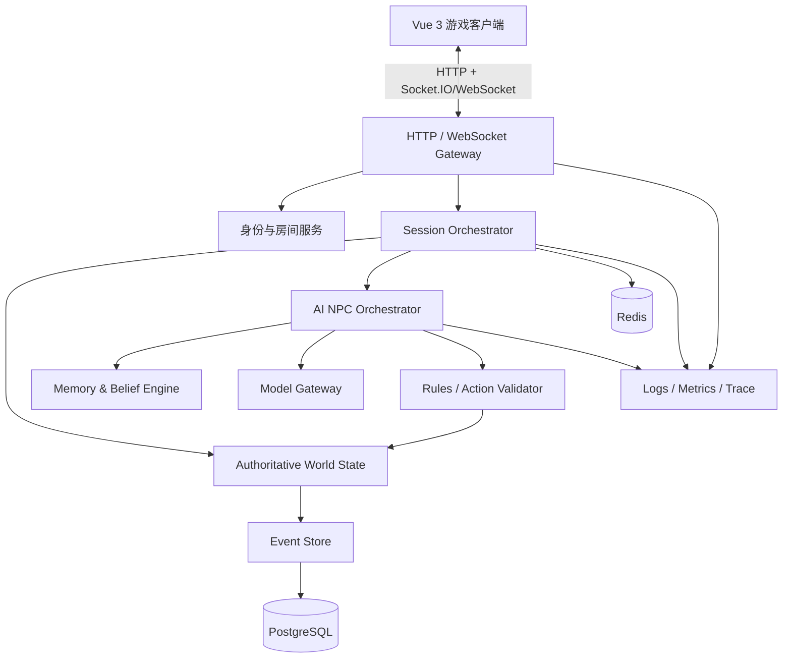
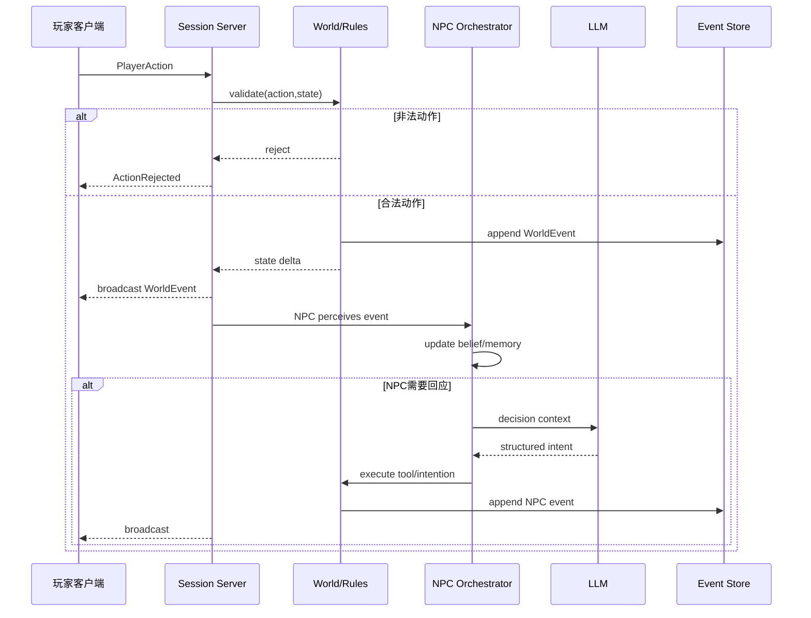
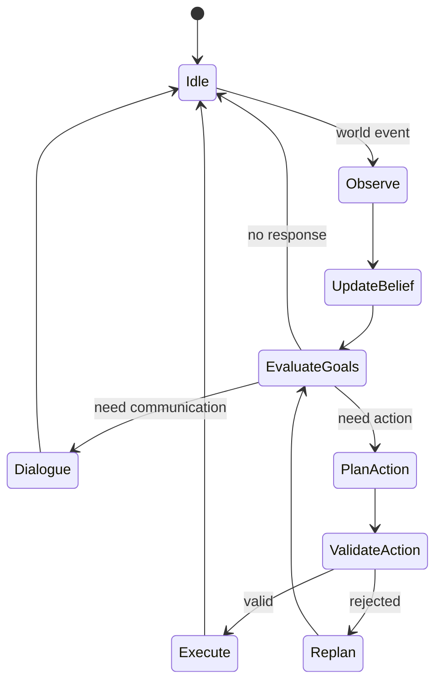

# 《西游记》多人 AI 协作游戏：初步产品与技术架构设计

## 执行摘要

本方案面向一个**多人实时、AI 驱动、关卡制的合作叙事游戏**：唐僧与孙悟空作为跨关卡持续存在的核心 AI NPC，每局最多 5 名人类玩家进入同一关卡；首期规划 6 个可选择关卡，每关约 15–30 分钟。关卡不以复述原著剧情为目标，而是从经典“取经受阻—人物分歧—协作解决—继续前行”的结构中提炼六类玩法机制：**纠纷化解、信任与证据、多人协同、承诺与选择、身份验证、谈判与执行**。

技术上建议采用**服务端权威世界状态 + 事件驱动 AI NPC + WebSocket 实时通信**。前端采用 Vue 3；Vue 官方推荐在构建型项目中使用 Single-File Components，并提供响应式和组件化模型，适合把世界视图、聊天、任务信息、角色状态拆为独立模块。citeturn722568search1turn141969search35 后端语言不锁定，第一阶段应优先优化开发效率与可验证性，而不是过早绑定某种语言或微服务体系。

实时同步建议首版以 **Socket.IO/WebSocket + 服务端顺序事件流** 为主。Socket.IO 原生提供房间广播、多服务器 Adapter 与临时断线恢复能力，较适合一局对应一个 room 的结构。citeturn722568search2turn141969search11turn141969search0 CRDT 不建议承担角色位置、道具归属、关卡状态等权威游戏数据；Yjs 一类 CRDT 更适合多人同时编辑、共享笔记或白板等“允许并发合并”的子系统，因为其共享数据类型本身支持并发自动合并。citeturn722568search3

AI 层不应让大模型直接“控制游戏世界”。推荐采用：

**感知 → 信念更新 → 目标选择 → LLM 决策 → 工具调用 → 服务端校验 → 世界事件落盘**

大模型负责“想说什么、想尝试什么”，确定性游戏服务负责“能不能发生、发生以后世界变成什么”。这也是后续 TLA+/TLC 验证能够发挥价值的前提。

比赛合规方面，目前 ModelScope 官方活动页能够确认：第三期主题为 **“AI 造游戏”**，要求创作原创游戏并发布到魔搭创空间供用户直接体验；官方活动列表当前显示报名截止为 **2026 年 12 月 1 日 10:00**。citeturn698846view0 官方可抓取页面没有完整展示详细评审条款，因此本文不会把第三方整理的评分、指定发布渠道或加分项写成已确认规则；提交前应以登录后的官方赛事页重新核对。

核心架构原则可以概括成一句：

> **LLM 决定角色意图，状态机约束角色人格与目标，规则引擎决定世界事实，事件日志决定过去发生过什么。**

这样才能既保留 AI 的“活”，又避免多人游戏变成几个模型互相编故事。

## 游戏设计与六类关卡模板

### 核心循环

每关采用以下统一循环：

```text
进入关卡
  ↓
获得本关身份、权限、局部信息
  ↓
接触唐僧 / 孙悟空 / 队友 / 场景
  ↓
发现阻碍与人物分歧
  ↓
玩家分别行动、交涉、调查、传递信息
  ↓
AI NPC 根据实际获知的信息重新判断
  ↓
世界状态改变
  ↓
出现新机会 / 新问题
  ↓
达成继续前行条件或进入失败/代价结局
  ↓
结算 → 更新唐僧/悟空跨关状态
```

重点是**不存在固定“正确对白”**。

玩家说服唐僧，不代表世界事实随之改变；玩家告诉孙悟空某人危险，也不意味着孙悟空自动相信。信息必须来自具体来源，物件必须实际被移动，承诺必须被记录，NPC 必须经历“知道—相信—决定—行动”的过程。

### 玩家角色原则

每关最多五名玩家，身份均来自该关卡环境中的配角体系，但身份不应等价于职业按钮。

一个玩家身份最少定义五组信息：

| 字段 | 含义 |
|---|---|
| `relationship` | 与唐僧、悟空、本地人物的初始关系 |
| `knowledge` | 开局真实知道的事实 |
| `beliefs` | 角色自己的推测，可错误 |
| `capabilities` | 能操作哪些场景、物件、流程 |
| `motivation` | 为什么愿意协助师徒，以及自己的利益 |

例如，同一关中可以同时存在“知道部分事实但没有权力”的角色，以及“有执行权限但不知道真相”的角色。合作由**信息与行动能力的不对称**自然产生，而不是系统硬塞“玩家 A 必须等玩家 B 按按钮”。

八戒、沙僧第一阶段不建议固定为常驻 AI 或永久玩家位。更稳妥的是把他们作为**按关卡启用的角色槽**：某些关卡可以由玩家扮演；无人选择时，由受规则约束的代理逻辑或简化 AI 接管。这样不会让两个角色永久吃掉五人容量，也不会为了维持阵容而强行让每关都围绕四师徒设计。

### 唐僧与孙悟空的长期结构

唐僧与悟空承担跨关连续性。

两人的状态不是简单的“好感度”，而是少量可解释变量：

```text
唐僧
- 对悟空判断的基础信任
- 对玩家群体建议的开放程度
- 对承诺/程序/证据的偏好
- 若干已发生的重要共同经历

孙悟空
- 对师父自主判断的尊重程度
- 遇险时先行动还是先解释的倾向
- 对陌生人证言的接受阈值
- 若干已发生的重要共同经历
```

这些变量只影响**决策权重**，不能直接覆盖人格。

例如经历数关之后，唐僧可以更愿意先听悟空说明，但不能因为“信任 +20”突然放弃自己的价值判断。

### 六关玩法模板

这里刻意只保留**机制模板**，不写任何具体神话事件、具体反派或原著解法，防止后续关卡创作被预先答案污染。

| 关卡类型 | 主要问题 | 玩家核心行为 | AI NPC 重点 | 验收问题 |
|---|---|---|---|---|
| **纠纷化解** | 已产生损失，各方对责任理解不同 | 调查、补偿、修复、协调 | 是否承认责任、是否接受解决方案 | 不靠战斗能否形成多种合理结局 |
| **信任与证据** | 两位核心 NPC 对同一危险判断相反 | 找证据、验证来源、观察行为 | 相信谁、何时行动、证据阈值 | 是否避免“玩家一句话直接改信念” |
| **多人协同** | 多项工作需要同时推进 | 分工、交换物品、协调时间 | AI 会临时改变计划 | 五名玩家是否都有真实贡献空间 |
| **承诺与选择** | 某个选择与既有承诺冲突 | 协商、兑现、重新谈条件 | AI 自己做价值判断 | NPC 是否拥有拒绝玩家的能力 |
| **身份验证** | 外观/说法不足以证明身份 | 比对证据、行为、关系记忆 | 怀疑、验证、暂缓判断 | 是否杜绝“一问暗号立即通关” |
| **谈判与执行** | 即使达成协议，也必须实际完成 | 议价、交换、取得资源、执行 | 条件变化后是否重新谈判 | 是否区分“答应了”和“做到了” |

这六套模板可以对应六个最终关卡，但**关卡故事设计与机制实现应拆开**。工程团队先实现六种交互能力，叙事团队后续再选择最合适的原著篇章承载它们。

### 玩家—NPC 交互范式

不涉及任何具体剧情，可以先验证四种最基础行为。

**信息提供**

玩家告诉唐僧：

> “我刚刚在另一处看见过这个人。”

系统记录的不是“唐僧得知真相”，而是：

```text
Source = Player3
Claim = "Player3 saw PersonX at LocationB"
Evidence = testimony
NPCReceived = true
```

唐僧再结合对 Player3 的信任、其他证据、当前风险判断是否相信。

**请求行为**

玩家对悟空：

> “先别动手，我去确认一下。”

模型可以产生：

```json
{
  "intent": "delay_action",
  "duration": 30,
  "reason": "allow_player_verification"
}
```

世界引擎判断悟空当前是否愿意执行，而不是让语言模型自己宣布“悟空等待了三十秒”。

**现实操作**

玩家：

> “我把物件交给另一个玩家。”

只有所有权服务成功执行：

```text
Transfer(owner=A, target=B, item=X)
```

物品才真正发生转移。

**承诺**

NPC：

> “我等你回来再决定。”

系统可以登记：

```text
Promise {
  promisor: NPC
  condition: PlayerReturn
  expireAt: ...
}
```

以后 NPC 是否违背承诺，就有明确事实基础。

## 玩家进程与单局流程

### 单关时间结构

单关建议以 **15–30 分钟**为设计区间，不写死为 30 分钟。

推荐初始节奏：

| 时间 | 阶段 | 目的 |
|---:|---|---|
| 0–3 min | 入场 | 获得身份、环境与当前问题 |
| 3–8 min | 探索 | 找人、调查、形成初步判断 |
| 8–18 min | 扩展 | 玩家和 AI 行动互相产生新后果 |
| 18–25 min | 收束 | 尝试执行最终方案 |
| 25–30 min | 缓冲/终局 | 超时处理、结局、复盘 |

能够合理提前解决就提前结束，禁止为了达到时长人为制造第二个事故。

### 角色轮换

一名账号在六关里不是同一个“故事人物”。

因此必须区分：

```text
UserId      = 真人账号
CharacterId = 本关角色
SessionId   = 本局实例
```

唐僧和悟空**不能因为认识 UserId，就认为认识下一关的新 CharacterId**。

跨关只能持久化：

- 唐僧状态；
- 悟空状态；
- 两人之间的重要共同经历；
- 已明确影响后续世界的全局结果。

不能持久化：

- 玩家上一关本地角色的私人关系；
- 本关没有传播出去的秘密；
- 道具位置；
- 临时承诺；
- NPC 未实际感知的信息。

### 掉线与角色托管

角色断线后不删除。

状态转换建议：

```text
HumanControlled
      ↓ timeout
GracePeriod
      ↓
AIProxyControlled
      ↓ reconnect
HumanControlled
```

托管 AI 应继承该角色**已经知道的内容、当前位置、持有物品、当前承诺**，但权限受到限制。

禁止托管 AI：

- 擅自作出重大不可逆选择；
- 泄露玩家私人频道；
- 消耗稀缺关键物品，除非这是维持游戏必需行为；
- 改写玩家角色背景。

## 技术架构

Vue 3 官方提供组件化、响应式 UI 模型，Vue Router 是官方客户端路由方案，因此前端建议采用 Vue 3 + TypeScript + Vue Router，状态层可使用 Pinia 或等价轻量 store。citeturn722568search1turn141969search35

### 总体结构



### 前端目录

```text
src/
  app/
    router/
    stores/

  features/
    lobby/
    session/
    character/
    dialogue/
    world/
    inventory/
    objective/
    recap/

  components/
    GameViewport.vue
    DialoguePanel.vue
    CharacterCard.vue
    InventoryPanel.vue
    TeamPanel.vue

  realtime/
    socket.ts
    event-buffer.ts
    reconnect.ts

  domain/
    world.ts
    character.ts
    event.ts
    action.ts
```

客户端**不维护权威世界状态**。

客户端只做：

```text
authoritative snapshot
        +
confirmed events
        +
local optimistic UI
```

例如玩家拖动普通 UI 元素可以立即响应；但“拿走关键物件”必须等待服务器 `ActionAccepted`。

### 实时同步选型

Socket.IO 支持 room 广播，并可通过 Redis Adapter 将广播扩展到多个 Socket.IO Server；同时其文档明确指出临时断线无法被彻底消除，应用仍需处理恢复与事件补发。citeturn722568search2turn141969search31turn141969search0

| 技术 | 适用位置 | 推荐 |
|---|---|---|
| Native WebSocket | 极简协议、高控制度 | 可用 |
| **Socket.IO** | 房间、重连、事件确认 | **MVP 推荐** |
| CRDT / Yjs | 多人共同编辑文本/白板 | 可选局部使用 |
| OT | 文本协作 | 当前无需 |
| HTTP | 登录、房间列表、历史查询 | 推荐 |

Yjs 的共享数据允许并发更新自动合并，因此若未来有“五位玩家共同写路线图、共同绘制地图”的功能，可以局部使用；它不适合作为关键道具唯一所有权这一类需要确定性仲裁的主状态。citeturn722568search3

### 后端逻辑部署

首版建议采用**逻辑服务分层、物理部署从简**。

不要第一天就拆十几个微服务。

可以只有：

```text
game-api
ai-worker
postgres
redis
```

代码内部按模块隔离。

后续高并发时再拆分：

```text
Gateway
Session Service
World Service
AI Orchestrator
Model Gateway
Memory Service
Event Processor
```

### 数据层

推荐：

**PostgreSQL：最终持久状态与事件索引。**

PostgreSQL 官方文档说明 `jsonb` 支持结构化 JSON 存储及索引，因此很适合存储既有稳定字段、又包含关卡扩展字段的角色状态与事件 payload。citeturn722568search4

**Redis：短生命周期实时数据。**

用途：

- session presence；
- websocket fan-out；
- 短期锁；
- 推理任务队列；
- 热状态缓存。

Redis Streams 是追加式流，并原生提供消费者组等消费机制，可选用于 AI 决策任务和异步事件处理。citeturn722568search5

不建议把完整世界事实只存 Redis。

### AI 服务

推荐增加一个 `Model Gateway`，业务代码不直接绑定某一个模型 API：

```text
NPC Orchestrator
       |
       v
Model Gateway
    |       |
Provider A Provider B
```

阿里云百炼当前提供 OpenAI 兼容 API 与 DashScope 接口，因此适配层可以用统一的模型请求接口封装供应商差异。citeturn141969search18turn141969search32

接口可以定义为：

```typescript
interface ModelGateway {
  decide(req: NPCDecisionRequest): Promise<NPCDecision>;
  speak(req: NPCDialogueRequest): Promise<NPCDialogue>;
}
```

这样后续可无痛测试不同模型的：

- 延迟；
- 成本；
- 中文角色一致性；
- tool calling 稳定性。

### 一次玩家行为的完整时序



关键要求：

**LLM 输出永远不能直接成为 WorldEvent。**

它只能成为：

```text
ProposedIntent
```

规则服务验证后才能转为：

```text
AcceptedAction → WorldEvent
```

## AI NPC 架构

### NPC 状态模型

每个核心 AI：

```text
NPCState
├── Identity
├── Personality
├── Values
├── Goals
├── CurrentPlan
├── Beliefs
├── Relationships
├── EpisodicMemory
├── Commitments
├── CurrentPerception
└── EmotionalState
```

其中最重要的是区分：

```text
WORLD FACT
NPC BELIEF
NPC CLAIM
```

三者绝不能混在一起。

例如：

```json
{
  "worldFact": {
    "itemOwner": "player_2"
  },

  "npcBelief": {
    "itemOwner": "player_1",
    "confidence": 0.7
  }
}
```

NPC 可以相信错误事实。

**世界不能因为 NPC 相信它而改变。**

### AI 决策状态机



### 记忆层次

建议四层。

| 层级 | 内容 | 生命周期 |
|---|---|---|
| Working Memory | 最近对话、当前位置 | 秒/分钟 |
| Episode Memory | 本关重要事件 | 本局 |
| Relationship Memory | 谁做过什么重要事情 | 当前核心 NPC 跨关 |
| Canonical Memory | 不可改变的人设和基础事实 | 永久 |

长对话不要全部重新送给模型。

建议：

```text
最近原始事件
+
结构化信念
+
相关记忆召回
+
当前世界快照
```

组成推理上下文。

### 感知

NPC 不订阅完整事件流，而订阅**它有资格感知的事件**。

事件可带：

```json
{
  "visibility": {
    "mode": "local",
    "area": "courtyard",
    "audibleRadius": 8
  }
}
```

感知服务计算：

```text
WorldEvent
 ↓
PerceptionFilter
 ↓
NPCObservation
```

这样才能实现真正的秘密。

### 对话策略

LLM 每次输出推荐采用结构化结果：

```json
{
  "speech": "……",
  "intent": "ask_for_evidence",
  "target": "player_3",
  "beliefUpdates": [],
  "proposedActions": [],
  "emotionDelta": {
    "concern": 0.1
  }
}
```

但 `beliefUpdates` 不能直接写数据库。

应由 deterministic policy 检查：

```text
是否存在对应 Observation？
是否符合角色知识范围？
是否错误引用未来剧情？
```

### 可解释性

每次重大 NPC 决策保存：

```json
{
  "decisionId": "...",
  "npc": "...",
  "triggerEvents": ["E103", "E105"],
  "relevantBeliefs": ["B21"],
  "goal": "protect_companion",
  "chosenIntent": "verify_before_action"
}
```

这些数据：

- 不实时暴露给玩家；
- 可供调试；
- 可用于赛后“为什么 NPC 这么做”的开发者分析；
- 可发现模型是否偷看了不该知道的信息。

## 一致性、TLA+ 与接口契约

TLA+ 的 TLC 是显式状态模型检查器，可以检查 safety 与 liveness 属性，因此很适合用在房间生命周期、唯一所有权、角色托管等有限状态协议上，而不是证明 LLM 文本“绝对正确”。citeturn722568search8

### 服务端一致性规则

首版遵循：

> **每个 Session 拥有一个逻辑顺序的 authoritative event stream。**

事件：

```text
E100
E101
E102
...
```

所有状态变化：

```text
State[n+1] = Reduce(State[n], Event[n+1])
```

客户端可以乱序接收网络包，但必须按：

```text
sessionSeq
```

应用。

### 需要建模的 TLA+ 模块

| TLA+ 模块 | 验证问题 |
|---|---|
| `SessionLifecycle` | 房间是否可能同时处于 Running 与 Finished |
| `Ownership` | 一个唯一物件是否可能同时属于两个角色 |
| `RoleHandoff` | 真人与托管 AI 是否会同时控制同一角色 |
| `Reconnect` | 断线恢复是否会重复应用动作 |
| `SecretVisibility` | NPC 是否可能获得不在其感知集合的信息 |
| `Commitment` | 已终止 session 是否仍执行新承诺/动作 |

### 示例：物品所有权

以下是**规格骨架，不是完整证明，也未声称已经通过 TLC**。

```tla
---------------- MODULE Ownership ----------------
EXTENDS Naturals, FiniteSets

CONSTANTS Players, Items, None

VARIABLES owner

Init ==
    owner \in [Items -> Players \cup {None}]

Transfer(item, from, to) ==
    /\ item \in Items
    /\ from \in Players
    /\ to \in Players
    /\ owner[item] = from
    /\ owner' = [owner EXCEPT ![item] = to]

Next ==
    \E item \in Items,
       from \in Players,
       to \in Players :
       Transfer(item, from, to)

TypeOK ==
    owner \in [Items -> Players \cup {None}]

Spec ==
    Init /\ [][Next]_<<owner>>

THEOREM Spec => []TypeOK
==================================================
```

实际系统中 `owner` 是单值映射，本身就表达“一个 item 同时只有一个 owner”。

后续需要加入：

```text
transfer nonce
session phase
character online state
action authorization
```

### 示例：断线托管

```tla
---------------- MODULE RoleHandoff ----------------

CONSTANTS Characters

ControlModes ==
    {"Human", "Grace", "AIProxy"}

VARIABLES mode

Init ==
    mode = [c \in Characters |-> "Human"]

Disconnect(c) ==
    /\ mode[c] = "Human"
    /\ mode' = [mode EXCEPT ![c] = "Grace"]

Takeover(c) ==
    /\ mode[c] = "Grace"
    /\ mode' = [mode EXCEPT ![c] = "AIProxy"]

Reconnect(c) ==
    /\ mode[c] \in {"Grace", "AIProxy"}
    /\ mode' = [mode EXCEPT ![c] = "Human"]

Next ==
    \/ \E c \in Characters : Disconnect(c)
    \/ \E c \in Characters : Takeover(c)
    \/ \E c \in Characters : Reconnect(c)

TypeOK ==
    \A c \in Characters : mode[c] \in ControlModes

Spec ==
    Init /\ [][Next]_<<mode>>
==================================================
```

正式模型需要增加：

```text
humanCanIssue[c]
proxyCanIssue[c]
```

然后检查核心 invariant：

```tla
NoDualControl ==
    \A c \in Characters :
        ~(humanCanIssue[c] /\ proxyCanIssue[c])
```

### Secret Preservation

不去形式化“秘密剧情内容”，只形式化**信息流权限**：

```text
Known(npc) ⊆ VisibleEvents(npc) ∪ DerivedFacts(Known(npc))
```

第一阶段可以弱化为更容易 TLC 检查的属性：

```text
如果事件 e 不属于 npc.visibleEvents，
且没有合法传播动作，
则 e 不得出现在 npc.receivedEvents。
```

### TLC 验证计划

每个模块从极小状态空间开始，例如：

```text
Players = 2
Items = 2
Characters = 2
Events <= 4
```

TLC 先检查：

- invariant violation；
- deadlock；
- liveness；
- counterexample trace。

然后逐渐加入 disconnect、duplicate request、timeout、reconnect、concurrent transfer 等情况。

TLC 官方工具定位就是针对可执行 TLA+ 规格进行显式状态检查，并可检查 safety/liveness，因此这里应重点建模**协议正确性**而非自然语言生成质量。citeturn722568search8turn141969search10

### API 面

REST：

| 方法 | Endpoint | 用途 |
|---|---|---|
| `POST` | `/sessions` | 创建房间 |
| `POST` | `/sessions/{id}/join` | 加入 |
| `GET` | `/sessions/{id}` | 获取 snapshot |
| `POST` | `/sessions/{id}/roles/{role}/claim` | 选择角色 |
| `GET` | `/sessions/{id}/recap` | 重连/结算摘要 |
| `GET` | `/progression` | 获取唐僧/悟空持续状态 |

实时客户端事件：

```json
{
  "type": "player.action.request",
  "sessionId": "S1",
  "actorId": "C3",
  "clientActionId": "A-UUID",
  "baseSeq": 1008,
  "action": {
    "kind": "transfer_item",
    "itemId": "I7",
    "targetId": "C4"
  }
}
```

服务端确认：

```json
{
  "type": "world.event",
  "sessionId": "S1",
  "seq": 1009,
  "eventId": "E1009",
  "causedBy": "A-UUID",
  "event": {
    "kind": "item.transferred",
    "itemId": "I7",
    "from": "C3",
    "to": "C4"
  }
}
```

AI 请求：

```json
{
  "npcId": "NPC_MONKEY",
  "decisionId": "D928",
  "observations": [...],
  "beliefs": [...],
  "goals": [...],
  "availableTools": [
    "speak",
    "move",
    "inspect",
    "ask",
    "wait"
  ]
}
```

模型响应：

```json
{
  "speech": "...",
  "intent": "inspect",
  "toolCalls": [
    {
      "tool": "inspect",
      "args": {
        "objectId": "..."
      }
    }
  ]
}
```

服务端再次验证 tool call。

## 测试、合规与工程推进

### 测试矩阵

除了正常单元测试，应优先做**多人乱序测试和 NPC 黑盒测试**。

| 测试 | 示例 |
|---|---|
| 并发 | 两人同时捡同一个物品 |
| 重复请求 | 手机重发同一 Action |
| 掉线 | 交互过程中断网 |
| 重连 | AI 托管后真人回来 |
| 消息乱序 | E102 先于 E101 抵达 |
| AI 幻觉 | NPC 声称看见没看见的事件 |
| Prompt injection | 玩家要求 NPC 泄露系统提示 |
| 偷看 | NPC 引用另一房间事件 |
| 超时 | 模型 10 秒仍未响应 |
| 模型失败 | tool JSON 不合法 |
| 五人压测 | 同时聊天+行动+两个 AI 决策 |

### 核心 Playtest 指标

MVP 不建议先盯留存，而先验证设计假设：

```text
每局每名玩家有效行为数
玩家闲置时间占比
AI 主动行为次数
NPC→NPC / NPC→玩家主动交互次数
玩家行动改变 NPC 计划比例
关键世界事件因玩家引发比例
LLM invalid tool call rate
AI decision latency p50 / p95
session desync rate
disconnect recovery success rate
```

尤其值得关注：

> **五人局里，第五活跃玩家有没有事情做？**

如果大多数时刻只有一人在和 NPC 对话，其余四人围观，核心多人设计就还没有成立。

### 延迟策略

AI 不需要对每个世界事件都推理。

可以采用：

```text
即时：
移动
拿取
UI
普通世界操作

异步 0.5–3s：
NPC 普通反应

允许更慢：
重大判断
复杂谈判
总结
```

NPC 思考时仍应允许其他玩家活动。

禁止用一个全局 LLM request lock 把整个房间冻结。

### 魔搭赛事合规

目前能从官方页面确认的是：第三期是“AI 造游戏”主题，参赛作品要求为原创游戏，并发布至魔搭创空间让用户可直接试玩；官方列表显示报名截止为 2026 年 12 月 1 日 10:00。citeturn698846view0

因此当前工程 checklist 至少应包含：

| 项目 | 状态 |
|---|---|
| 原创可运行游戏 | **官方确认要求** |
| 魔搭创空间部署 | **官方确认要求** |
| 用户可直接试玩 | **官方确认要求** |
| 报名截止时间 | **官方当前页面：12 月 1 日 10:00** |
| AI NPC 是否有专项评分 | **提交前再次核验** |
| 指定社媒发布格式 | **提交前再次核验** |
| 演示视频格式/长度 | **提交前再次核验** |
| 创作手记要求 | **提交前再次核验** |
| 使用指定模型是否加分 | **提交前再次核验** |

不要根据第三方转载把尚未在官方可访问文本中验证的规则写死进产品。

### IP 与《西游记》

工程和美术资源应坚持：

> **只以古典原著、公版文本及团队原创表达作为创作来源，不复刻现代影视、动漫、游戏的独创表达。**

中国现行《著作权法》规定，自然人作品的多数财产权保护期通常为作者终生及死亡后五十年；法律也明确，改编已有作品产生的新作品拥有独立著作权，但行使该权利不得侵犯原作品权利。citeturn751897search0turn751897search2

因此古典文本本身与具体的现代影视表达必须分开看。

资产管线应维护：

```text
asset_source
├── original_team
├── classical_public_domain_reference
└── licensed_asset
```

禁止直接使用：

- 现代电视剧人物造型；
- 演员面容；
- 电视剧对白；
- 现代配乐；
- 现代动画角色设计；
- 其他游戏的 UI、人物、怪物资产。

最终上线前仍建议做一次素材级版权检查。

### 第一阶段开发里程碑

**M0：协议原型**

交付：

- Session 状态机；
- 角色控制权；
- Event schema；
- `Ownership.tla`；
- `RoleHandoff.tla`；
- TLC 最小模型结果。

**M1：单房间无 AI**

交付：

- Vue 3 客户端；
- 2–5 人进入；
- 场景同步；
- 道具交互；
- 掉线恢复；
- 世界 Event Log。

成功标准：

> 五个人可以连续操作 15 分钟，不产生世界状态分叉。

**M2：单 AI**

先只接孙悟空或测试 NPC。

交付：

```text
Observation
Belief
Goal
Decision
Tool
Action
```

完整闭环。

成功标准：

> NPC 不会凭语言直接改变世界，并且开发者能够追踪它为什么作出一次行动。

**M3：双核心 AI**

加入唐僧—悟空关系。

测试：

- 两人产生分歧；
- 分别听到不同消息；
- NPC 对 NPC 主动互动；
- 玩家能够改变两人的后续计划。

**M4：机制关卡**

只做一关，不急着制作六关内容。

优先实现：

> **信任/证据 + 纠纷解决**

因为它最能同时暴露：

- AI 信念模型问题；
- 多玩家信息传播问题；
- 世界事实一致性问题。

**M5：第二机制关**

加入：

> 多人协调 + 道具交接 + 承诺。

如果两关仍然成立，再开始批量设计其余四关。

**M6：六关框架与跨关**

最后才实现：

```text
Level Select
Role Rotation
TangState
WukongState
CrossLevelMemory
Ending Recap
```

### 短期风险表

| 风险 | 严重度 | 对策 |
|---|---:|---|
| AI 自己编世界事实 | 极高 | 所有世界变化必须 tool + validator |
| 唐僧变成拖后腿机器 | 高 | 给唐僧独立目标、权限和可成功策略 |
| 悟空万能导致玩家无事 | 高 | 核心问题不能全部是战斗问题 |
| 五人局只有一人玩 | 极高 | 信息/权限分散，多点并行事件 |
| LLM 延迟拖垮节奏 | 高 | 非阻塞 AI、并行处理、快速 fallback |
| 玩家用提示注入破坏 NPC | 高 | 系统提示不作为秘密唯一边界；权限由服务器实现 |
| 掉线导致双重控制 | 高 | Role Handoff 状态机 + TLC |
| 道具重复/丢失 | 高 | authoritative ownership + idempotency |
| AI 偷看未来或秘密 | 极高 | Perception Filter + structured observations |
| 六关制作量失控 | 极高 | 先做机制组件，再写关卡 |
| 现代西游素材侵权 | 高 | 只用古典文本、公版来源和原创资产 |
| 比赛部署临近截止才验证 | 高 | 尽早做魔搭创空间最小部署 |

### 当前最值得立即产出的工程交付物

下一阶段不应该马上写六关剧情，而应该形成一套真正可开发的 **Vertical Slice Spec**：

```text
/game
  Domain Model
  Event Catalog
  Action Catalog
  NPC State Schema
  Memory Schema
  Permission Model

/protocol
  HTTP API
  WebSocket Events
  AI Tool Schemas

/formal
  SessionLifecycle.tla
  Ownership.tla
  RoleHandoff.tla
  Reconnect.tla
  SecretVisibility.tla

/frontend
  Vue application shell
  world viewport
  dialogue
  team panel
  realtime client

/backend
  session
  world
  rule validator
  event log
  ai orchestrator

/content
  generic level schema
  role schema
  objective schema
  ending conditions
```

在这套骨架成立后，六个关卡只是在同一个引擎上配置不同的**人物、场景、权限、知识、目标和终局条件**，而不是写六套互不兼容的程序。

整个项目技术上的“最小正确架构”可以最终压缩为：

> **Vue 3 客户端 + Socket.IO/WebSocket + 单一权威 Session World + PostgreSQL Event/State + Redis 实时层 + AI Orchestrator + Model Gateway + TLA+ 验证关键并发协议。**

Socket.IO 的 room 与多节点 Adapter 能覆盖初期多人房间需求，PostgreSQL 的 `jsonb` 适合半结构化游戏状态，Redis Streams 可作为事件/任务异步流候选，而 TLC 可验证有限状态协议中的 safety 与 liveness。citeturn722568search2turn722568search4turn722568search5turn722568search8

最关键的架构判断则与具体技术无关：

> **不要让大模型成为数据库，不要让 Prompt 成为权限系统，不要让文本叙事代替世界状态。**

只要牢牢守住这一点，后面无论模型、后端语言、关卡故事如何变化，这套架构都还能继续演进。